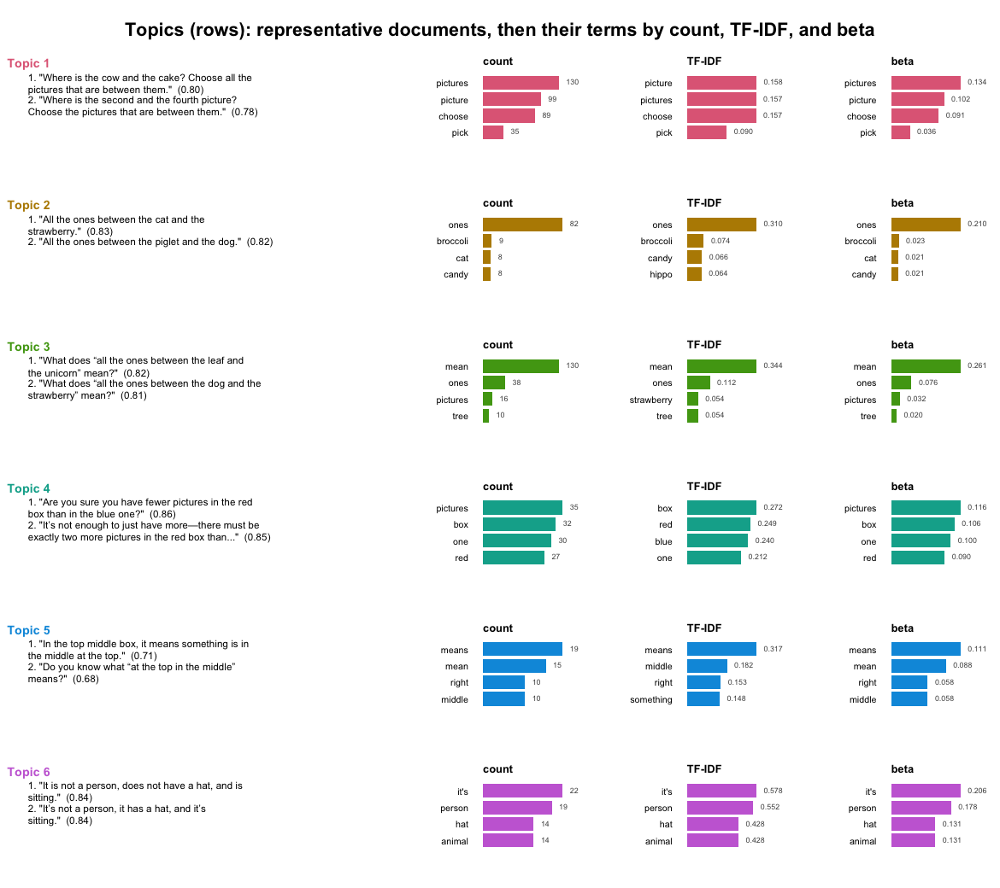

<!-- README.md is generated from README.Rmd. Please edit that file and rebuild
     from the repository root with:
     Rscript -e 'pkgload::load_all(".", quiet = TRUE); knitr::knit("README.Rmd", "README.md")' -->


# sbert 

<!-- badges: start -->
[](https://CRAN.R-project.org/package=sbert)
<!-- badges: end -->

## Vignettes and guides

**Vignettes**

- [Semantic topic modeling with Sentence-BERT](https://sonsoles.me/sbert/articles/sbert.html)
- [Sentence embeddings without Python](https://sonsoles.me/sbert/articles/embeddings.html)

**Guides**

- [Choosing the number of topics and the granularity](https://sonsoles.me/sbert/articles/choosing-topics.html)
- [Segmenting long documents](https://sonsoles.me/sbert/articles/segmenting.html)
- [Preparing and cleaning a corpus](https://sonsoles.me/sbert/articles/preparing-corpus.html)
- [Describing and naming topics](https://sonsoles.me/sbert/articles/describing-topics.html)
- [Assigning new documents and topic mixtures](https://sonsoles.me/sbert/articles/assigning-topics.html)
- [Models, the cache, and custom models](https://sonsoles.me/sbert/articles/models-and-cache.html)
- [Parallel and high-throughput topic modeling](https://sonsoles.me/sbert/articles/parallel.html)
- [Verification: Python parity and determinism](https://sonsoles.me/sbert/articles/verification.html)

**Case studies**

- [COVID-19 research abstracts](https://sonsoles.me/sbert/articles/case-covid.html)
- [Multilingual feedback messages](https://sonsoles.me/sbert/articles/case-multilingual-feedback.html)

## Overview

`sbert` fits topic models of texts from their sentence embeddings. A
sentence embedding places a text in a space where texts with similar meaning
lie close together, whatever words they use (Reimers & Gurevych, 2019), so
topics found in that space group texts by what they mean rather than by the
words they share. Each topic is described by its most typical texts and by
its distinctive terms, scored with class-based TF-IDF (Grootendorst, 2022).
Topics can be fitted to whole documents or to their sentences, clauses or
phrases, compared across numbers of topics by coherence and diversity, and
used to assign new texts and give each document a mixture of topics.

The embeddings come from pretrained models, each fixed to one version (see
`models()`). A model is downloaded only when it is first needed, and the
bundled `feedback_embeddings` let every topic-model function run without any
download.

## The method

Each text $d$ is encoded as an embedding and scaled to unit length, so
that the dot product of two embeddings is their cosine similarity. The
normalized embeddings are partitioned into $K$ topics by k-means (Lloyd,
1982), started from deterministic farthest-point centers, so the same input
always gives the same topics. A topic is described in two ways. Its
representative texts are those nearest its center, and the most central
one labels the topic. Its terms are scored by class-based TF-IDF
(Grootendorst, 2022), which treats all texts of a topic as one document:

$$
w_{x,c} = \mathrm{tf}_{x,c} \cdot \log\left(1 + \frac{A}{f_x}\right),
$$

where $\mathrm{tf}_{x,c}$ is the frequency of term $x$ in topic $c$,
normalized by the topic's length, $f_x$ is the frequency of $x$ across all
topics, and $A$ is the average number of words per topic. A term scores
high when it is frequent in one topic and rare in the others. Terms depend
only on the assignments and the text, so they can be re-weighted without
refitting.

## Installation


``` r
install.packages("sbert")

# development version
install.packages("remotes")
remotes::install_github("sonsoleslp/sbert")
```

Nothing is downloaded when the package is installed or loaded. Encoding
needs the ONNX Runtime and a model, each downloaded once and on request:


``` r
library(sbert)
install_runtime()
model_download()
```

Texts are tokenized with each model's own Hugging Face tokenizer through
[`tok`](https://cran.r-project.org/package=tok) and encoded by an ONNX graph
through [`onnxr`](https://cran.r-project.org/package=onnxr); pooling and
normalization are done in R, with no Python. Each of the 14
models is pinned to a fixed revision and its files are verified by SHA-256.

## Example

The package bundles `feedback_translations`, AI-generated feedback messages
from a mathematics learning application, and `feedback_embeddings`, the
embeddings of its first 600 distinct English messages, so the example below
runs without a model. `dedupe()` keeps one copy of each repeated message
and counts its occurrences in `n`; `compare_topics()` fits one model per
candidate number of topics.


``` r
library(sbert)

corpus <- head(dedupe(feedback_translations, column = "translation"), 600)
sweep <- compare_topics(corpus, column = "translation",
                        n_topics = c(4, 6, 8),
                        embeddings = feedback_embeddings)
summary(sweep)
#> Topic-count comparison: highest mean npmi coherence per level
#> 
#>   segment n_candidates min_topics max_topics best_n_topics coherence topic_diversity
#>  document            3          4          8             6    -0.104           0.917
#>  explained all_converged
#>      0.226          TRUE
```

Six topics have the highest coherence. `fitted()` takes that model without
refitting, and `topic_sizes()` counts each topic's distinct messages and,
with `weights = "n"`, every time a message was shown:


``` r
topic_model <- fitted(sweep, n_topics = 6)
topic_sizes(topic_model, weights = "n")
#>   topic                                                       label n_documents
#> 1     1   Where is the cow and the cake? Choose all the pictures...         223
#> 2     2            All the ones between the cat and the strawberry.         133
#> 3     3         What does “all the ones between the leaf and the...         131
#> 4     4 Are you sure you have fewer pictures in the red box than...          49
#> 5     5      In the top middle box, it means something is in the...          37
#> 6     6    It is not a person, does not have a hat, and is sitting.          27
#>   proportion n_weighted weighted_share
#> 1     0.3717        267         0.3608
#> 2     0.2217        162         0.2189
#> 3     0.2183        138         0.1865
#> 4     0.0817         76         0.1027
#> 5     0.0617         57         0.0770
#> 6     0.0450         40         0.0541
```

With a downloaded model the same model is fitted from the text alone,
`topics(corpus, n_topics = 6, column = "translation")`. The fit report shows
each topic's most typical messages and its distinctive terms:


``` r
plot(topic_model, type = "fit", n_terms = 4, n_representatives = 2)
```

<div class="figure" style="text-align: center">

<p class="caption">plot of chunk topics-fit</p>
</div>

## Authors and citation

`sbert` is written by [Mohammed Saqr](https://saqr.me) and
[Sonsoles López-Pernas](https://sonsoles.me). Sonsoles López-Pernas
maintains the package. Questions and bug reports can be submitted through
the [repository issue tracker](https://github.com/sonsoleslp/sbert/issues).
The package citation is available through `citation("sbert")`.

Grootendorst, M. (2022). BERTopic: Neural topic modeling with a
class-based TF-IDF procedure. arXiv:2203.05794.

Lloyd, S. P. (1982). Least squares quantization in PCM. *IEEE Transactions
on Information Theory*, *28*(2), 129--137.
<https://doi.org/10.1109/TIT.1982.1056489>

Reimers, N., & Gurevych, I. (2019). Sentence-BERT: Sentence embeddings
using Siamese BERT-networks. *Proceedings of EMNLP-IJCNLP 2019*,
3982--3992. <https://doi.org/10.18653/v1/D19-1410>


