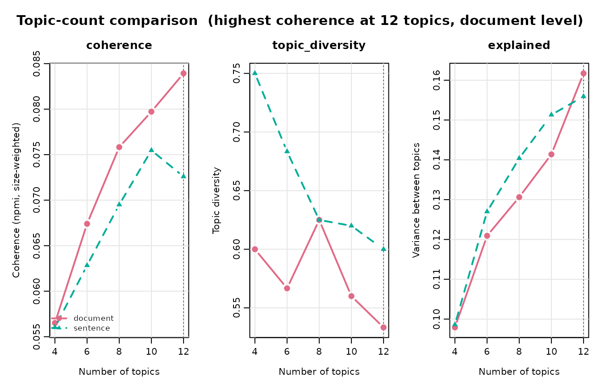
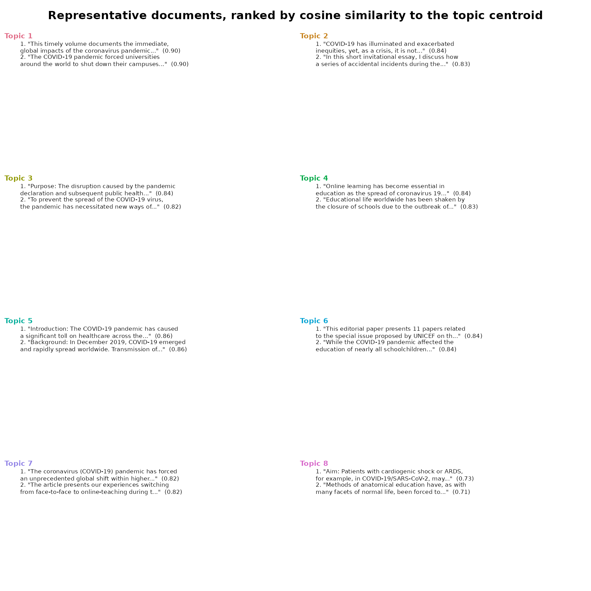

# Case study: COVID-19 research abstracts

A literature that grew as fast as research on COVID-19 and education is
difficult to survey by reading. Thousands of abstracts appeared within a
few years, written in different disciplines and for different audiences,
and a map of their themes has to be built from the texts themselves. A
semantic topic model builds that map from meaning rather than from
shared words: each abstract becomes a sentence embedding, a vector in
which texts with similar meaning lie close together, and a topic is a
group of nearby embeddings. The topics are then read through their most
typical texts, and words serve only as labels.

Abstracts pose a problem of granularity. An abstract is several
sentences that do different jobs (context, aim, sample, method, finding,
implication), and an encoder reads a limited number of tokens: the
default model, `all-MiniLM-L6-v2`, reads at most 256 and ignores the
rest. A whole abstract is therefore one vector for a mixture of
statements, part of which the model never sees, while a sentence is
short enough to be read in full but carries only one of those
statements. This case study fits topics at both levels and asks what
each level finds: what the abstracts are about, what their sentences do,
how the two groupings relate, and which to use for which question.

Unlike the vignettes, this article downloads a model and encodes several
thousand abstracts and all of their sentences, which takes a few
minutes. The numbers in the text are computed when the article is built,
so they always describe the output shown.

``` r

library(sbert)
#> sbert 0.5.14: Sentence-BERT embeddings and topic models in R.
#>   14 pinned models (see models()); default: all-MiniLM-L6-v2.
#>   A model is downloaded only on request, once, and verified by SHA-256.
```

## Data

`covid` holds 4170 records of peer-reviewed research on COVID-19 and its
effects on education, children, schools, and society, published from
2020 to 2024. Each row is one record.

- **Publication year:** `Year`, an integer; available for every record.
- **Text:** `Abstract`, the abstract, the unit of analysis. Records
  without an abstract carry the placeholder `"[No abstract available]"`.

323 records have only the placeholder. They are dropped, and the
remaining abstracts are counted by year.

``` r

abstracts <- subset(covid, Abstract != "[No abstract available]")
nrow(abstracts)
#> [1] 3847
xtabs(~ Year, data = abstracts)
#> Year
#> 2020 2021 2022 2023 2024 
#>  645 2551  541  105    5
with(abstracts, sum(grepl("©", Abstract)))
#> [1] 3832
```

3847 abstracts remain, most of them from 2021, and 3832 of them contain
a “©” sign.

Almost every abstract ends with a copyright notice, such as “© 2021
Informa UK Limited, trading as Taylor & Francis Group.” Left in, the
notices would form topics of their own, grouped by publisher rather than
by research. The `remove` argument of
[`clean_corpus()`](https://sonsoles.me/sbert/reference/clean_corpus.md)
deletes text that matches a regular expression. The pattern below
deletes a notice at the end of an abstract that starts with “©”,
“Copyright ©”, or “Copyright” and a year; abstracts that mention
copyright as a subject keep their text.
[`clean_corpus()`](https://sonsoles.me/sbert/reference/clean_corpus.md)
also repairs broken characters, removes HTML tags, URLs, DOIs, and
bracketed citations, and with `min_content = 0.5` drops rows that are
mostly numbers or symbols rather than words. Given a data frame and a
`column`, it cleans that column and keeps the other columns.

``` r

abstracts <- clean_corpus(
  abstracts,
  column = "Abstract",
  remove = "(copyright:?\\s*(©|\\d{4})|©).{0,1000}$",
  min_content = 0.5
)
nrow(abstracts)
#> [1] 3847
with(abstracts, sum(grepl("©", Abstract)))
#> [1] 0
```

All 3847 abstracts pass the content filter, and after cleaning 0 contain
a “©” sign. [`dedupe()`](https://sonsoles.me/sbert/reference/dedupe.md)
counts the distinct texts:

``` r

nrow(dedupe(abstracts, column = "Abstract"))
#> [1] 3667
```

3667 of the 3847 abstracts are distinct; the others repeat an abstract
that appears in another record. Every record is kept, so a repeated
abstract counts once per record in the topic sizes below.

The last property that matters for the model is length. The number of
words per abstract and the number of sentences that
[`segment()`](https://sonsoles.me/sbert/reference/segment.md) finds:

``` r

with(abstracts, summary(lengths(strsplit(Abstract, "\\s+"))))
#>    Min. 1st Qu.  Median    Mean 3rd Qu.    Max. 
#>      15     141     184     188     228     749
sentences <- with(abstracts, segment(Abstract, level = "sentence"))
nrow(sentences)
#> [1] 29869
```

The median abstract has 184 words, and 38% of the abstracts have more
than 200. A tokenizer emits more tokens than words, so these abstracts
are likely to exceed the 256 tokens that the model reads, and their
endings, where findings and conclusions usually stand, do not enter the
whole-abstract embedding. The 29869 sentences, about 7.8 per abstract,
are each read in full.

## Fitting abstracts and sentences

Install the ONNX Runtime and download the default model,
`all-MiniLM-L6-v2`. Both steps happen once per computer.

``` r

install_runtime()
#> Downloading ONNX Runtime 1.25.1...
#> Extracting...
#> onnxruntime 1.25.1 installed successfully.
#> location: /home/runner/.local/share/R/onnxr
model_download()
#> Downloading sentence-transformers/all-MiniLM-L6-v2 at revision 1110a243fdf4706b3f48f1d95db1a4f5529b4d41 (Apache-2.0; 90.9 MB total) to '/home/runner/.cache/R/sbert/all-MiniLM-L6-v2/1110a243fdf4706b3f48f1d95db1a4f5529b4d41'.
```

Words such as *covid*, *pandemic*, and *study* appear in nearly every
abstract, so they are added to the standard English stop words, and
`numbers = "remove"` leaves out bare numbers such as years. Stop words
affect only the word labels and the word-based measures; the topics
themselves are computed from the embeddings of the full text.

``` r

covid_stop_words <- stop_words(add = c(
  "covid", "coronavirus", "sars", "cov", "pandemic", "disease",
  "study", "studies", "result", "results", "conclusion", "conclusions",
  "background", "method", "methods", "objective", "aim"
))
```

[`compare_topics()`](https://sonsoles.me/sbert/reference/compare_topics.md)
fits one model for each candidate number of topics, here on whole
abstracts (`"document"`) and on sentences (`"sentence"`) in one call.
`max_tokens = 200` caps a sentence at 200 of the model’s tokens and
splits a longer one at its punctuation, so that no sentence is cut off.
`coherence_weight = "size"` averages the coherence of a candidate’s
topics in proportion to their sizes. A topic of a handful of unusual
abstracts whose rare words always occur together scores a very high
coherence and, in an unweighted mean, can make a candidate look better
than its other topics justify; in the run published with sbert 0.5.12, a
three-abstract topic at eight topics had a coherence of 0.90 and lifted
the unweighted mean of that candidate to 0.18. k-means on tens of
thousands of sentences can need more than the default 100 iterations to
settle; `iter_max = 300` gives it room, and the `converged` column of
the table reports whether every candidate converged.

``` r

sweep <- compare_topics(
  abstracts,
  column = "Abstract",
  n_topics = c(4, 6, 8, 10, 12),
  segment = c("document", "sentence"),
  max_tokens = 200,
  coherence_weight = "size",
  iter_max = 300,
  stop_words = covid_stop_words,
  numbers = "remove"
)
sweep
#> <sbert_topic_sweep> 10 candidates, coherence measure: npmi, weighted by topic size
#>   segment n_topics coherence topic_diversity explained converged
#>  document        4    0.0565           0.600    0.0979      TRUE
#>  document        6    0.0674           0.567    0.1209      TRUE
#>  document        8    0.0758           0.625    0.1306      TRUE
#>  document       10    0.0797           0.560    0.1414      TRUE
#>  document       12    0.0839           0.533    0.1617      TRUE
#>  sentence        4    0.0560           0.750    0.0986      TRUE
#>  sentence        6    0.0628           0.683    0.1270      TRUE
#>  sentence        8    0.0695           0.625    0.1404      TRUE
#>  sentence       10    0.0755           0.620    0.1513      TRUE
#>  sentence       12    0.0726           0.600    0.1559      TRUE
#> 
#> Fitted models retained: fitted(x, n_topics = 12, segment = "document")
summary(sweep)
#> Topic-count comparison: highest mean npmi coherence (weighted by topic size) per level
#> 
#>   segment n_candidates min_topics max_topics best_n_topics coherence topic_diversity
#>  document            5          4         12            12    0.0839           0.533
#>  sentence            5          4         12            10    0.0755           0.620
#>  explained all_converged
#>      0.162          TRUE
#>      0.151          TRUE
```

The table has one row per level and candidate: `coherence` (how often
the top words of a topic occur together), `topic_diversity` (the share
of distinct words among all topics’ top words), `explained` (the share
of the variance in the embeddings that lies between topics), and
`converged`. [`summary()`](https://rdrr.io/r/base/summary.html) gives
the most coherent candidate at each level. The plot shows the three
measures against the number of topics:

``` r

plot(sweep)
```



`explained` tends to rise as topics are added, so it cannot choose a
count by itself; coherence and diversity can. To compare the two levels
at the same resolution, both are read at eight topics below. The guide
[Choosing the number of topics and the
granularity](https://sonsoles.me/sbert/articles/choosing-topics.md)
discusses the choice in detail.

``` r

topic_model <- fitted(sweep, n_topics = 8, segment = "document")
sentence_model <- fitted(sweep, n_topics = 8, segment = "sentence")
```

## What are the abstracts about?

[`representatives()`](https://sonsoles.me/sbert/reference/representatives.md)
returns, for each topic, the abstracts closest to that topic and clearly
farther from every other topic. One per topic, in full:

``` r

knitr::kable(representatives(topic_model, n = 1), digits = 2)
```

| topic | rank | document_id | text | distance | margin |
|---:|---:|---:|:---|---:|---:|
| 1 | 1 | 3417 | In the face of the sudden outbreak of COVID-19 virus, the Ministry of Education requires schools to postpone the opening, but calls for ‘ensuring learning undisrupted when classes are disrupted’ at the same time. Online teaching has been widely used during the epidemic, but there are still many shortcomings, which limit the effectiveness of online teaching. Based on the current development of online teaching, this paper analyzes the main existing problems and puts forward some improvement measures in order to give full play to the advantages of online teaching and promote the teaching reform of combining online and offline in colleges and universities. | 0.17 | 0.12 |
| 2 | 1 | 1873 | Purpose: This article aims to provide a timely examination of and reflection on the impact of COVID-19 on the neo-liberal paradigm that has been prevalent in international higher education (HE) for two decades since the late 1990s. Design/methodology/approach: Methodologically, this paper deploys conceptual mapping as an analytical tool to explore and examine the global news updates that provide timely (i.e. early 2020) record of the fast-moving pandemic. Findings: It unfolds four pairs of contradictions occurring in the Western universities during the pandemic outbreak, i.e. HE as cross-border services vs border control, the state’s shrinking public funding vs universities under financial threat, increased reliance on foreign students’ tuition fee vs decreased international enrolment and the user-pays philosophy vs the rising force of user says. Research limitations/implications: It is argued that the pending crises facing Western universities are not merely financial issues; they reveal the shortcomings that are inherent in business model of HE driven by economic globalisation but triggered by coronavirus pandemic to erupt. The pandemic should be temporary, but its spill-over effects may alter the overarching landscape of the international HE relations, which is part and parcel of the changing geopolitical order featured as de-globalisation. Practical implications: The paper has practical implications for acting on international HE in the time of coronavirus pandemic. They mainly consider four aspects: travel distance as new determinant of study abroad, the renewed significance of a state’s role in policymaking and financial undertaking, shortcomings in market mechanism and East Asia as an emerging regional hub of study abroad. Social implications: This paper is expected to leverage three lessons learned from the upending situation. First, it is conceptually misleading to define international HE as a form of market-led “transnational service” and cross-border tradeable product undermining a state’s control. Second, a state’s supervising model needs to be reviewed, to embrace the renewed relationship between a state and universities in the new context of global pandemic. Third, the global landscape of international HE may be altered. Originality/value: This conceptual paper provides a timely critique of the neo-liberal paradigm in HE and shedding light on the changing global landscape of international HE along with the changing geopolitical relations reshuffled by COVID-19 and its spill-over effects. | 0.24 | 0.21 |
| 3 | 1 | 3492 | The aims of this paper are to explore novice teachers’ experiences in the Covid-19 crisis, and to examine their professional identity construction process. During the global crisis, novice teachers had to deal with unexpected challenges and take advantage of new opportunities. This study is based on 32 narratives of novice teachers in Israel who took part in a one semester online Zoom induction in two workshops. The open conversations narratives in the meetings were recorded and transcribed, and then subjected to categorical content analysis. The findings show the challenges and opportunities related to three central categories: technological, pedagogical and educational system in the novice teachers’ experiences. The main contributions of this study are: understanding the novice teachers’ experiences in the uncertainty and turmoil of the crisis, and learning about professional dilemmas and tensions which gave rise to various challenges and opportunities that that supported the construction their professional identity. | 0.30 | 0.14 |
| 4 | 1 | 2654 | This study investigates the impact of implementing integral calculus lectures which were originally very suitable in face-to-face delivery, but during the Covid-19 pandemic situation, these were delivered online through e-learning. This research analyzes the correlation between self-efficacy, creativity perception, and productive disposition towards academic performance using path analysis and was modeled in the form of regression equation. This study involved 108 students (35 males and 72 females) at a university in Bandung, West Java, Indonesia. The research instrument used was questionnaire of self-efficacy (11 items), creativity perception (15 items) and mathematical disposition (14 items). All research variable items had a Pearson correlation greater than 0.25, so all items were said to be valid. The reliability coefficient of Cronbach’s Alpha for self-efficacy, perceived creativity, and productive disposition were included in the high category. The results showed a correlation between self-efficacy and creativity perception with regard to productive disposition. There was also a direct correlation between self-efficacy and academic performance. Creativity perception did not show a direct influence on academic performance nor. Productive disposition had a direct influence on academic performance. There was a correlation between self-efficacy, creativity perception, and productive disposition of academic performance. Self-efficacy (happy to help other friends, dare to face criticism and challenges, and dare to compete to win a competition) had the largest contribution to academic performance while creativity perception (creative ideas must be sophisticated and complex, creative people have high curiosity, creative people find it difficult to accept different opinions from others, creativity can only be developed in certain people, and creativity comes over by chance) has the smallest one. These findings can be used as first step in understanding creative perception as a weak contribution to cognitive abilities about academic performance, even though creativity has an important role in developing mathematics performance. | 0.38 | 0.19 |
| 5 | 1 | 1889 | Objective: Describe the early impact of the COVID-19 pandemic on general surgery residency training nationwide. Design: A 31-question electronic survey was distributed to general surgery program directors. Qualitative data underwent iterative coding analysis. Quantitative data were evaluated with summary statistics and bivariate analyses. Participants: Eighty-four residency programs (33.6% response rate) with representation across US geographic regions, program affiliations, and sizes. Results: Widespread changes were observed in the surgical training environment. One hundred percent of programs reduced the number of residents on rounds and 95.2% reduced the size of their in-hospital resident workforce; on average, daytime staffing decreased by nearly half. With telehealth clinics (90.5%) and remote inpatient consults (26.2%), both clinical care and resident didactics (86.9%) were increasingly virtual, with similar impact across all program demographics. Conversely, availability of some wellness initiatives was significantly higher among university programs than independent programs, including childcare (51.2% vs 6.7%), housing (41.9% vs 13.3%), and virtual mental health services (83.7% vs 53.3%). Conclusions: Changes in clinical care delivery dramatically reduced in face-to-face learning opportunities for surgical trainees during the COVID-19 pandemic. While this effect had equal impact across all program types, sizes, and geographies, the same cannot be said for wellness initiatives. Though all programs initiated some strategies to protect resident health, the disparity between university programs and independent programs may be cause for action. | 0.31 | 0.24 |
| 6 | 1 | 1254 | In the spring of 2020, as a result of the lockdown caused by the COVID-19 pandemic, many children dropped out of daycare and early education in Finland, and parents had to balance work and childcare for months. The wellbeing of families during the lockdown has been studied to some extent, but few studies have focused on children under school age. In May 2020, we sent a survey to the 82 families originally recruited in our study on supporting social-emotional development in early childhood education units, which had been interrupted by the pandemic. Twenty families responded to questionnaires about the impacts of the lockdown on the wellbeing of the children and their parents. Parents reported a decline in children’s prosocial behavior compared to the time before the pandemic and assessed that the children who stayed at home were lonelier than children who remained in daycare. Otherwise, being at home or in care was not associated with children’s physical or mental wellbeing. Parents had experienced increased mental strain and increased problems in marital relationships and the disruption of children’s participation in daycare was associated with deterioration in the parent - child relationship. Due to the small sample size, these results should be interpreted with caution. | 0.32 | 0.22 |
| 7 | 1 | 1534 | This work presents embedding a design thinking teaching module within an existing engineering undergraduate lab course. The lab, which is freshmen level, gradually builds up critical skills beyond the common mathematical and analytical skills. Such skills are becoming mandatory by the fourth industrial revolution and jobs of future skillset. It gradually and solidly introduces design thinking concepts through a number of experiments where students are fully exposed to the stages of design thinking: empathize, define, ideate, prototype and test. Such skills are needed to address problems, common in modern technological advances, which are not well defined and require out of the box innovation. The lab, which was primarily offered on-line due the COVID-19 pandemic, was taken by more than 100 freshmen level students, required a final design project. The student learning outcomes were acquired and analyzed. | 0.41 | 0.18 |
| 8 | 1 | 997 | Aim: Patients with cardiogenic shock or ARDS, for example, in COVID-19/SARS-CoV-2, may require extracorporeal membrane oxygenation (ECMO). An ECLS/ECMO model simulating challenging vascular anatomy is desirable for cannula insertion training purposes. We assessed the ability of various 3D-printable materials to mimic the penetration properties of human tissue by using porcine aortae. Methods: A test bench for needle penetration and piercing in sampled porcine aorta and preselected 3D-printable polymers was assembled. The 3D-printable materials had Shore A hardness of 10, 20, and 50. 17G Vygon 1.0 × 1.4 mm × 70 mm needles were used for penetration tests. Results: For the porcine tissue and Shore A 10, Shore A 20, and Shore A 50 polymers, penetration forces of 0.9036 N, 0.9725 N, 1.0386 N, and 1.254 N were needed, respectively. For piercing through the porcine tissue and Shore A 10, Shore A 20, and Shore A 50 polymers, forces of 0.8399 N, 1.244 N, 1.475 N, and 1.482 N were needed, respectively. ANOVA showed different variances among the groups, and pairwise two-tailed t-tests showed significantly different needle penetration and piercing forces, except for penetration of Shore A 10 and 20 polymers (p = 0.234 and p = 0.0857). Significantly higher forces were required for all other materials. Conclusion: Shore A 10 and 20 polymers have similar needle penetration properties compared to the porcine tissue. Significantly more force is needed to pierce through the material fully. The most similar tested material to porcine aorta for needle penetration and piercing in ECMO-implantation is the silicon Shore A 10 polymer. This silicon could be a 3D-printable material in surgical training for ECMO-implantation. | 0.27 | 0.55 |

The plot shows the opening of two abstracts per topic:

``` r

plot(topic_model, type = "representatives", n_representatives = 2)
```



A topic is named from what its representatives share: the population
studied (students, teachers, children, residents), the setting (schools,
universities, laboratories, hospitals), or the kind of paper (survey,
reflection, editorial). Two abstracts that use the same words can fall
in different topics when they report different things, and the
representatives, not the word lists below, show which.
[`topic_sizes()`](https://sonsoles.me/sbert/reference/topic_sizes.md)
counts the abstracts in each topic:

``` r

topic_sizes(topic_model)
#>   topic                                                       label n_documents
#> 1     1       This timely volume documents the immediate, global...         808
#> 2     2     COVID-19 has illuminated and exacerbated inequities,...         702
#> 3     3           Purpose: The disruption caused by the pandemic...         579
#> 4     4 Online learning has become essential in education as the...         501
#> 5     5         Introduction: The COVID-19 pandemic has caused a...         465
#> 6     6   This editorial paper presents 11 papers related to the...         443
#> 7     7        The coronavirus (COVID-19) pandemic has forced an...         346
#> 8     8        Aim: Patients with cardiogenic shock or ARDS, for...           3
#>   proportion
#> 1    0.21003
#> 2    0.18248
#> 3    0.15051
#> 4    0.13023
#> 5    0.12087
#> 6    0.11515
#> 7    0.08994
#> 8    0.00078
```

The 3847 abstracts are divided into eight topics; the largest holds 808
and the smallest 3. A very small topic is worth reading in full: it can
isolate papers that do not belong to the corpus’s subject, which is
useful in itself. [`summary()`](https://rdrr.io/r/base/summary.html)
lists each topic under its label with its size and the coherence of its
top words, and [`terms()`](https://rdrr.io/r/stats/terms.html) lists
those words:

``` r

summary(topic_model)
#> Semantic topic model summary
#>   documents:            3847
#>   topics:               8
#>   model:                sentence-transformers/all-MiniLM-L6-v2
#>   between/total SS:     13.1%
#>   mean npmi  coherence:  0.1819
#>   topic diversity:      0.625 (top 10 terms)
#> 
#>  topic                                                       label n_documents proportion
#>      1       This timely volume documents the immediate, global...         808  0.2100338
#>      2     COVID-19 has illuminated and exacerbated inequities,...         702  0.1824799
#>      3           Purpose: The disruption caused by the pandemic...         579  0.1505069
#>      4 Online learning has become essential in education as the...         501  0.1302313
#>      5         Introduction: The COVID-19 pandemic has caused a...         465  0.1208734
#>      6   This editorial paper presents 11 papers related to the...         443  0.1151547
#>      7        The coronavirus (COVID-19) pandemic has forced an...         346  0.0899402
#>      8        Aim: Patients with cardiogenic shock or ARDS, for...           3  0.0007798
#>  coherence
#>    0.07843
#>    0.03236
#>    0.06198
#>    0.06907
#>    0.09903
#>    0.14200
#>    0.06779
#>    0.90427
terms(topic_model, n = 5)
#>    topic                                                       label        term rank
#> 1      1       This timely volume documents the immediate, global...      online    1
#> 2      1       This timely volume documents the immediate, global...    learning    2
#> 3      1       This timely volume documents the immediate, global...    students    3
#> 4      1       This timely volume documents the immediate, global...   education    4
#> 5      1       This timely volume documents the immediate, global...    teaching    5
#> 6      2     COVID-19 has illuminated and exacerbated inequities,...   education    1
#> 7      2     COVID-19 has illuminated and exacerbated inequities,...      social    2
#> 8      2     COVID-19 has illuminated and exacerbated inequities,...      crisis    3
#> 9      2     COVID-19 has illuminated and exacerbated inequities,...      higher    4
#> 10     2     COVID-19 has illuminated and exacerbated inequities,...     article    5
#> 11     3           Purpose: The disruption caused by the pandemic...    teachers    1
#> 12     3           Purpose: The disruption caused by the pandemic...    teaching    2
#> 13     3           Purpose: The disruption caused by the pandemic...    learning    3
#> 14     3           Purpose: The disruption caused by the pandemic...      online    4
#> 15     3           Purpose: The disruption caused by the pandemic...   education    5
#> 16     4 Online learning has become essential in education as the...    students    1
#> 17     4 Online learning has become essential in education as the...    learning    2
#> 18     4 Online learning has become essential in education as the...      online    3
#> 19     4 Online learning has become essential in education as the...   education    4
#> 20     4 Online learning has become essential in education as the...    distance    5
#> 21     5         Introduction: The COVID-19 pandemic has caused a...     medical    1
#> 22     5         Introduction: The COVID-19 pandemic has caused a...    students    2
#> 23     5         Introduction: The COVID-19 pandemic has caused a...    clinical    3
#> 24     5         Introduction: The COVID-19 pandemic has caused a...      health    4
#> 25     5         Introduction: The COVID-19 pandemic has caused a...   education    5
#> 26     6   This editorial paper presents 11 papers related to the...      school    1
#> 27     6   This editorial paper presents 11 papers related to the...    children    2
#> 28     6   This editorial paper presents 11 papers related to the...   education    3
#> 29     6   This editorial paper presents 11 papers related to the...     parents    4
#> 30     6   This editorial paper presents 11 papers related to the...     schools    5
#> 31     7        The coronavirus (COVID-19) pandemic has forced an...    students    1
#> 32     7        The coronavirus (COVID-19) pandemic has forced an...    learning    2
#> 33     7        The coronavirus (COVID-19) pandemic has forced an...    teaching    3
#> 34     7        The coronavirus (COVID-19) pandemic has forced an...      online    4
#> 35     7        The coronavirus (COVID-19) pandemic has forced an...      course    5
#> 36     8        Aim: Patients with cardiogenic shock or ARDS, for...       shore    1
#> 37     8        Aim: Patients with cardiogenic shock or ARDS, for... penetration    2
#> 38     8        Aim: Patients with cardiogenic shock or ARDS, for...     porcine    3
#> 39     8        Aim: Patients with cardiogenic shock or ARDS, for...    polymers    4
#> 40     8        Aim: Patients with cardiogenic shock or ARDS, for...        ecmo    5
#>     score frequency    beta
#> 1  0.0684      2707 0.02993
#> 2  0.0612      2667 0.02948
#> 3  0.0469      2057 0.02274
#> 4  0.0454      1953 0.02159
#> 5  0.0446      1608 0.01778
#> 6  0.0416      1314 0.01975
#> 7  0.0291       564 0.00848
#> 8  0.0217       352 0.00529
#> 9  0.0216       409 0.00615
#> 10 0.0200       325 0.00489
#> 11 0.0543      1107 0.01822
#> 12 0.0495      1198 0.01972
#> 13 0.0370      1082 0.01781
#> 14 0.0319       849 0.01397
#> 15 0.0305       881 0.01450
#> 16 0.0536      1618 0.02599
#> 17 0.0496      1487 0.02388
#> 18 0.0421      1146 0.01841
#> 19 0.0369      1092 0.01754
#> 20 0.0262       448 0.00720
#> 21 0.0576       871 0.01480
#> 22 0.0458      1306 0.02219
#> 23 0.0388       499 0.00848
#> 24 0.0355       569 0.00967
#> 25 0.0274       767 0.01303
#> 26 0.0537       649 0.01486
#> 27 0.0441       422 0.00966
#> 28 0.0437       907 0.02077
#> 29 0.0361       339 0.00776
#> 30 0.0318       353 0.00808
#> 31 0.0483       813 0.02341
#> 32 0.0431       721 0.02076
#> 33 0.0372       515 0.01483
#> 34 0.0294       447 0.01287
#> 35 0.0265       221 0.00636
#> 36 0.3649        10 0.04310
#> 37 0.2988         8 0.03448
#> 38 0.2346         6 0.02586
#> 39 0.1994         5 0.02155
#> 40 0.1634         4 0.01724
```

Words such as *online*, *learning*, and *students* run through the whole
corpus, so several topics share them, and a topic’s top words describe
it less precisely than its representatives. The embeddings separate
abstracts by what they report rather than by the words they use, and the
word lists serve as labels after the topics have been read.

## What do the sentences do?

The sentence model was fitted in the same call. It models 29871
sentences. Its representatives are short enough to read in full:

``` r

knitr::kable(representatives(sentence_model, n = 3), digits = 2)
```

| topic | rank | document_id | segment | text | distance | margin |
|---:|---:|---:|---:|:---|---:|---:|
| 1 | 1 | 2580 | 3 | Background The COVID-19 pandemic has significantly affected educational activities and disrupted the traditional norms of education at colleges and universities in the world, and, as a result, teaching and learning have shifted to online. | 0.09 | 0.21 |
| 1 | 2 | 876 | 1 | Background: The Coronavirus Disease 2019 (COVID-19) pandemic has necessitated a sudden transition to remote learning in medical schools. | 0.20 | 0.21 |
| 1 | 3 | 2804 | 2 | This paper aims to present and describe a higher education experience with Flipped Learning before and during the transformation of education due to the COVID-19 pandemic. | 0.26 | 0.21 |
| 2 | 1 | 3417 | 3 | Based on the current development of online teaching, this paper analyzes the main existing problems and puts forward some improvement measures in order to give full play to the advantages of online teaching and promote the teaching reform of combining online and offline in colleges and universities. | 0.27 | 0.24 |
| 2 | 2 | 1612 | 2 | Based on data gathered through a survey (N = 784), this paper analyses students’ perceptions regarding the effectiveness of online education in a period when this type of education is the only available option. | 0.21 | 0.24 |
| 2 | 3 | 3426 | 3 | The factors influencing online education adoption are explained in this research with a Structural Equation Model (SEM). | 0.37 | 0.23 |
| 3 | 1 | 1053 | 6 | The study explores the complements of physical experiments brought in with animations, simulations, and remote laboratory set-ups for providing skill trainings to learners. | 0.37 | 0.18 |
| 3 | 2 | 1352 | 3 | This design-based syllabus is more acquainted with face to face or physical teaching learning environment. | 0.37 | 0.17 |
| 3 | 3 | 1649 | 1 | In this paper, a hybrid model for teaching Engineering Mechanics courses is presented. | 0.51 | 0.17 |
| 4 | 1 | 2145 | 6 | The findings revealed a tension between expectations of producers of policy and enactors of policy within unequal school settings. | 0.41 | 0.23 |
| 4 | 2 | 2256 | 2 | Despite education being the only viable means towards a better future, the closing of schools set-off to heighten prevailing educational disparities towards academic access, experience and achievement for the vulnerable children of the country. | 0.29 | 0.23 |
| 4 | 3 | 2617 | 2 | Within this matrix of interdependent relations, schools operate under increasingly hybrid accountability arrangements in which public accountability can both complement and compete with market and social regimes and their associated institutional logics, goals, values and mechanisms. | 0.44 | 0.22 |
| 5 | 1 | 2547 | 7 | Further findings indicate that, in unprecedented times, policies developed for use in different contexts can be met with innovative collaborative efforts with a focused goal that transcend seemingly insurmountable challenges. | 0.40 | 0.25 |
| 5 | 2 | 2588 | 3 | The focus of this article is on planning with canonical works to meet the current moment. | 0.48 | 0.25 |
| 5 | 3 | 279 | 5 | However, the processes involved in making this happen are elusive and complex. | 0.51 | 0.24 |
| 6 | 1 | 876 | 6 | Results: Of 268 students enrolled, 104 responded (53.7% of first-year students and 23.9% of second-year students). | 0.25 | 0.30 |
| 6 | 2 | 2378 | 7 | 275 students (80.2% of the expected) enrolled in 17 undergraduate courses (those that are not related to engineering) answered the questionnaire. | 0.35 | 0.28 |
| 6 | 3 | 616 | 5 | Students in medical fields made up 289 (23.6%). | 0.40 | 0.27 |
| 7 | 1 | 3106 | 4 | The research utilized a descriptive methodology, with a data collection technique conducted through online surveys. | 0.26 | 0.28 |
| 7 | 2 | 3655 | 6 | Content analysis technique was used in the analysis of the data obtained. | 0.33 | 0.28 |
| 7 | 3 | 166 | 8 | The conventional content analysis method was used to analyze the data. | 0.34 | 0.26 |
| 8 | 1 | 1587 | 1 | In response to the emerging and ever solution to the COVID-19 outbreak. | 0.20 | 0.24 |
| 8 | 2 | 2143 | 1 | This editorial to the Special Section on COVID-19 emphasises the importance of researching pandemic realities and the value that the findings can bring to the way we shape decisions in the future, for the ‘new normal’. | 0.14 | 0.24 |
| 8 | 3 | 3544 | 1 | Background: The coronavirus disease (COVID-19) global pandemic has resulted in unprecedented public health measures. | 0.20 | 0.24 |

Sentence topics can be of two kinds. Some are subjects, as at the
document level. Others gather sentences that play the same part in an
abstract whatever its subject: the opening that states what the pandemic
did to education, the report of a sample and response rate, the
description of a method, a general or hedging statement. In the run
published with sbert 0.5.12, one sentence topic was represented by
sentences such as “Results: Of 268 students enrolled, 104 responded” and
another by “Content analysis technique was used in the analysis of the
data obtained.”, topics of reporting rather than of research subjects.

A sentence topic that plays a structural part appears in many abstracts.
`topic_sizes(by = "document")` counts the abstracts that have at least
one sentence in each topic:

``` r

topic_sizes(sentence_model, by = "document")
#>   topic                                                       label n_documents
#> 1     1       Background The COVID-19 pandemic has significantly...        3040
#> 2     2 The main objective of this study is therefore to explore...        1837
#> 3     3   The methods used to incorporate this technology can be...        2001
#> 4     4     It examines the measures which were taken to fix the...        2068
#> 5     5  We provide implications for researchers and practitioners.        1698
#> 6     6                    Results: Twenty-seven students enrolled.        1495
#> 7     7                      A survey design was used in the study.        1334
#> 8     8      Background: The COVID-19 pandemic has disrupted the...        1318
#>   proportion
#> 1      0.790
#> 2      0.478
#> 3      0.520
#> 4      0.538
#> 5      0.441
#> 6      0.389
#> 7      0.347
#> 8      0.343
```

`proportion` is here the share of abstracts that touch the topic, so the
shares do not add up to one. The most widespread sentence topic reaches
79% of the abstracts. [`summary()`](https://rdrr.io/r/base/summary.html)
reports the sentence topics’ top words and coherence:

``` r

summary(sentence_model)
#> Semantic topic model summary
#>   documents:            3847
#>   segments:             29871 (sentence level)
#>   topics:               8
#>   model:                sentence-transformers/all-MiniLM-L6-v2
#>   between/total SS:     14.0%
#>   mean npmi  coherence:  0.0788
#>   topic diversity:      0.625 (top 10 terms)
#> 
#>  topic                                                       label n_documents proportion
#>      1       Background The COVID-19 pandemic has significantly...        5766    0.19303
#>      2 The main objective of this study is therefore to explore...        4548    0.15225
#>      3   The methods used to incorporate this technology can be...        4378    0.14656
#>      4     It examines the measures which were taken to fix the...        4153    0.13903
#>      5  We provide implications for researchers and practitioners.        3233    0.10823
#>      6                    Results: Twenty-seven students enrolled.        2991    0.10013
#>      7                      A survey design was used in the study.        2469    0.08266
#>      8      Background: The COVID-19 pandemic has disrupted the...        2333    0.07810
#>  coherence
#>    0.04668
#>    0.07689
#>    0.05934
#>    0.02694
#>    0.04142
#>    0.06124
#>    0.19595
#>    0.12209
```

The words of a structural topic describe its function only indirectly:
no word says that a sentence opens an abstract or reports a sample. The
representatives remain the evidence.

## How do the two granularities differ?

[`topic_gamma()`](https://sonsoles.me/sbert/reference/topic_gamma.md)
gives the mix of sentence topics within each abstract: the share of its
sentences that fall in each topic. With `top = 2` it keeps the two
largest shares of every abstract:

``` r

head(topic_gamma(sentence_model, top = 2), 10)
#>    document_id rank topic gamma n_segments
#> 1            1    1     4 0.556          9
#> 2            1    2     1 0.333          9
#> 3            2    1     1 0.333          6
#> 4            2    2     2 0.333          6
#> 5            3    1     1 0.429          7
#> 6            3    2     5 0.286          7
#> 7            4    1     3 0.667          6
#> 8            4    2     2 0.167          6
#> 9            5    1     2 0.500          8
#> 10           5    2     1 0.250          8
```

An abstract whose largest share is close to one says one kind of thing
throughout; an abstract whose largest share is well below one spreads
its sentences over several topics, which a single whole-abstract topic
cannot show. To relate the two groupings, each abstract’s document topic
is paired with its dominant sentence topic (`top = 1`; an abstract whose
sentences are split evenly is counted under one of the tied topics), and
the pairs are cross-tabulated:

``` r

granularity <- merge(
  as.data.frame(topic_model),
  topic_gamma(sentence_model, top = 1),
  by = "document_id",
  suffixes = c("_abstract", "_sentence")
)
xtabs(~ topic_abstract + topic_sentence, data = granularity)
#>               topic_sentence
#> topic_abstract   1   2   3   4   5   6   7   8
#>              1 240 403  80  35  18  17  13   2
#>              2 246   3  14 149 174   4   4 108
#>              3 127 131 174 103  27   5  10   2
#>              4  85 169  60  29  19  75  63   1
#>              5 151  13  70   6  40  97  36  52
#>              6 164   8  11 198  24   6  11  21
#>              7  64  36 209   5  12  13   4   3
#>              8   1   0   0   0   2   0   0   0
```

Each row is a whole-abstract topic and each column the sentence topic
that holds the largest share of an abstract’s sentences. A row
concentrated in one column means the abstract topic corresponds to one
sentence topic; a row spread across columns means that abstracts of one
subject are dominated by different kinds of sentences, typically the
structural ones, which recur across subjects. The most frequent dominant
sentence topic is the dominant one in 28% of the 3847 abstracts.

## Which granularity to use

The two models answer different questions:

- **Whole abstracts** group papers by what each abstract is about as a
  whole. Use them to map the research themes of a literature. The model
  reads only the first 256 tokens, so the subject is taken mostly from
  the opening of a long abstract.
- **Sentences** group by what a single sentence says or does, and can
  yield structural topics (context, sample, method) next to subject
  topics. Use them to study how abstracts are written, to reach content
  beyond the first 256 tokens, or to describe each abstract as a mixture
  of topics with
  [`topic_gamma()`](https://sonsoles.me/sbert/reference/topic_gamma.md).

Next steps:

- `predict(topic_model, new_abstracts)` assigns new abstracts to these
  topics without refitting; for the sentence model it splits the new
  abstracts into sentences in the same way. See [Assigning new documents
  and topic
  mixtures](https://sonsoles.me/sbert/articles/assigning-topics.md).
- `reduce_topics(topic_model, n_topics = 4)` merges similar topics, and
  [`topic_hierarchy()`](https://sonsoles.me/sbert/reference/topic_hierarchy.md)
  shows which topics are closest to each other.
- [Segmenting long
  documents](https://sonsoles.me/sbert/articles/segmenting.md) covers
  the sentence, clause, and phrase levels and `max_tokens`; [Preparing
  and cleaning a
  corpus](https://sonsoles.me/sbert/articles/preparing-corpus.md) covers
  [`clean_corpus()`](https://sonsoles.me/sbert/reference/clean_corpus.md).
- [Parallel and high-throughput topic
  modeling](https://sonsoles.me/sbert/articles/parallel.md) shows how to
  encode once and reuse the embeddings across many fits and sessions.
