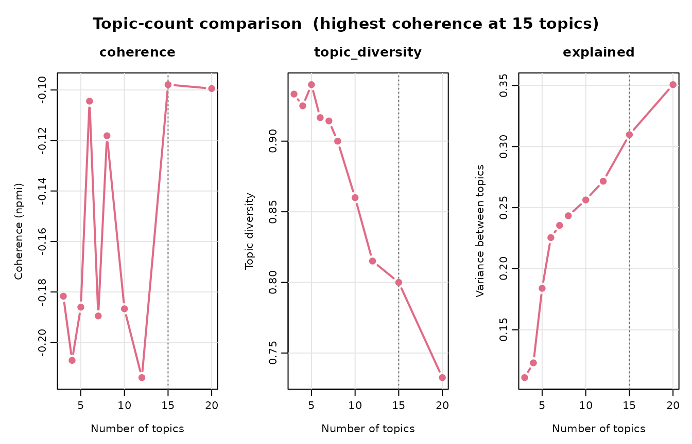

# Choosing the number of topics and the granularity

Two decisions shape a semantic topic model before any topic is read: how
many topics the texts are divided into, and what unit of text is
divided. Neither has a correct value that can be estimated from the
data. k-means (Lloyd, 1982) partitions the embeddings into as many
groups as it is asked for, and every additional group captures more of
their variation, so a fit criterion alone always prefers more topics.
The unit matters as much: a document that does several things at once
can belong to only one topic, while its sentences can belong to
different ones.

This guide treats both decisions as comparisons. Candidate models are
fitted on the same embeddings and compared on measures of their quality,
and the candidates the measures favor are then examined for topics that
duplicate one another. The measures inform the choice; the
representative texts of the candidates decide it.

``` r

library(sbert)
#> sbert 0.5.14: Sentence-BERT embeddings and topic models in R.
#>   14 pinned models (see models()); default: all-MiniLM-L6-v2.
#>   A model is downloaded only on request, once, and verified by SHA-256.
```

## Data

The analysis uses the first 600 distinct feedback messages of
`feedback_translations`, whose sentence embeddings ship with the package
as `feedback_embeddings` (row *i* of the matrix embeds row *i* of
`corpus`), so every model below is fitted without downloading a model.

- **`translation`:** the English text of each message; the modeled text.
- **`n`:** the number of times the message occurs in the full corpus,
  added by [`dedupe()`](https://sonsoles.me/sbert/reference/dedupe.md).
- **`feedback_embeddings`:** a 600 by 384 matrix of `all-MiniLM-L6-v2`
  embeddings, one row per message.

``` r

corpus <- head(dedupe(feedback_translations, column = "translation"), 600)
dim(feedback_embeddings)
#> [1] 600 384
```

## How do the candidate counts compare?

[`compare_topics()`](https://sonsoles.me/sbert/reference/compare_topics.md)
fits one model for every candidate number of topics on one shared set of
embeddings, and keeps the fitted models. The candidates here run from 3
to 20 topics:

``` r

sweep <- compare_topics(corpus, column = "translation",
                        n_topics = c(3, 4, 5, 6, 7, 8, 10, 12, 15, 20),
                        embeddings = feedback_embeddings)
sweep
#> <sbert_topic_sweep> 10 candidates, coherence measure: npmi
#>  n_topics coherence topic_diversity explained converged
#>         3   -0.1817           0.933     0.111      TRUE
#>         4   -0.2071           0.925     0.123      TRUE
#>         5   -0.1860           0.940     0.184      TRUE
#>         6   -0.1044           0.917     0.226      TRUE
#>         7   -0.1895           0.914     0.236      TRUE
#>         8   -0.1181           0.900     0.243      TRUE
#>        10   -0.1867           0.860     0.256      TRUE
#>        12   -0.2139           0.815     0.272      TRUE
#>        15   -0.0979           0.800     0.310      TRUE
#>        20   -0.0994           0.733     0.351      TRUE
#> 
#> Fitted models retained: fitted(x, n_topics = 15)
```

Each row reports three measures and a convergence flag.

- `explained` is the share of the variation in the embeddings that lies
  between topics, the between-topic sum of squares over the total. It is
  the only measure computed from the embeddings. It rises from 0.111
  with three topics to 0.351 with twenty, and it can only rise: a
  partition into more groups can always reproduce a coarser one and then
  split a group further, which lowers the within-topic variation. It
  describes how much structure each count captures, never which count to
  use.
- `coherence` is the mean normalized pointwise mutual information (NPMI;
  Bouma, 2009) of each topic’s top ten terms: whether the words that
  describe a topic occur together in the same messages. It lies between
  -1 and 1, and higher is better.
- `topic_diversity` is the share of distinct words among the pooled
  top-ten lists of all topics (Dieng et al., 2020). It is 1 when no two
  topics share a top word, and it falls as topics begin to repeat each
  other’s vocabulary.
- `converged` records whether k-means reached a stable partition within
  `iter_max` iterations (default 100). A candidate that did not converge
  also raises a warning of class `sbert_no_converge`, and its measures
  describe an unfinished partition. Every candidate here converged.

Coherence is negative at every count, because the messages are short and
two content words rarely occur in the same message. It does not fall
steadily as topics are added: it has a local peak at six topics
(-0.104), a second at eight (-0.118), and reaches its highest values at
fifteen (-0.0979) and twenty (-0.0994). Topic diversity falls from 0.940
at five topics to 0.733 at twenty, a first sign that the larger models
describe several topics with the same words.

[`summary()`](https://rdrr.io/r/base/summary.html) states the most
coherent candidate in one row, together with whether every candidate
converged:

``` r

summary(sweep)
#> Topic-count comparison: highest mean npmi coherence per level
#> 
#>   segment n_candidates min_topics max_topics best_n_topics coherence topic_diversity
#>  document           10          3         20            15   -0.0979             0.8
#>  explained all_converged
#>       0.31          TRUE
```

[`plot()`](https://rdrr.io/r/graphics/plot.default.html) draws the three
measures against the number of topics, with a dotted line at the most
coherent candidate:

``` r

plot(sweep)
```



The plot shows the pattern that makes the highest coherence a poor rule.
Between three and twelve topics the curve has a clear maximum at six;
beyond twelve, coherence climbs again while diversity drops. The next
two sections ask why.

## Why do small topics flatter the mean coherence?

The coherence of a candidate is the plain mean over its topics, so a
topic of three messages counts as much as a topic of a hundred and
sixty. [`fitted()`](https://rdrr.io/r/stats/fitted.values.html) takes
the fifteen-topic model out of the comparison without refitting it, and
[`summary()`](https://rdrr.io/r/base/summary.html) lists the size and
coherence of every topic:

``` r

model_15 <- fitted(sweep, n_topics = 15)
summary(model_15)
#> Semantic topic model summary
#>   documents:            600
#>   topics:               15
#>   model:                precomputed embeddings
#>   between/total SS:     31.0%
#>   mean npmi  coherence:  -0.0979
#>   topic diversity:      0.800 (top 10 terms)
#> 
#>  topic                                                        label n_documents
#>      1    Where is the cow and the cake? Choose all the pictures...         162
#>      2             All the ones between the cat and the strawberry.          97
#>      3           What does “all the ones between the dog and the...          86
#>      4  Are you sure you have fewer pictures in the red box than...          47
#>      5              Which one comes right after the eighth picture?          41
#>      6                            All between the swan and the cat.          32
#>      7     It is not a person, does not have a hat, and is sitting.          27
#>      8           What does “all between the swan and the bag” mean?          26
#>      9      What does all the pictures between the apple and the...          21
#>     10       On the right in the middle. Do you know what on the...          17
#>     11 What does “all the ones between the pants and the bus” mean?          16
#>     12                        What does it mean to be on the grass?          15
#>     13       Find the train that makes the sound with the number...           8
#>     14                            You’re looking for more than one.           3
#>     15                                                That's right!           2
#>  proportion coherence
#>    0.270000  -0.14974
#>    0.161667  -0.39221
#>    0.143333  -0.33728
#>    0.078333   0.30105
#>    0.068333   0.04030
#>    0.053333  -0.54358
#>    0.045000   0.18491
#>    0.043333  -0.57580
#>    0.035000  -0.33242
#>    0.028333   0.16253
#>    0.026667  -0.48450
#>    0.025000   0.23862
#>    0.013333   0.42078
#>    0.005000   0.01946
#>    0.003333  -0.02049
```

The fifteen topics range from 162 messages to 2. The three smallest hold
8, 3 and 2 messages, and the most coherent topic of the model (0.421) is
the one with 8 messages, all built around one instruction (*Find the
train that makes the sound with the number…*). Three of the four largest
topics, which hold most of the messages, have negative coherence (-0.150
to -0.392). The plain mean therefore describes the small topics more
than the corpus.

`coherence_weight = "size"` weights each topic’s coherence by its number
of messages, so that a tiny topic of near-identical texts cannot decide
the comparison:

``` r

sweep_weighted <- compare_topics(corpus, column = "translation",
                                 n_topics = c(3, 4, 5, 6, 7, 8, 10, 12, 15, 20),
                                 embeddings = feedback_embeddings,
                                 coherence_weight = "size")
sweep_weighted
#> <sbert_topic_sweep> 10 candidates, coherence measure: npmi, weighted by topic size
#>  n_topics coherence topic_diversity explained converged
#>         3    -0.348           0.933     0.111      TRUE
#>         4    -0.363           0.925     0.123      TRUE
#>         5    -0.259           0.940     0.184      TRUE
#>         6    -0.216           0.917     0.226      TRUE
#>         7    -0.234           0.914     0.236      TRUE
#>         8    -0.240           0.900     0.243      TRUE
#>        10    -0.257           0.860     0.256      TRUE
#>        12    -0.265           0.815     0.272      TRUE
#>        15    -0.180           0.800     0.310      TRUE
#>        20    -0.166           0.733     0.351      TRUE
#> 
#> Fitted models retained: fitted(x, n_topics = 20)
```

Weighting lowers the coherence of every candidate, because in every
model the coherent topics are the small ones: for fifteen topics it
moves from -0.0979 to -0.180, for six from -0.104 to -0.216. Up to
twelve topics the weighted measure still peaks at six. Above twelve it
still rises, to -0.180 at fifteen and -0.166 at twenty. Weighting
removes the influence of the tiny topics, and on this corpus that is not
what drives coherence up at high counts; the next section shows what
does. The same weighting is available for a single model as
`coherence(model, weight = "size")`.

## Is a count too fine?

A count is too fine when it splits one kind of text into topics that
differ only in wording.
[`topic_hierarchy()`](https://sonsoles.me/sbert/reference/topic_hierarchy.md)
measures the cosine distance between the topic centers and merges the
closest topics step by step;
[`summary()`](https://rdrr.io/r/base/summary.html) gives each topic its
nearest neighbor:

``` r

tree_15 <- topic_hierarchy(model_15)
summary(tree_15)
#> Nearest topic of each topic (cosine distance between centers)
#> 
#>  topic                                                        label nearest_topic
#>      1    Where is the cow and the cake? Choose all the pictures...             9
#>      2             All the ones between the cat and the strawberry.             6
#>      3           What does “all the ones between the dog and the...             8
#>      4  Are you sure you have fewer pictures in the red box than...             5
#>      5              Which one comes right after the eighth picture?             1
#>      6                            All between the swan and the cat.             2
#>      7     It is not a person, does not have a hat, and is sitting.            12
#>      8           What does “all between the swan and the bag” mean?             3
#>      9      What does all the pictures between the apple and the...             1
#>     10       On the right in the middle. Do you know what on the...             5
#>     11 What does “all the ones between the pants and the bus” mean?             3
#>     12                        What does it mean to be on the grass?             8
#>     13       Find the train that makes the sound with the number...             5
#>     14                            You’re looking for more than one.             4
#>     15                                                That's right!            10
#>                                                nearest_label distance merge_step
#>      What does all the pictures between the apple and the...    0.220          3
#>                            All between the swan and the cat.    0.183          2
#>           What does “all between the swan and the bag” mean?    0.170          1
#>              Which one comes right after the eighth picture?    0.360          5
#>    Where is the cow and the cake? Choose all the pictures...    0.304          5
#>             All the ones between the cat and the strawberry.    0.183          2
#>                        What does it mean to be on the grass?    0.474          8
#>           What does “all the ones between the dog and the...    0.170          1
#>    Where is the cow and the cake? Choose all the pictures...    0.220          3
#>              Which one comes right after the eighth picture?    0.456          9
#>           What does “all the ones between the dog and the...    0.273          4
#>           What does “all between the swan and the bag” mean?    0.443          8
#>              Which one comes right after the eighth picture?    0.593         11
#>  Are you sure you have fewer pictures in the red box than...    0.628         12
#>       On the right in the middle. Do you know what on the...    0.697         12
#>  merge_height
#>         0.220
#>         0.183
#>         0.170
#>         0.360
#>         0.360
#>         0.183
#>         0.474
#>         0.170
#>         0.220
#>         0.546
#>         0.288
#>         0.474
#>         0.693
#>         0.714
#>         0.714
```

Several pairs lie much closer to each other than to anything else.
Topics 3 and 8 (0.170 apart) are both questions of the form *What does
“all the ones between X and Y” mean?*, differing in whether the message
says “all the ones between” or “all between”. Topics 2 and 6 (0.183) are
the same short hint with the same two phrasings. Topics 1 and 9 (0.220)
share the phrase “all the pictures between”, once in an instruction and
once inside a question about its meaning. The first two splits follow
wording, not what the message does for the learner, and splits of this
kind explain the rise of coherence at high counts: a topic restricted to
one phrasing has top words that always occur together. The fifteen-topic
model is too fine for a question about kinds of feedback.

The same diagnosis applied to the six-topic model:

``` r

model_6 <- fitted(sweep, n_topics = 6)
tree_6 <- topic_hierarchy(model_6)
summary(tree_6)
#> Nearest topic of each topic (cosine distance between centers)
#> 
#>  topic                                                       label nearest_topic
#>      1   Where is the cow and the cake? Choose all the pictures...             2
#>      2            All the ones between the cat and the strawberry.             1
#>      3         What does “all the ones between the leaf and the...             5
#>      4 Are you sure you have fewer pictures in the red box than...             1
#>      5      In the top middle box, it means something is in the...             3
#>      6    It is not a person, does not have a hat, and is sitting.             5
#>                                              nearest_label distance merge_step
#>           All the ones between the cat and the strawberry.    0.320          2
#>  Where is the cow and the cake? Choose all the pictures...    0.320          2
#>     In the top middle box, it means something is in the...    0.297          1
#>  Where is the cow and the cake? Choose all the pictures...    0.461          4
#>        What does “all the ones between the leaf and the...    0.297          1
#>     In the top middle box, it means something is in the...    0.538          5
#>  merge_height
#>         0.320
#>         0.320
#>         0.297
#>         0.635
#>         0.297
#>         0.738
plot(tree_6)
```


The closest pair in the six-topic model is 0.297 apart: questions about
the meaning of a phrase (topic 3) and definitions of a phrase (topic 5).
They concern meaning, but one asks the learner and the other tells them,
which is a distinction of function rather than of wording. The six
topics are not near-duplicates of one another.

## Can merging recover a coarser model?

[`reduce_topics()`](https://sonsoles.me/sbert/reference/reduce_topics.md)
merges the topics of a fitted model along the hierarchy, without
refitting k-means. Merging the fifteen topics into twelve folds exactly
the three near-duplicate pairs found above:

``` r

topic_sizes(reduce_topics(model_15, n_topics = 12))
#>    topic                                                        label n_documents
#> 1      1    Where is the cow and the cake? Choose all the pictures...         183
#> 2      2                 All the ones between the piglet and the dog.         129
#> 3      3           What does “all the ones between the dog and the...         112
#> 4      4  Are you sure you have fewer pictures in the red box than...          47
#> 5      5              Which one comes right after the eighth picture?          41
#> 6      6     It is not a person, does not have a hat, and is sitting.          27
#> 7      7       On the right in the middle. Do you know what on the...          17
#> 8      8 What does “all the ones between the pants and the bus” mean?          16
#> 9      9                        What does it mean to be on the grass?          15
#> 10    10       Find the train that makes the sound with the number...           8
#> 11    11                            You’re looking for more than one.           3
#> 12    12                                     That doesn’t seem right.           2
#>    proportion
#> 1     0.30500
#> 2     0.21500
#> 3     0.18667
#> 4     0.07833
#> 5     0.06833
#> 6     0.04500
#> 7     0.02833
#> 8     0.02667
#> 9     0.02500
#> 10    0.01333
#> 11    0.00500
#> 12    0.00333
```

Merging is suited to removing such duplicates. It is not a substitute
for fitting a smaller count directly. Merged down to six topics, the
fifteen topics become one topic of 457 messages, two of 88 and 42, and
three of 8, 3 and 2:

``` r

merged_6 <- reduce_topics(model_15, n_topics = 6)
topic_sizes(merged_6)
#>   topic                                                       label n_documents
#> 1     1              All the ones between the leaf and the unicorn.         457
#> 2     2 There are eight pictures in the gray box. Where is there...          88
#> 3     3               It’s a person, has a hat, and isn’t standing.          42
#> 4     4      Find the train that makes the sound with the number...           8
#> 5     5                           You’re looking for more than one.           3
#> 6     6                                    That doesn’t seem right.           2
#>   proportion
#> 1    0.76167
#> 2    0.14667
#> 3    0.07000
#> 4    0.01333
#> 5    0.00500
#> 6    0.00333
```

The hierarchy merges the closest centers first, so the main kinds of
feedback, which lie close together, are merged with each other, while
the small topics far from everything else survive to the end. The
cross-tabulation of the merged model against the six-topic k-means fit
shows how differently the two divide the same messages:

``` r

assignments <- merge(as.data.frame(model_6), as.data.frame(merged_6),
                     by = "document_id", suffixes = c("_kmeans", "_merged"))
with(assignments, table(topic_kmeans, topic_merged))
#>             topic_merged
#> topic_kmeans   1   2   3   4   5   6
#>            1 184  32   0   7   0   0
#>            2 127   5   0   0   1   0
#>            3 127   4   0   0   0   0
#>            4   0  47   0   1   1   0
#>            5  19   0  15   0   1   2
#>            6   0   0  27   0   0   0
```

The first merged topic absorbs most of k-means topics 1, 2 and 3. To
move to a much smaller count, fit it with
[`compare_topics()`](https://sonsoles.me/sbert/reference/compare_topics.md)
or [`topics()`](https://sonsoles.me/sbert/reference/topics.md); use
[`reduce_topics()`](https://sonsoles.me/sbert/reference/reduce_topics.md)
for the last few merges of near-duplicate topics.

## Should the unit be the document or the sentence?

The second decision is the unit that is embedded and clustered. A model
at the document level gives each document one topic. A model at the
sentence level embeds every sentence, so a document that hints and then
corrects contributes one sentence to each topic, and
[`topic_gamma()`](https://sonsoles.me/sbert/reference/topic_gamma.md)
reports the share of each topic in each document (see [Assigning new
documents and topic
mixtures](https://sonsoles.me/sbert/articles/assigning-topics.md)).
Sentences are also short enough to be read in full by the encoder, which
reads at most 256 tokens of a text with the default model; long
documents are truncated.

[`segment()`](https://sonsoles.me/sbert/reference/segment.md) splits
text into sentences without a model, which shows how much the unit would
change for these messages:

``` r

sentences <- with(corpus, segment(translation, level = "sentence"))
nrow(sentences)
#> [1] 781
with(sentences, table(segment))
#> segment
#>   1   2   3 
#> 600 177   4
```

The 600 messages hold 781 sentences: 177 messages have a second sentence
and 4 a third. Most messages are single sentences, so for this corpus
the document is a natural unit. For long texts, such as research
abstracts, the choice changes what a topic is.

[`compare_topics()`](https://sonsoles.me/sbert/reference/compare_topics.md)
compares both units in one call when `segment` names both levels. Every
candidate count is fitted at every level, and
[`fitted()`](https://rdrr.io/r/stats/fitted.values.html) takes
`segment =` to pick one. The sentence embeddings are not bundled with
the package, so the chunk below needs a downloaded model and is not run
here:

``` r

model_download()
levels <- compare_topics(corpus, column = "translation",
                         n_topics = c(4, 6, 8, 10),
                         segment = c("document", "sentence"))
summary(levels)
plot(levels)
sentence_model <- fitted(levels, n_topics = 6, segment = "sentence")
topic_sizes(sentence_model, by = "document")
```

`summary(levels)` gives the most coherent count per level, and
`plot(levels)` draws one line per level, told apart by color, point
shape and line type. With precomputed embeddings, `embeddings` takes a
list of matrices named by level, such as
`list(document = feedback_embeddings, sentence = sentence_embeddings)`,
whose sentence matrix has one row per row of
`segment(..., level = "sentence")`. The coherence of the two levels is
computed on different units, so a comparison between levels rests on
reading their topics more than on their numbers. Splitting long
documents, merging short fragments and capping segment length are
covered in [Segmenting long
documents](https://sonsoles.me/sbert/articles/segmenting.md).

## When to use which

| Question | Verb |
|----|----|
| How do candidate counts compare? | [`compare_topics()`](https://sonsoles.me/sbert/reference/compare_topics.md), `plot(sweep)` |
| Which candidate is most coherent? | `summary(sweep)` |
| Do small topics drive the comparison? | `compare_topics(coherence_weight = "size")`, `summary(model)` |
| Did every candidate converge? | the `converged` column |
| Are some topics near-duplicates? | [`topic_hierarchy()`](https://sonsoles.me/sbert/reference/topic_hierarchy.md), `summary(tree)`, `plot(tree)` |
| Merge near-duplicates without refitting | [`reduce_topics()`](https://sonsoles.me/sbert/reference/reduce_topics.md) |
| Use one candidate | `fitted(sweep, n_topics = )` |
| Documents or sentences? | `compare_topics(segment = c("document", "sentence"))` |

The six-topic model chosen here is read and named in [Describing and
naming topics](https://sonsoles.me/sbert/articles/describing-topics.md),
and the full analysis is in [Semantic topic modeling with
Sentence-BERT](https://sonsoles.me/sbert/articles/sbert.md).

## References

Bouma, G. (2009). Normalized (pointwise) mutual information in
collocation extraction. *Proceedings of GSCL*, 31–40.

Dieng, A. B., Ruiz, F. J. R., & Blei, D. M. (2020). Topic modeling in
embedding spaces. *Transactions of the Association for Computational
Linguistics*, *8*, 439–453. <https://doi.org/10.1162/tacl_a_00325>

Lloyd, S. P. (1982). Least squares quantization in PCM. *IEEE
Transactions on Information Theory*, *28*(2), 129–137.
<https://doi.org/10.1109/TIT.1982.1056489>
