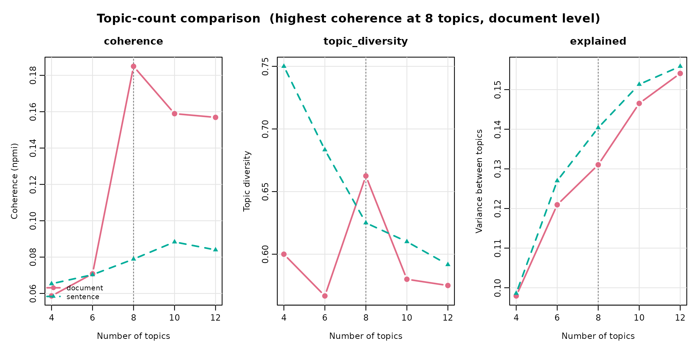
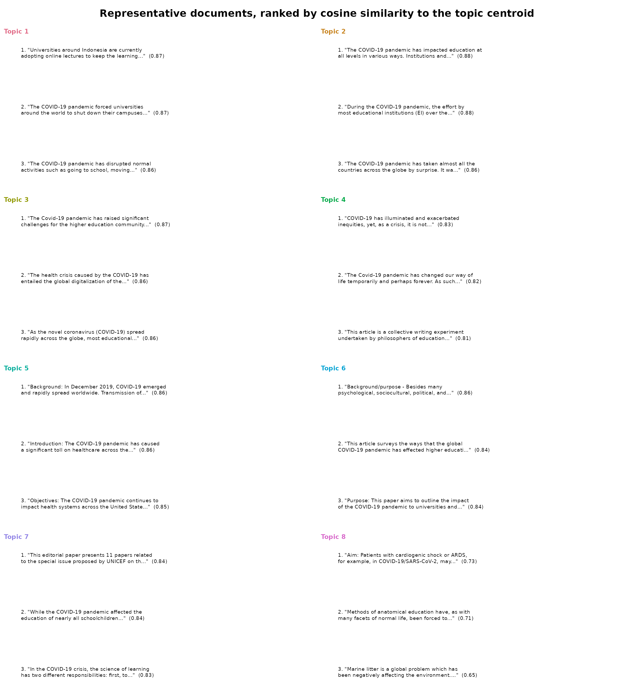

# Topic Modeling COVID-19 Research Abstracts

The `covid` dataset that ships with **sbert** holds 4,170 records of
research on COVID-19 and education, children, schools, and society,
published from 2020 to 2024. This article finds the main themes in their
abstracts.

**sbert** groups texts by what they mean. Each text becomes an
embedding, a vector of numbers in which texts with similar meaning lie
close together, and a topic is a group of texts whose embeddings are
close. So we read each topic’s example texts first and use words only as
labels at the end.

Abstracts are long. The default model reads at most 256 tokens of a text
and ignores the rest, and many abstracts are longer than that. So we fit
topics twice: once on whole abstracts, and once on their sentences,
which are short enough to be read in full. The two give different
answers to different questions.

Unlike the vignette, this article downloads a model and encodes about
3,800 abstracts and all their sentences. It takes a few minutes.

## Preparing the abstracts

323 records have no abstract, only the placeholder
`"[No abstract available]"`. We drop them.

``` r

abstracts <- subset(covid, Abstract != "[No abstract available]")
nrow(abstracts)
#> [1] 3847
```

Almost every abstract ends with a copyright notice, such as “© 2021
Informa UK Limited, trading as Taylor & Francis Group.” Left in, the
notices would form topics of their own, grouped by publisher rather than
by research. The `remove` argument of
[`clean_corpus()`](https://sonsoles.me/sbert/reference/clean_corpus.md)
deletes text that matches a regular expression. The pattern below
deletes a notice at the end of an abstract that starts with “©”,
“Copyright ©”, or “Copyright” and a year. It does not touch abstracts
that mention copyright as a subject.

[`clean_corpus()`](https://sonsoles.me/sbert/reference/clean_corpus.md)
also repairs broken characters, removes HTML tags, URLs, DOIs, and
bracketed citations, and with `min_content = 0.5` drops rows that are
mostly numbers or symbols rather than words. Given a data frame and a
`column`, it cleans that column and keeps the other columns.

``` r

abstracts <- clean_corpus(
  abstracts,
  column = "Abstract",
  remove = "(copyright:?\\s*(©|\\d{4})|©).{0,1000}$",
  min_content = 0.5
)
nrow(abstracts)
#> [1] 3847
```

## The model

Install the ONNX Runtime and download the default model,
`all-MiniLM-L6-v2`. Both steps happen once per computer.

``` r

install_runtime()
model_download()
```

## Choosing the number of topics

[`compare_topics()`](https://sonsoles.me/sbert/reference/compare_topics.md)
fits one model for each topic count, here on both whole abstracts
(`"document"`) and sentences (`"sentence"`). `max_tokens = 200` splits
the rare sentence longer than 200 words at its punctuation, so that no
sentence is cut off.

Words such as *covid*, *pandemic*, and *study* appear in nearly every
abstract, so they are added to the standard English stop words, and
`numbers = "remove"` leaves out bare numbers such as years. Stop words
affect only the word labels and the word-based measures. The topics
themselves are computed from the embeddings of the full text.

``` r

covid_stop_words <- stop_words(add = c(
  "covid", "coronavirus", "sars", "cov", "pandemic", "disease",
  "study", "studies", "result", "results", "conclusion", "conclusions",
  "background", "method", "methods", "objective", "aim"
))

sweep <- compare_topics(
  abstracts,
  column = "Abstract",
  n_topics = c(4, 6, 8, 10, 12),
  segment = c("document", "sentence"),
  max_tokens = 200,
  stop_words = covid_stop_words,
  numbers = "remove"
)
sweep
#> <sbert_topic_sweep> 10 candidates, coherence measure: npmi
#>   segment n_topics  coherence topic_diversity  explained
#>  document        4 0.05863244       0.6000000 0.09793182
#>  document        6 0.07081375       0.5666667 0.12093830
#>  document        8 0.18496168       0.6625000 0.13103483
#>  document       10 0.15892319       0.5800000 0.14652464
#>  document       12 0.15689454       0.5750000 0.15408795
#>  sentence        4 0.06533172       0.7500000 0.09858943
#>  sentence        6 0.07032180       0.6833333 0.12698610
#>  sentence        8 0.07889676       0.6250000 0.14037657
#>  sentence       10 0.08834204       0.6100000 0.15132116
#>  sentence       12 0.08397123       0.5916667 0.15587298
#> 
#> Fitted models retained: fitted(x, n_topics = 8, segment = "document")
```

``` r

plot(sweep)
```



On whole abstracts, coherence jumps from 0.07 at six topics to 0.18 at
eight. The jump is not what it seems. From eight topics on, one topic
holds only three abstracts that are not about education at all, and
their rare words (*ECMO*, *porcine*, *polymers*) always occur together,
so that topic alone has a coherence of 0.90 and lifts the mean. The
other seven topics average 0.08, only a little above six topics. We
still use eight: the topics are a little more coherent and more diverse
than at six, and the small topic is useful because it isolates papers
that do not belong in this corpus.

On sentences, coherence changes little from one count to the next. We
use eight there too, so that the two models can be compared.

``` r

topic_model <- fitted(sweep, n_topics = 8, segment = "document")
```

## What the abstracts are about

[`representatives()`](https://sonsoles.me/sbert/reference/representatives.md)
returns, for each topic, the abstracts closest to that topic and clearly
farther from every other topic. Here is one per topic, in full:

``` r

knitr::kable(representatives(topic_model, n = 1), digits = 2)
```

| topic | rank | document_id | text | distance | margin |
|---:|---:|---:|:---|---:|---:|
| 1 | 1 | 3305 | This study aims to measure the level of student satisfaction with online learning services in higher education. The research method used is a survey, it is to meet the data needs on a large scale. The study population was students of higher education at the undergraduate level from 26 universities. Samples were taken randomly with due observance of campus representatives from all regions of Indonesia (N=224). The data collection tool used an online learning satisfaction questionnaire that was developed and validated. The questionnaire contains 19 statements. The data analysis used was descriptive statistical analysis techniques. The results of data processing showed a very satisfying level of 19%, 41% satisfied, 30% dissatisfied, and 10% very dissatisfied. Several factors causing dissatisfaction include limited internet access, and low lecturer’s attachment and guidance. The findings are expected to be input to higher education leaders and lecturers in order to improve the quality of online learning services according to the needs of students. | 0.31 | 0.18 |
| 2 | 1 | 1621 | This paper examines ICT policy in education with a particular focus on teachers’ engagement in emergent remote teaching (ERT) during the initial COVID‐19 school closure in South Korea. It involves a documentary analysis of newspaper articles on “starting school online” from the highest read daily newspapers published in South Korea, through which three issues regarding teachers and teaching are identified: teachers’ digital competency, teachers’ sense of professional identity, and the revalorisation of the teacher role. Discussion of the three issues points to the need to reflect on and rethink the government’s policies for ICT in education. This paper provides an overview of the ICT policies to show their overall inadequacy with respect to providing teachers with the necessary training and framework for technology‐related professional development. It highlights the need to understand the changing nature of teaching and learning in a digital education environment and it suggests a possible redesign of the education and training provisions to teachers to support their professional competency in the digital age. | 0.33 | 0.15 |
| 3 | 1 | 3118 | Today’s engineering laboratory education often lacks opportunities for students to practice critical thinking through real-world problems. This particular objective is even harder to achieve through online laboratory experiments. In this article, we summarize our innovation in using a real-world challenge, analyze big data, to empower student data analysis skills in remote teaching platform. This approach allows students to collect data, analyze, and evaluate possible solutions continuously through hands-on experimentation with accessible resources around them. Compared to the video-recorded lab, our method achieves a higher level of learning in Bloom’s taxonomy. To further improve our approach, we summarize our lesson learned from transferring six different engineering laboratory courses online, in response to the COVID-19. A thriving 21st-century learning environment has to embrace agility, create flexibility, adapt to technology, and support virtual team collaborations. | 0.35 | 0.17 |
| 4 | 1 | 2610 | In this article, we take the risk of reading the contemporary world based on images that have been published on social media during the pandemic crisis. By questioning the abyssal lines (SOUSA SANTOS, 2007) imbued and naturalized by the projects of Modernity and Humanism, the article discusses the ways in which nature invaded, in the middle of the pandemic, “this side” of modernity. The following section explores the undemocratic virus by problematizing the abyssal lines of social class differences. Then, in order to further complexify the stark differences between white supremacy and black genocide, the next section demonstrates that we have not overcome this historical crisis of humanity. Section five investigates the abyssal lines between access to education and the perpetuation of a project for education that secures the denial of its existence. In the conclusion, we explain the reasons that make us conceive of these images as procedural micropolitics that have the potential to construct “new modes of subjectivity” (GUATTARI; ROLNIK, 1996, ) and suggest a pedagogy of visual literacy and its micropolitics and an epistemic turn in the notions of “crisis”. | 0.30 | 0.21 |
| 5 | 1 | 3073 | The COVID-19 pandemic has engendered rapid and significant changes in patient care. Within the realm of surgical training, the resultant reduction in clinical exposure and case volume jeopardizes the quality of surgical training. Thus, our general surgery residency program proceeded to develop a tailored approach to training that mitigates impact on resident surgical education and optimizes clinical exposure without compromising safety. Residents were engaged directly in planning efforts to craft a response to the pandemic. Following the elimination of elective cases, the in-house resident complement was effectively decreased to reduce unnecessary exposure, with a back-up pool to address unanticipated absences and needs. Personal protective equipment availability and supply, the greatest concern to residents, has remained adequate, while being utilized according to current guidelines. Interested residents were given the opportunity to work in designated COVID ICUs on a volunteer basis. With the decrease in operative volume and clinical duties, we shifted our educational focus to an intensive didactic schedule using a teleconferencing platform and targeted areas of weakness on prior in-service exams. We also highlighted critical COVID-19 literature in a weekly journal club to better understand this novel disease and its effect on surgical practice. The long-term impact of the COVID-19 pandemic on resident education remains to be seen. Success may be achieved with commitment to constant needs assessment in the changing landscape of healthcare with the goal of producing a skilled surgical workforce for public service. | 0.26 | 0.25 |
| 6 | 1 | 1995 | Purpose: This paper aims to outline the impact of the COVID-19 pandemic to universities and how they may react. Design/methodology/approach: A description of the impact of the COVID-19 pandemic to higher education institutions is presented at different levels. Findings: Even though the COVID-19 pandemic affects higher education institutions in many ways, there are some measures which may be undertaken to mitigate its impacts. Practical implications: The measures suggested may assist universities at present, and in future recovery efforts. Originality/value: The value of the paper resides on a multi-perspective analysis of higher education institutions can do, as part of the recovery efforts in face of the pandemic. | 0.16 | 0.22 |
| 7 | 1 | 1236 | Recent research on the effects of COVID-19 on school closures has mainly focused on primary and secondary education, with extremely limited attention to early childhood education (ECE). To address this gap, we identify the extent to which parents and caregivers with pre-primary school-aged children were engaged in their children’s learning during school closures in Ethiopia. Our focus on Ethiopia is of particular relevance given that ECE provision has expanded dramatically in recent years, aimed at ensuring children are prepared for primary school. Using data collected through a phone survey with 480 parents and caregivers, the results revealed that learning disruption due to COVID-19 school closures is likely to be substantial and will probably widen existing inequalities further. Many poorer households and those where parents or caregivers are not literate, are less likely to have child-oriented learning resources, and home learning activities between parents and children in these households are limited. The study highlights that greater attention needs to be paid to mitigate the threats of COVID-19 on Ethiopia’s recent gains in ECE, to prevent the pandemic from further reinforcing inequalities between children from advantaged and disadvantaged households. | 0.21 | 0.24 |
| 8 | 1 | 997 | Aim: Patients with cardiogenic shock or ARDS, for example, in COVID-19/SARS-CoV-2, may require extracorporeal membrane oxygenation (ECMO). An ECLS/ECMO model simulating challenging vascular anatomy is desirable for cannula insertion training purposes. We assessed the ability of various 3D-printable materials to mimic the penetration properties of human tissue by using porcine aortae. Methods: A test bench for needle penetration and piercing in sampled porcine aorta and preselected 3D-printable polymers was assembled. The 3D-printable materials had Shore A hardness of 10, 20, and 17G Vygon 1.0 × 1.4 mm × 70 mm needles were used for penetration tests. Results: For the porcine tissue and Shore A 10, Shore A 20, and Shore A 50 polymers, penetration forces of 0.9036 N, 0.9725 N, 1.0386 N, and 1.254 N were needed, respectively. For piercing through the porcine tissue and Shore A 10, Shore A 20, and Shore A 50 polymers, forces of 0.8399 N, 1.244 N, 1.475 N, and 1.482 N were needed, respectively. ANOVA showed different variances among the groups, and pairwise two-tailed t-tests showed significantly different needle penetration and piercing forces, except for penetration of Shore A 10 and 20 polymers (p = 0.234 and p = 0.0857). Significantly higher forces were required for all other materials. Conclusion: Shore A 10 and 20 polymers have similar needle penetration properties compared to the porcine tissue. Significantly more force is needed to pierce through the material fully. The most similar tested material to porcine aorta for needle penetration and piercing in ECMO-implantation is the silicon Shore A 10 polymer. This silicon could be a 3D-printable material in surgical training for ECMO-implantation. | 0.27 | 0.56 |

The plot shows the opening of three abstracts per topic:

``` r

plot(topic_model, type = "representatives", n_representatives = 3)
```



Read together, the examples show eight subjects:

1.  Students’ acceptance of and satisfaction with online learning,
    mostly surveys.
2.  Teachers and emergency remote teaching in schools.
3.  Laboratory and hands-on courses moved online, in engineering and
    chemistry.
4.  Social and political commentary: images on social media, grassroots
    organizing, community solidarity.
5.  Surgical and medical training.
6.  Universities as institutions: their finances, international
    students, and private higher education.
7.  Young children, parents, and families during school and daycare
    closures.
8.  Three papers outside education: a training model for ECMO, marine
    plastic litter, and anatomy teaching by dissection.

[`topic_sizes()`](https://sonsoles.me/sbert/reference/topic_sizes.md)
counts the abstracts in each topic. The first three topics, on online
learning, teachers, and laboratory courses, hold more than half of them.

``` r

topic_sizes(topic_model)
#>   topic                                                      label n_documents
#> 1     1    Universities around Indonesia are currently adopting...         803
#> 2     2     The COVID-19 pandemic has impacted education at all...         699
#> 3     3 The Covid-19 pandemic has raised significant challenges...         615
#> 4     4    COVID-19 has illuminated and exacerbated inequities,...         476
#> 5     5      Background: In December 2019, COVID-19 emerged and...         452
#> 6     6        Background/purpose - Besides many psychological,...         407
#> 7     7  This editorial paper presents 11 papers related to the...         392
#> 8     8       Aim: Patients with cardiogenic shock or ARDS, for...           3
#>     proportion
#> 1 0.2087340785
#> 2 0.1817000260
#> 3 0.1598648297
#> 4 0.1237327788
#> 5 0.1174941513
#> 6 0.1057967247
#> 7 0.1018975825
#> 8 0.0007798284
```

## What the sentences are about

The sentence model was fitted in the same call.
[`fitted()`](https://rdrr.io/r/stats/fitted.values.html) returns it. Its
example sentences are short enough to read in full:

``` r

sentence_model <- fitted(sweep, n_topics = 8, segment = "sentence")
knitr::kable(representatives(sentence_model, n = 3), digits = 2)
```

| topic | rank | document_id | segment | text | distance | margin |
|---:|---:|---:|---:|:---|---:|---:|
| 1 | 1 | 2580 | 3 | Background The COVID-19 pandemic has significantly affected educational activities and disrupted the traditional norms of education at colleges and universities in the world, and, as a result, teaching and learning have shifted to online. | 0.09 | 0.21 |
| 1 | 2 | 876 | 1 | Background: The Coronavirus Disease 2019 (COVID-19) pandemic has necessitated a sudden transition to remote learning in medical schools. | 0.20 | 0.21 |
| 1 | 3 | 2804 | 2 | This paper aims to present and describe a higher education experience with Flipped Learning before and during the transformation of education due to the COVID-19 pandemic. | 0.26 | 0.21 |
| 2 | 1 | 1612 | 2 | Based on data gathered through a survey (N = 784), this paper analyses students’ perceptions regarding the effectiveness of online education in a period when this type of education is the only available option. | 0.21 | 0.25 |
| 2 | 2 | 3417 | 3 | Based on the current development of online teaching, this paper analyzes the main existing problems and puts forward some improvement measures in order to give full play to the advantages of online teaching and promote the teaching reform of combining online and offline in colleges and universities. | 0.27 | 0.24 |
| 2 | 3 | 3426 | 3 | The factors influencing online education adoption are explained in this research with a Structural Equation Model (SEM). | 0.37 | 0.22 |
| 3 | 1 | 1053 | 6 | The study explores the complements of physical experiments brought in with animations, simulations, and remote laboratory set-ups for providing skill trainings to learners. | 0.37 | 0.18 |
| 3 | 2 | 1352 | 3 | This design-based syllabus is more acquainted with face to face or physical teaching learning environment. | 0.37 | 0.17 |
| 3 | 3 | 1649 | 1 | In this paper, a hybrid model for teaching Engineering Mechanics courses is presented. | 0.50 | 0.17 |
| 4 | 1 | 2145 | 6 | The findings revealed a tension between expectations of producers of policy and enactors of policy within unequal school settings. | 0.41 | 0.23 |
| 4 | 2 | 2256 | 2 | Despite education being the only viable means towards a better future, the closing of schools set-off to heighten prevailing educational disparities towards academic access, experience and achievement for the vulnerable children of the country. | 0.29 | 0.23 |
| 4 | 3 | 2617 | 2 | Within this matrix of interdependent relations, schools operate under increasingly hybrid accountability arrangements in which public accountability can both complement and compete with market and social regimes and their associated institutional logics, goals, values and mechanisms. | 0.44 | 0.22 |
| 5 | 1 | 2547 | 7 | Further findings indicate that, in unprecedented times, policies developed for use in different contexts can be met with innovative collaborative efforts with a focused goal that transcend seemingly insurmountable challenges. | 0.40 | 0.25 |
| 5 | 2 | 2588 | 3 | The focus of this article is on planning with canonical works to meet the current moment. | 0.48 | 0.25 |
| 5 | 3 | 279 | 5 | However, the processes involved in making this happen are elusive and complex. | 0.50 | 0.24 |
| 6 | 1 | 876 | 6 | Results: Of 268 students enrolled, 104 responded (53.7% of first-year students and 23.9% of second-year students). | 0.25 | 0.30 |
| 6 | 2 | 2378 | 7 | 275 students (80.2% of the expected) enrolled in 17 undergraduate courses (those that are not related to engineering) answered the questionnaire. | 0.35 | 0.28 |
| 6 | 3 | 616 | 5 | Students in medical fields made up 289 (23.6%). | 0.40 | 0.27 |
| 7 | 1 | 3106 | 4 | The research utilized a descriptive methodology, with a data collection technique conducted through online surveys. | 0.26 | 0.28 |
| 7 | 2 | 3655 | 6 | Content analysis technique was used in the analysis of the data obtained. | 0.33 | 0.27 |
| 7 | 3 | 166 | 8 | The conventional content analysis method was used to analyze the data. | 0.34 | 0.26 |
| 8 | 1 | 1587 | 1 | In response to the emerging and ever solution to the COVID-19 outbreak. | 0.20 | 0.24 |
| 8 | 2 | 2143 | 1 | This editorial to the Special Section on COVID-19 emphasises the importance of researching pandemic realities and the value that the findings can bring to the way we shape decisions in the future, for the ‘new normal’. | 0.14 | 0.24 |
| 8 | 3 | 3544 | 1 | Background: The coronavirus disease (COVID-19) global pandemic has resulted in unprecedented public health measures. | 0.20 | 0.24 |

Most sentence topics are not subjects but the jobs that sentences do in
an abstract:

- Topic 1 opens an abstract by saying what the pandemic did to
  education.
- Topic 5 holds general, hedging sentences (“However, the processes
  involved in making this happen are elusive and complex.”).
- Topic 6 reports samples and response rates (“Of 268 students enrolled,
  104 responded”).
- Topic 7 describes methods of data collection and analysis.
- Topic 8 states the pandemic as background (“The WHO has stated the
  outbreak of COVID-19 as a pandemic issue.”).

Only three are subjects: perceptions of online education (topic 2),
course design with labs, simulations, and hybrid teaching (topic 3), and
education policy and inequality (topic 4).

`topic_sizes(by = "document")` counts how many abstracts have at least
one sentence in each topic:

``` r

topic_sizes(sentence_model, by = "document")
#>   topic                                                       label n_documents
#> 1     1       Background The COVID-19 pandemic has significantly...        3040
#> 2     2 The main objective of this study is therefore to explore...        1839
#> 3     3   The methods used to incorporate this technology can be...        1998
#> 4     4     It examines the measures which were taken to fix the...        2065
#> 5     5  We provide implications for researchers and practitioners.        1693
#> 6     6                    Results: Twenty-seven students enrolled.        1489
#> 7     7                      A survey design was used in the study.        1335
#> 8     8      Background: The COVID-19 pandemic has disrupted the...        1320
#>   proportion
#> 1  0.7902262
#> 2  0.4780348
#> 3  0.5193657
#> 4  0.5367819
#> 5  0.4400832
#> 6  0.3870548
#> 7  0.3470237
#> 8  0.3431245
```

[`topic_gamma()`](https://sonsoles.me/sbert/reference/topic_gamma.md)
gives the mix of topics in each abstract: the share of its sentences
that fall in each topic. The shares of an abstract add up to 1.

``` r

head(topic_gamma(sentence_model), 16)
#>    document_id topic     gamma n_segments
#> 1            1     1 0.3333333          9
#> 2            1     2 0.0000000          9
#> 3            1     3 0.0000000          9
#> 4            1     4 0.5555556          9
#> 5            1     5 0.0000000          9
#> 6            1     6 0.1111111          9
#> 7            1     7 0.0000000          9
#> 8            1     8 0.0000000          9
#> 9            2     1 0.3333333          6
#> 10           2     2 0.3333333          6
#> 11           2     3 0.0000000          6
#> 12           2     4 0.0000000          6
#> 13           2     5 0.3333333          6
#> 14           2     6 0.0000000          6
#> 15           2     7 0.0000000          6
#> 16           2     8 0.0000000          6
```

## The words each topic uses

[`summary()`](https://rdrr.io/r/base/summary.html) lists each topic
under its label, the opening of its most central abstract or sentence,
and reports the coherence of its top words.
[`terms()`](https://rdrr.io/r/stats/terms.html) lists those words.

``` r

summary(topic_model)
#> Semantic topic model summary
#>   documents:            3847
#>   topics:               8
#>   model:                sentence-transformers/all-MiniLM-L6-v2
#>   between/total SS:      13.1%
#>   mean npmi  coherence:  0.1850
#>   topic topic_diversity:      0.662 (top 10 terms)
#> 
#>  topic                                                      label n_documents
#>      1    Universities around Indonesia are currently adopting...         803
#>      2     The COVID-19 pandemic has impacted education at all...         699
#>      3 The Covid-19 pandemic has raised significant challenges...         615
#>      4    COVID-19 has illuminated and exacerbated inequities,...         476
#>      5      Background: In December 2019, COVID-19 emerged and...         452
#>      6        Background/purpose - Besides many psychological,...         407
#>      7  This editorial paper presents 11 papers related to the...         392
#>      8       Aim: Patients with cardiogenic shock or ARDS, for...           3
#>  proportion coherence
#>   0.2087341   0.07733
#>   0.1817000   0.07523
#>   0.1598648   0.09003
#>   0.1237328   0.03543
#>   0.1174942   0.09903
#>   0.1057967   0.05638
#>   0.1018976   0.14200
#>   0.0007798   0.90427
```

``` r

terms(topic_model, n = 5)
#>    topic                                                      label
#> 1      1    Universities around Indonesia are currently adopting...
#> 2      1    Universities around Indonesia are currently adopting...
#> 3      1    Universities around Indonesia are currently adopting...
#> 4      1    Universities around Indonesia are currently adopting...
#> 5      1    Universities around Indonesia are currently adopting...
#> 6      2     The COVID-19 pandemic has impacted education at all...
#> 7      2     The COVID-19 pandemic has impacted education at all...
#> 8      2     The COVID-19 pandemic has impacted education at all...
#> 9      2     The COVID-19 pandemic has impacted education at all...
#> 10     2     The COVID-19 pandemic has impacted education at all...
#> 11     3 The Covid-19 pandemic has raised significant challenges...
#> 12     3 The Covid-19 pandemic has raised significant challenges...
#> 13     3 The Covid-19 pandemic has raised significant challenges...
#> 14     3 The Covid-19 pandemic has raised significant challenges...
#> 15     3 The Covid-19 pandemic has raised significant challenges...
#> 16     4    COVID-19 has illuminated and exacerbated inequities,...
#> 17     4    COVID-19 has illuminated and exacerbated inequities,...
#> 18     4    COVID-19 has illuminated and exacerbated inequities,...
#> 19     4    COVID-19 has illuminated and exacerbated inequities,...
#> 20     4    COVID-19 has illuminated and exacerbated inequities,...
#> 21     5      Background: In December 2019, COVID-19 emerged and...
#> 22     5      Background: In December 2019, COVID-19 emerged and...
#> 23     5      Background: In December 2019, COVID-19 emerged and...
#> 24     5      Background: In December 2019, COVID-19 emerged and...
#> 25     5      Background: In December 2019, COVID-19 emerged and...
#> 26     6        Background/purpose - Besides many psychological,...
#> 27     6        Background/purpose - Besides many psychological,...
#> 28     6        Background/purpose - Besides many psychological,...
#> 29     6        Background/purpose - Besides many psychological,...
#> 30     6        Background/purpose - Besides many psychological,...
#> 31     7  This editorial paper presents 11 papers related to the...
#> 32     7  This editorial paper presents 11 papers related to the...
#> 33     7  This editorial paper presents 11 papers related to the...
#> 34     7  This editorial paper presents 11 papers related to the...
#> 35     7  This editorial paper presents 11 papers related to the...
#> 36     8       Aim: Patients with cardiogenic shock or ARDS, for...
#> 37     8       Aim: Patients with cardiogenic shock or ARDS, for...
#> 38     8       Aim: Patients with cardiogenic shock or ARDS, for...
#> 39     8       Aim: Patients with cardiogenic shock or ARDS, for...
#> 40     8       Aim: Patients with cardiogenic shock or ARDS, for...
#>            term rank      score frequency        beta
#> 1        online    1 0.06224614      2677 0.027224929
#> 2      learning    2 0.06036407      2860 0.029086028
#> 3      students    3 0.05722093      2726 0.027723256
#> 4     education    4 0.03941373      1841 0.018722859
#> 5      teaching    5 0.03157991      1238 0.012590385
#> 6      teachers    1 0.05779352      1448 0.019390433
#> 7      teaching    2 0.04893846      1457 0.019510954
#> 8      learning    3 0.04138165      1489 0.019939472
#> 9     education    4 0.04014249      1424 0.019069045
#> 10       online    5 0.03631193      1186 0.015881943
#> 11     learning    1 0.05079927      1550 0.024477291
#> 12     students    2 0.04726181      1450 0.022898111
#> 13       online    3 0.04495176      1245 0.019660792
#> 14     teaching    4 0.04265984      1077 0.017007770
#> 15         face    5 0.02615803       476 0.007516897
#> 16       social    1 0.03887026       510 0.011336608
#> 17    education    2 0.03692031       789 0.017538400
#> 18         work    3 0.02611242       300 0.006668593
#> 19      article    4 0.02126510       234 0.005201503
#> 20       health    5 0.01936549       237 0.005268189
#> 21      medical    1 0.05968672       874 0.015339254
#> 22     students    2 0.04571544      1262 0.022148900
#> 23     clinical    3 0.03869326       482 0.008459405
#> 24       health    4 0.03716058       576 0.010109165
#> 25    education    5 0.02756176       746 0.013092773
#> 26    education    1 0.04909214       940 0.023320433
#> 27       higher    2 0.04322329       496 0.012305250
#> 28     students    3 0.02949456       576 0.014289967
#> 29 universities    4 0.02285689       230 0.005706063
#> 30 institutions    5 0.02235797       226 0.005606827
#> 31       school    1 0.05532799       592 0.015314966
#> 32     children    2 0.04562050       386 0.009985772
#> 33    education    3 0.04296815       789 0.020411331
#> 34      parents    4 0.03653572       304 0.007864442
#> 35      schools    5 0.02990247       294 0.007605743
#> 36        shore    1 0.36486584        10 0.043103448
#> 37  penetration    2 0.29881103         8 0.034482759
#> 38      porcine    3 0.23459295         6 0.025862069
#> 39     polymers    4 0.19942306         5 0.021551724
#> 40         ecmo    5 0.16338542         4 0.017241379
```

The words say much less than the examples. Topics 1 and 3 have almost
the same top words (*online*, *learning*, *students*), yet one is about
students’ acceptance of online learning and the other about laboratory
courses moved online. Words such as *learning*, *students*, and *online*
run through the whole corpus, so they cannot tell these topics apart.
The embeddings can, because they capture what each abstract says rather
than which words it uses.

The sentence topics’ words are vaguer still. Only topic 7’s top words,
*data*, *analysis*, and *used*, are clear, because sentences about
methods reuse the same few words. None of the words shows what most
sentence topics do: open an abstract, report a sample, or hedge.

``` r

summary(sentence_model)
#> Semantic topic model summary
#>   documents:            3847
#>   segments:             29835 (sentence level)
#>   topics:               8
#>   model:                sentence-transformers/all-MiniLM-L6-v2
#>   between/total SS:      14.0%
#>   mean npmi  coherence:  0.0789
#>   topic topic_diversity:      0.625 (top 10 terms)
#> 
#>  topic                                                       label n_documents
#>      1       Background The COVID-19 pandemic has significantly...        5760
#>      2 The main objective of this study is therefore to explore...        4556
#>      3   The methods used to incorporate this technology can be...        4376
#>      4     It examines the measures which were taken to fix the...        4149
#>      5  We provide implications for researchers and practitioners.        3217
#>      6                    Results: Twenty-seven students enrolled.        2986
#>      7                      A survey design was used in the study.        2454
#>      8      Background: The COVID-19 pandemic has disrupted the...        2337
#>  proportion coherence
#>     0.19306   0.04651
#>     0.15271   0.07672
#>     0.14667   0.05946
#>     0.13906   0.02686
#>     0.10783   0.04134
#>     0.10008   0.06141
#>     0.08225   0.19613
#>     0.07833   0.12274
```

## Which model to use

The two models answer different questions. Whole abstracts group papers
by subject: who was studied and what was taught. Sentences group mainly
by what a sentence does in an abstract (context, sample, method,
hedging), with a few subject topics among them. Almost every abstract
(79%) has a sentence in topic 1, the opening context.

Use whole abstracts to map the research themes of a literature. Use
sentences to study how abstracts are written, or to reach content beyond
the first 256 tokens of long abstracts, which the whole-abstract model
never reads.

## Next steps

- `predict(topic_model, new_abstracts)` assigns new abstracts to these
  topics without refitting. For the sentence model it splits the new
  abstracts into sentences in the same way.
- `reduce_topics(topic_model, n_topics = 4)` merges similar topics, and
  [`topic_hierarchy()`](https://sonsoles.me/sbert/reference/topic_hierarchy.md)
  shows which topics are closest to each other.
- The article *Parallel and High-Throughput Topic Modeling* shows how to
  encode once and reuse the embeddings across many fits and sessions.
