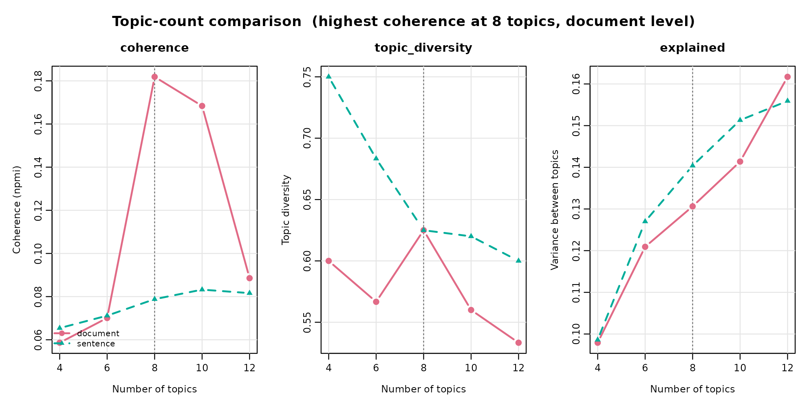
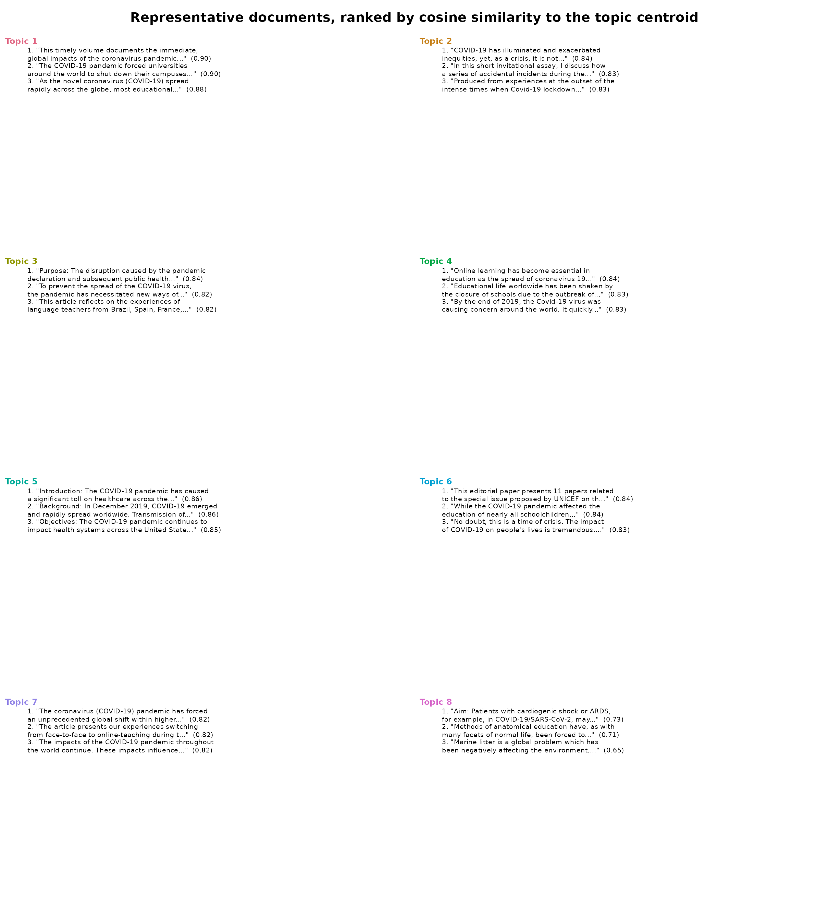

# Topic Modeling COVID-19 Research Abstracts

The `covid` dataset that ships with **sbert** holds 4,170 records of
research on COVID-19 and education, children, schools, and society,
published from 2020 to 2024. This article finds the main themes in their
abstracts.

**sbert** groups texts by what they mean. Each text becomes an
embedding, a vector of numbers in which texts with similar meaning lie
close together, and a topic is a group of texts whose embeddings are
close. So we read each topic’s example texts first and use words only as
labels at the end.

Abstracts are long. The default model reads at most 256 tokens of a text
and ignores the rest, and many abstracts are longer than that. So we fit
topics twice: once on whole abstracts, and once on their sentences,
which are short enough to be read in full. The two give different
answers to different questions.

Unlike the vignette, this article downloads a model and encodes about
3,800 abstracts and all their sentences. It takes a few minutes.

## Preparing the abstracts

323 records have no abstract, only the placeholder
`"[No abstract available]"`. We drop them.

``` r

abstracts <- subset(covid, Abstract != "[No abstract available]")
nrow(abstracts)
#> [1] 3847
```

Almost every abstract ends with a copyright notice, such as “© 2021
Informa UK Limited, trading as Taylor & Francis Group.” Left in, the
notices would form topics of their own, grouped by publisher rather than
by research. The `remove` argument of
[`clean_corpus()`](https://sonsoles.me/sbert/reference/clean_corpus.md)
deletes text that matches a regular expression. The pattern below
deletes a notice at the end of an abstract that starts with “©”,
“Copyright ©”, or “Copyright” and a year. It does not touch abstracts
that mention copyright as a subject.

[`clean_corpus()`](https://sonsoles.me/sbert/reference/clean_corpus.md)
also repairs broken characters, removes HTML tags, URLs, DOIs, and
bracketed citations, and with `min_content = 0.5` drops rows that are
mostly numbers or symbols rather than words. Given a data frame and a
`column`, it cleans that column and keeps the other columns.

``` r

abstracts <- clean_corpus(
  abstracts,
  column = "Abstract",
  remove = "(copyright:?\\s*(©|\\d{4})|©).{0,1000}$",
  min_content = 0.5
)
nrow(abstracts)
#> [1] 3847
```

## The model

Install the ONNX Runtime and download the default model,
`all-MiniLM-L6-v2`. Both steps happen once per computer.

``` r

install_runtime()
model_download()
```

## Choosing the number of topics

[`compare_topics()`](https://sonsoles.me/sbert/reference/compare_topics.md)
fits one model for each topic count, here on both whole abstracts
(`"document"`) and sentences (`"sentence"`). `max_tokens = 200` splits
the rare sentence longer than 200 words at its punctuation, so that no
sentence is cut off.

Words such as *covid*, *pandemic*, and *study* appear in nearly every
abstract, so they are added to the standard English stop words, and
`numbers = "remove"` leaves out bare numbers such as years. Stop words
affect only the word labels and the word-based measures. The topics
themselves are computed from the embeddings of the full text.

``` r

covid_stop_words <- stop_words(add = c(
  "covid", "coronavirus", "sars", "cov", "pandemic", "disease",
  "study", "studies", "result", "results", "conclusion", "conclusions",
  "background", "method", "methods", "objective", "aim"
))

sweep <- compare_topics(
  abstracts,
  column = "Abstract",
  n_topics = c(4, 6, 8, 10, 12),
  segment = c("document", "sentence"),
  max_tokens = 200,
  stop_words = covid_stop_words,
  numbers = "remove"
)
sweep
#> <sbert_topic_sweep> 10 candidates, coherence measure: npmi
#>   segment n_topics  coherence topic_diversity  explained
#>  document        4 0.05863244       0.6000000 0.09791067
#>  document        6 0.07008644       0.5666667 0.12092086
#>  document        8 0.18186563       0.6250000 0.13062603
#>  document       10 0.16837360       0.5600000 0.14137591
#>  document       12 0.08854879       0.5333333 0.16170851
#>  sentence        4 0.06541105       0.7500000 0.09860441
#>  sentence        6 0.07117401       0.6833333 0.12700263
#>  sentence        8 0.07881864       0.6250000 0.14038779
#>  sentence       10 0.08323372       0.6200000 0.15130692
#>  sentence       12 0.08161888       0.6000000 0.15591558
#> 
#> Fitted models retained: fitted(x, n_topics = 8, segment = "document")
```

``` r

plot(sweep)
```



On whole abstracts, coherence jumps from 0.07 at six topics to 0.18 at
eight. The jump is not what it seems. From eight topics on, one topic
holds only three abstracts that are not about education at all, and
their rare words (*ECMO*, *porcine*, *polymers*) always occur together,
so that topic alone has a coherence of 0.90 and lifts the mean. The
other seven topics average 0.08, only a little above six topics. We
still use eight: the topics are a little more coherent and more diverse
than at six, and the small topic is useful because it isolates papers
that do not belong in this corpus.

On sentences, coherence changes little from one count to the next. We
use eight there too, so that the two models can be compared.

``` r

topic_model <- fitted(sweep, n_topics = 8, segment = "document")
```

## What the abstracts are about

[`representatives()`](https://sonsoles.me/sbert/reference/representatives.md)
returns, for each topic, the abstracts closest to that topic and clearly
farther from every other topic. Here is one per topic, in full:

``` r

knitr::kable(representatives(topic_model, n = 1), digits = 2)
```

| topic | rank | document_id | text | distance | margin |
|---:|---:|---:|:---|---:|---:|
| 1 | 1 | 3417 | In the face of the sudden outbreak of COVID-19 virus, the Ministry of Education requires schools to postpone the opening, but calls for ‘ensuring learning undisrupted when classes are disrupted’ at the same time. Online teaching has been widely used during the epidemic, but there are still many shortcomings, which limit the effectiveness of online teaching. Based on the current development of online teaching, this paper analyzes the main existing problems and puts forward some improvement measures in order to give full play to the advantages of online teaching and promote the teaching reform of combining online and offline in colleges and universities. | 0.17 | 0.12 |
| 2 | 1 | 1873 | Purpose: This article aims to provide a timely examination of and reflection on the impact of COVID-19 on the neo-liberal paradigm that has been prevalent in international higher education (HE) for two decades since the late 1990s. Design/methodology/approach: Methodologically, this paper deploys conceptual mapping as an analytical tool to explore and examine the global news updates that provide timely (i.e. early 2020) record of the fast-moving pandemic. Findings: It unfolds four pairs of contradictions occurring in the Western universities during the pandemic outbreak, i.e. HE as cross-border services vs border control, the state’s shrinking public funding vs universities under financial threat, increased reliance on foreign students’ tuition fee vs decreased international enrolment and the user-pays philosophy vs the rising force of user says. Research limitations/implications: It is argued that the pending crises facing Western universities are not merely financial issues; they reveal the shortcomings that are inherent in business model of HE driven by economic globalisation but triggered by coronavirus pandemic to erupt. The pandemic should be temporary, but its spill-over effects may alter the overarching landscape of the international HE relations, which is part and parcel of the changing geopolitical order featured as de-globalisation. Practical implications: The paper has practical implications for acting on international HE in the time of coronavirus pandemic. They mainly consider four aspects: travel distance as new determinant of study abroad, the renewed significance of a state’s role in policymaking and financial undertaking, shortcomings in market mechanism and East Asia as an emerging regional hub of study abroad. Social implications: This paper is expected to leverage three lessons learned from the upending situation. First, it is conceptually misleading to define international HE as a form of market-led “transnational service” and cross-border tradeable product undermining a state’s control. Second, a state’s supervising model needs to be reviewed, to embrace the renewed relationship between a state and universities in the new context of global pandemic. Third, the global landscape of international HE may be altered. Originality/value: This conceptual paper provides a timely critique of the neo-liberal paradigm in HE and shedding light on the changing global landscape of international HE along with the changing geopolitical relations reshuffled by COVID-19 and its spill-over effects. | 0.24 | 0.21 |
| 3 | 1 | 3492 | The aims of this paper are to explore novice teachers’ experiences in the Covid-19 crisis, and to examine their professional identity construction process. During the global crisis, novice teachers had to deal with unexpected challenges and take advantage of new opportunities. This study is based on 32 narratives of novice teachers in Israel who took part in a one semester online Zoom induction in two workshops. The open conversations narratives in the meetings were recorded and transcribed, and then subjected to categorical content analysis. The findings show the challenges and opportunities related to three central categories: technological, pedagogical and educational system in the novice teachers’ experiences. The main contributions of this study are: understanding the novice teachers’ experiences in the uncertainty and turmoil of the crisis, and learning about professional dilemmas and tensions which gave rise to various challenges and opportunities that that supported the construction their professional identity. | 0.30 | 0.14 |
| 4 | 1 | 2654 | This study investigates the impact of implementing integral calculus lectures which were originally very suitable in face-to-face delivery, but during the Covid-19 pandemic situation, these were delivered online through e-learning. This research analyzes the correlation between self-efficacy, creativity perception, and productive disposition towards academic performance using path analysis and was modeled in the form of regression equation. This study involved 108 students (35 males and 72 females) at a university in Bandung, West Java, Indonesia. The research instrument used was questionnaire of self-efficacy (11 items), creativity perception (15 items) and mathematical disposition (14 items). All research variable items had a Pearson correlation greater than 0.25, so all items were said to be valid. The reliability coefficient of Cronbach’s Alpha for self-efficacy, perceived creativity, and productive disposition were included in the high category. The results showed a correlation between self-efficacy and creativity perception with regard to productive disposition. There was also a direct correlation between self-efficacy and academic performance. Creativity perception did not show a direct influence on academic performance nor. Productive disposition had a direct influence on academic performance. There was a correlation between self-efficacy, creativity perception, and productive disposition of academic performance. Self-efficacy (happy to help other friends, dare to face criticism and challenges, and dare to compete to win a competition) had the largest contribution to academic performance while creativity perception (creative ideas must be sophisticated and complex, creative people have high curiosity, creative people find it difficult to accept different opinions from others, creativity can only be developed in certain people, and creativity comes over by chance) has the smallest one. These findings can be used as first step in understanding creative perception as a weak contribution to cognitive abilities about academic performance, even though creativity has an important role in developing mathematics performance. | 0.38 | 0.19 |
| 5 | 1 | 1889 | Objective: Describe the early impact of the COVID-19 pandemic on general surgery residency training nationwide. Design: A 31-question electronic survey was distributed to general surgery program directors. Qualitative data underwent iterative coding analysis. Quantitative data were evaluated with summary statistics and bivariate analyses. Participants: Eighty-four residency programs (33.6% response rate) with representation across US geographic regions, program affiliations, and sizes. Results: Widespread changes were observed in the surgical training environment. One hundred percent of programs reduced the number of residents on rounds and 95.2% reduced the size of their in-hospital resident workforce; on average, daytime staffing decreased by nearly half. With telehealth clinics (90.5%) and remote inpatient consults (26.2%), both clinical care and resident didactics (86.9%) were increasingly virtual, with similar impact across all program demographics. Conversely, availability of some wellness initiatives was significantly higher among university programs than independent programs, including childcare (51.2% vs 6.7%), housing (41.9% vs 13.3%), and virtual mental health services (83.7% vs 53.3%). Conclusions: Changes in clinical care delivery dramatically reduced in face-to-face learning opportunities for surgical trainees during the COVID-19 pandemic. While this effect had equal impact across all program types, sizes, and geographies, the same cannot be said for wellness initiatives. Though all programs initiated some strategies to protect resident health, the disparity between university programs and independent programs may be cause for action. | 0.31 | 0.24 |
| 6 | 1 | 1254 | In the spring of 2020, as a result of the lockdown caused by the COVID-19 pandemic, many children dropped out of daycare and early education in Finland, and parents had to balance work and childcare for months. The wellbeing of families during the lockdown has been studied to some extent, but few studies have focused on children under school age. In May 2020, we sent a survey to the 82 families originally recruited in our study on supporting social-emotional development in early childhood education units, which had been interrupted by the pandemic. Twenty families responded to questionnaires about the impacts of the lockdown on the wellbeing of the children and their parents. Parents reported a decline in children’s prosocial behavior compared to the time before the pandemic and assessed that the children who stayed at home were lonelier than children who remained in daycare. Otherwise, being at home or in care was not associated with children’s physical or mental wellbeing. Parents had experienced increased mental strain and increased problems in marital relationships and the disruption of children’s participation in daycare was associated with deterioration in the parent - child relationship. Due to the small sample size, these results should be interpreted with caution. | 0.32 | 0.22 |
| 7 | 1 | 1534 | This work presents embedding a design thinking teaching module within an existing engineering undergraduate lab course. The lab, which is freshmen level, gradually builds up critical skills beyond the common mathematical and analytical skills. Such skills are becoming mandatory by the fourth industrial revolution and jobs of future skillset. It gradually and solidly introduces design thinking concepts through a number of experiments where students are fully exposed to the stages of design thinking: empathize, define, ideate, prototype and test. Such skills are needed to address problems, common in modern technological advances, which are not well defined and require out of the box innovation. The lab, which was primarily offered on-line due the COVID-19 pandemic, was taken by more than 100 freshmen level students, required a final design project. The student learning outcomes were acquired and analyzed. | 0.41 | 0.18 |
| 8 | 1 | 997 | Aim: Patients with cardiogenic shock or ARDS, for example, in COVID-19/SARS-CoV-2, may require extracorporeal membrane oxygenation (ECMO). An ECLS/ECMO model simulating challenging vascular anatomy is desirable for cannula insertion training purposes. We assessed the ability of various 3D-printable materials to mimic the penetration properties of human tissue by using porcine aortae. Methods: A test bench for needle penetration and piercing in sampled porcine aorta and preselected 3D-printable polymers was assembled. The 3D-printable materials had Shore A hardness of 10, 20, and 50. 17G Vygon 1.0 × 1.4 mm × 70 mm needles were used for penetration tests. Results: For the porcine tissue and Shore A 10, Shore A 20, and Shore A 50 polymers, penetration forces of 0.9036 N, 0.9725 N, 1.0386 N, and 1.254 N were needed, respectively. For piercing through the porcine tissue and Shore A 10, Shore A 20, and Shore A 50 polymers, forces of 0.8399 N, 1.244 N, 1.475 N, and 1.482 N were needed, respectively. ANOVA showed different variances among the groups, and pairwise two-tailed t-tests showed significantly different needle penetration and piercing forces, except for penetration of Shore A 10 and 20 polymers (p = 0.234 and p = 0.0857). Significantly higher forces were required for all other materials. Conclusion: Shore A 10 and 20 polymers have similar needle penetration properties compared to the porcine tissue. Significantly more force is needed to pierce through the material fully. The most similar tested material to porcine aorta for needle penetration and piercing in ECMO-implantation is the silicon Shore A 10 polymer. This silicon could be a 3D-printable material in surgical training for ECMO-implantation. | 0.27 | 0.55 |

The plot shows the opening of three abstracts per topic:

``` r

plot(topic_model, type = "representatives", n_representatives = 3)
```



Read together, the examples show eight subjects:

1.  Students’ acceptance of and satisfaction with online learning,
    mostly surveys.
2.  Teachers and emergency remote teaching in schools.
3.  Laboratory and hands-on courses moved online, in engineering and
    chemistry.
4.  Social and political commentary: images on social media, grassroots
    organizing, community solidarity.
5.  Surgical and medical training.
6.  Universities as institutions: their finances, international
    students, and private higher education.
7.  Young children, parents, and families during school and daycare
    closures.
8.  Three papers outside education: a training model for ECMO, marine
    plastic litter, and anatomy teaching by dissection.

[`topic_sizes()`](https://sonsoles.me/sbert/reference/topic_sizes.md)
counts the abstracts in each topic. The first three topics, on online
learning, teachers, and laboratory courses, hold more than half of them.

``` r

topic_sizes(topic_model)
#>   topic                                                       label n_documents
#> 1     1       This timely volume documents the immediate, global...         808
#> 2     2     COVID-19 has illuminated and exacerbated inequities,...         702
#> 3     3           Purpose: The disruption caused by the pandemic...         579
#> 4     4 Online learning has become essential in education as the...         501
#> 5     5         Introduction: The COVID-19 pandemic has caused a...         465
#> 6     6   This editorial paper presents 11 papers related to the...         443
#> 7     7        The coronavirus (COVID-19) pandemic has forced an...         346
#> 8     8        Aim: Patients with cardiogenic shock or ARDS, for...           3
#>     proportion
#> 1 0.2100337926
#> 2 0.1824798544
#> 3 0.1505068885
#> 4 0.1302313491
#> 5 0.1208734079
#> 6 0.1151546660
#> 7 0.0899402132
#> 8 0.0007798284
```

## What the sentences are about

The sentence model was fitted in the same call.
[`fitted()`](https://rdrr.io/r/stats/fitted.values.html) returns it. Its
example sentences are short enough to read in full:

``` r

sentence_model <- fitted(sweep, n_topics = 8, segment = "sentence")
knitr::kable(representatives(sentence_model, n = 3), digits = 2)
```

| topic | rank | document_id | segment | text | distance | margin |
|---:|---:|---:|---:|:---|---:|---:|
| 1 | 1 | 2580 | 3 | Background The COVID-19 pandemic has significantly affected educational activities and disrupted the traditional norms of education at colleges and universities in the world, and, as a result, teaching and learning have shifted to online. | 0.09 | 0.21 |
| 1 | 2 | 876 | 1 | Background: The Coronavirus Disease 2019 (COVID-19) pandemic has necessitated a sudden transition to remote learning in medical schools. | 0.20 | 0.21 |
| 1 | 3 | 2804 | 2 | This paper aims to present and describe a higher education experience with Flipped Learning before and during the transformation of education due to the COVID-19 pandemic. | 0.26 | 0.21 |
| 2 | 1 | 3417 | 3 | Based on the current development of online teaching, this paper analyzes the main existing problems and puts forward some improvement measures in order to give full play to the advantages of online teaching and promote the teaching reform of combining online and offline in colleges and universities. | 0.27 | 0.24 |
| 2 | 2 | 1612 | 2 | Based on data gathered through a survey (N = 784), this paper analyses students’ perceptions regarding the effectiveness of online education in a period when this type of education is the only available option. | 0.21 | 0.24 |
| 2 | 3 | 3426 | 3 | The factors influencing online education adoption are explained in this research with a Structural Equation Model (SEM). | 0.37 | 0.23 |
| 3 | 1 | 1053 | 6 | The study explores the complements of physical experiments brought in with animations, simulations, and remote laboratory set-ups for providing skill trainings to learners. | 0.37 | 0.18 |
| 3 | 2 | 1352 | 3 | This design-based syllabus is more acquainted with face to face or physical teaching learning environment. | 0.37 | 0.17 |
| 3 | 3 | 1649 | 1 | In this paper, a hybrid model for teaching Engineering Mechanics courses is presented. | 0.51 | 0.17 |
| 4 | 1 | 2145 | 6 | The findings revealed a tension between expectations of producers of policy and enactors of policy within unequal school settings. | 0.41 | 0.23 |
| 4 | 2 | 2256 | 2 | Despite education being the only viable means towards a better future, the closing of schools set-off to heighten prevailing educational disparities towards academic access, experience and achievement for the vulnerable children of the country. | 0.29 | 0.23 |
| 4 | 3 | 2617 | 2 | Within this matrix of interdependent relations, schools operate under increasingly hybrid accountability arrangements in which public accountability can both complement and compete with market and social regimes and their associated institutional logics, goals, values and mechanisms. | 0.44 | 0.22 |
| 5 | 1 | 2547 | 7 | Further findings indicate that, in unprecedented times, policies developed for use in different contexts can be met with innovative collaborative efforts with a focused goal that transcend seemingly insurmountable challenges. | 0.40 | 0.25 |
| 5 | 2 | 2588 | 3 | The focus of this article is on planning with canonical works to meet the current moment. | 0.48 | 0.25 |
| 5 | 3 | 279 | 5 | However, the processes involved in making this happen are elusive and complex. | 0.51 | 0.24 |
| 6 | 1 | 876 | 6 | Results: Of 268 students enrolled, 104 responded (53.7% of first-year students and 23.9% of second-year students). | 0.25 | 0.30 |
| 6 | 2 | 2378 | 7 | 275 students (80.2% of the expected) enrolled in 17 undergraduate courses (those that are not related to engineering) answered the questionnaire. | 0.35 | 0.28 |
| 6 | 3 | 616 | 5 | Students in medical fields made up 289 (23.6%). | 0.40 | 0.27 |
| 7 | 1 | 3106 | 4 | The research utilized a descriptive methodology, with a data collection technique conducted through online surveys. | 0.26 | 0.28 |
| 7 | 2 | 3655 | 6 | Content analysis technique was used in the analysis of the data obtained. | 0.33 | 0.28 |
| 7 | 3 | 166 | 8 | The conventional content analysis method was used to analyze the data. | 0.34 | 0.26 |
| 8 | 1 | 1587 | 1 | In response to the emerging and ever solution to the COVID-19 outbreak. | 0.20 | 0.24 |
| 8 | 2 | 2143 | 1 | This editorial to the Special Section on COVID-19 emphasises the importance of researching pandemic realities and the value that the findings can bring to the way we shape decisions in the future, for the ‘new normal’. | 0.14 | 0.24 |
| 8 | 3 | 3544 | 1 | Background: The coronavirus disease (COVID-19) global pandemic has resulted in unprecedented public health measures. | 0.20 | 0.24 |

Most sentence topics are not subjects but the jobs that sentences do in
an abstract:

- Topic 1 opens an abstract by saying what the pandemic did to
  education.
- Topic 5 holds general, hedging sentences (“However, the processes
  involved in making this happen are elusive and complex.”).
- Topic 6 reports samples and response rates (“Of 268 students enrolled,
  104 responded”).
- Topic 7 describes methods of data collection and analysis.
- Topic 8 states the pandemic as background (“The WHO has stated the
  outbreak of COVID-19 as a pandemic issue.”).

Only three are subjects: perceptions of online education (topic 2),
course design with labs, simulations, and hybrid teaching (topic 3), and
education policy and inequality (topic 4).

`topic_sizes(by = "document")` counts how many abstracts have at least
one sentence in each topic:

``` r

topic_sizes(sentence_model, by = "document")
#>   topic                                                       label n_documents
#> 1     1       Background The COVID-19 pandemic has significantly...        3040
#> 2     2 The main objective of this study is therefore to explore...        1837
#> 3     3   The methods used to incorporate this technology can be...        2001
#> 4     4     It examines the measures which were taken to fix the...        2068
#> 5     5  We provide implications for researchers and practitioners.        1698
#> 6     6                    Results: Twenty-seven students enrolled.        1495
#> 7     7                      A survey design was used in the study.        1334
#> 8     8      Background: The COVID-19 pandemic has disrupted the...        1318
#>   proportion
#> 1  0.7902262
#> 2  0.4775149
#> 3  0.5201456
#> 4  0.5375617
#> 5  0.4413829
#> 6  0.3886145
#> 7  0.3467637
#> 8  0.3426046
```

[`topic_gamma()`](https://sonsoles.me/sbert/reference/topic_gamma.md)
gives the mix of topics in each abstract: the share of its sentences
that fall in each topic. The shares of an abstract add up to 1.

``` r

head(topic_gamma(sentence_model), 16)
#>    document_id topic     gamma n_segments
#> 1            1     1 0.3333333          9
#> 2            1     2 0.0000000          9
#> 3            1     3 0.0000000          9
#> 4            1     4 0.5555556          9
#> 5            1     5 0.0000000          9
#> 6            1     6 0.1111111          9
#> 7            1     7 0.0000000          9
#> 8            1     8 0.0000000          9
#> 9            2     1 0.3333333          6
#> 10           2     2 0.3333333          6
#> 11           2     3 0.0000000          6
#> 12           2     4 0.0000000          6
#> 13           2     5 0.3333333          6
#> 14           2     6 0.0000000          6
#> 15           2     7 0.0000000          6
#> 16           2     8 0.0000000          6
```

## The words each topic uses

[`summary()`](https://rdrr.io/r/base/summary.html) lists each topic
under its label, the opening of its most central abstract or sentence,
and reports the coherence of its top words.
[`terms()`](https://rdrr.io/r/stats/terms.html) lists those words.

``` r

summary(topic_model)
#> Semantic topic model summary
#>   documents:            3847
#>   topics:               8
#>   model:                sentence-transformers/all-MiniLM-L6-v2
#>   between/total SS:      13.1%
#>   mean npmi  coherence:  0.1819
#>   topic topic_diversity:      0.625 (top 10 terms)
#> 
#>  topic                                                       label n_documents
#>      1       This timely volume documents the immediate, global...         808
#>      2     COVID-19 has illuminated and exacerbated inequities,...         702
#>      3           Purpose: The disruption caused by the pandemic...         579
#>      4 Online learning has become essential in education as the...         501
#>      5         Introduction: The COVID-19 pandemic has caused a...         465
#>      6   This editorial paper presents 11 papers related to the...         443
#>      7        The coronavirus (COVID-19) pandemic has forced an...         346
#>      8        Aim: Patients with cardiogenic shock or ARDS, for...           3
#>  proportion coherence
#>   0.2100338   0.07843
#>   0.1824799   0.03236
#>   0.1505069   0.06198
#>   0.1302313   0.06907
#>   0.1208734   0.09903
#>   0.1151547   0.14200
#>   0.0899402   0.06779
#>   0.0007798   0.90427
```

``` r

terms(topic_model, n = 5)
#>    topic                                                       label
#> 1      1       This timely volume documents the immediate, global...
#> 2      1       This timely volume documents the immediate, global...
#> 3      1       This timely volume documents the immediate, global...
#> 4      1       This timely volume documents the immediate, global...
#> 5      1       This timely volume documents the immediate, global...
#> 6      2     COVID-19 has illuminated and exacerbated inequities,...
#> 7      2     COVID-19 has illuminated and exacerbated inequities,...
#> 8      2     COVID-19 has illuminated and exacerbated inequities,...
#> 9      2     COVID-19 has illuminated and exacerbated inequities,...
#> 10     2     COVID-19 has illuminated and exacerbated inequities,...
#> 11     3           Purpose: The disruption caused by the pandemic...
#> 12     3           Purpose: The disruption caused by the pandemic...
#> 13     3           Purpose: The disruption caused by the pandemic...
#> 14     3           Purpose: The disruption caused by the pandemic...
#> 15     3           Purpose: The disruption caused by the pandemic...
#> 16     4 Online learning has become essential in education as the...
#> 17     4 Online learning has become essential in education as the...
#> 18     4 Online learning has become essential in education as the...
#> 19     4 Online learning has become essential in education as the...
#> 20     4 Online learning has become essential in education as the...
#> 21     5         Introduction: The COVID-19 pandemic has caused a...
#> 22     5         Introduction: The COVID-19 pandemic has caused a...
#> 23     5         Introduction: The COVID-19 pandemic has caused a...
#> 24     5         Introduction: The COVID-19 pandemic has caused a...
#> 25     5         Introduction: The COVID-19 pandemic has caused a...
#> 26     6   This editorial paper presents 11 papers related to the...
#> 27     6   This editorial paper presents 11 papers related to the...
#> 28     6   This editorial paper presents 11 papers related to the...
#> 29     6   This editorial paper presents 11 papers related to the...
#> 30     6   This editorial paper presents 11 papers related to the...
#> 31     7        The coronavirus (COVID-19) pandemic has forced an...
#> 32     7        The coronavirus (COVID-19) pandemic has forced an...
#> 33     7        The coronavirus (COVID-19) pandemic has forced an...
#> 34     7        The coronavirus (COVID-19) pandemic has forced an...
#> 35     7        The coronavirus (COVID-19) pandemic has forced an...
#> 36     8        Aim: Patients with cardiogenic shock or ARDS, for...
#> 37     8        Aim: Patients with cardiogenic shock or ARDS, for...
#> 38     8        Aim: Patients with cardiogenic shock or ARDS, for...
#> 39     8        Aim: Patients with cardiogenic shock or ARDS, for...
#> 40     8        Aim: Patients with cardiogenic shock or ARDS, for...
#>           term rank      score frequency        beta
#> 1       online    1 0.06842061      2707 0.029925490
#> 2     learning    2 0.06118855      2667 0.029483296
#> 3     students    3 0.04693513      2057 0.022739835
#> 4    education    4 0.04544966      1953 0.021590130
#> 5     teaching    5 0.04458727      1608 0.017776206
#> 6    education    1 0.04158326      1314 0.019753458
#> 7       social    2 0.02907108       564 0.008478653
#> 8       crisis    3 0.02172206       352 0.005291642
#> 9       higher    4 0.02159725       409 0.006148527
#> 10     article    5 0.01997422       325 0.004885749
#> 11    teachers    1 0.05429913      1107 0.018218024
#> 12    teaching    2 0.04945182      1198 0.019715621
#> 13    learning    3 0.03695515      1082 0.017806596
#> 14      online    4 0.03194530       849 0.013972089
#> 15   education    5 0.03052143       881 0.014498716
#> 16    students    1 0.05363807      1618 0.025987376
#> 17    learning    2 0.04956658      1487 0.023883330
#> 18      online    3 0.04208373      1146 0.018406386
#> 19   education    4 0.03692172      1092 0.017539069
#> 20    distance    5 0.02622634       448 0.007195516
#> 21     medical    1 0.05757898       871 0.014797574
#> 22    students    2 0.04579586      1306 0.022187866
#> 23    clinical    3 0.03877648       499 0.008477600
#> 24      health    4 0.03553463       569 0.009666842
#> 25   education    5 0.02743109       767 0.013030699
#> 26      school    1 0.05368962       649 0.014861461
#> 27    children    2 0.04414766       422 0.009663384
#> 28   education    3 0.04372194       907 0.020769407
#> 29     parents    4 0.03606336       339 0.007762766
#> 30     schools    5 0.03178023       353 0.008083352
#> 31    students    1 0.04832635       813 0.023413876
#> 32    learning    2 0.04309354       721 0.020764335
#> 33    teaching    3 0.03720162       515 0.014831668
#> 34      online    4 0.02943310       447 0.012873312
#> 35      course    5 0.02654100       221 0.006364657
#> 36       shore    1 0.36486584        10 0.043103448
#> 37 penetration    2 0.29881103         8 0.034482759
#> 38     porcine    3 0.23459295         6 0.025862069
#> 39    polymers    4 0.19942306         5 0.021551724
#> 40        ecmo    5 0.16338542         4 0.017241379
```

The words say much less than the examples. Topics 1 and 3 have almost
the same top words (*online*, *learning*, *students*), yet one is about
students’ acceptance of online learning and the other about laboratory
courses moved online. Words such as *learning*, *students*, and *online*
run through the whole corpus, so they cannot tell these topics apart.
The embeddings can, because they capture what each abstract says rather
than which words it uses.

The sentence topics’ words are vaguer still. Only topic 7’s top words,
*data*, *analysis*, and *used*, are clear, because sentences about
methods reuse the same few words. None of the words shows what most
sentence topics do: open an abstract, report a sample, or hedge.

``` r

summary(sentence_model)
#> Semantic topic model summary
#>   documents:            3847
#>   segments:             29871 (sentence level)
#>   topics:               8
#>   model:                sentence-transformers/all-MiniLM-L6-v2
#>   between/total SS:      14.0%
#>   mean npmi  coherence:  0.0788
#>   topic topic_diversity:      0.625 (top 10 terms)
#> 
#>  topic                                                       label n_documents
#>      1       Background The COVID-19 pandemic has significantly...        5766
#>      2 The main objective of this study is therefore to explore...        4548
#>      3   The methods used to incorporate this technology can be...        4378
#>      4     It examines the measures which were taken to fix the...        4153
#>      5  We provide implications for researchers and practitioners.        3233
#>      6                    Results: Twenty-seven students enrolled.        2991
#>      7                      A survey design was used in the study.        2469
#>      8      Background: The COVID-19 pandemic has disrupted the...        2333
#>  proportion coherence
#>     0.19303   0.04668
#>     0.15225   0.07689
#>     0.14656   0.05934
#>     0.13903   0.02694
#>     0.10823   0.04142
#>     0.10013   0.06124
#>     0.08266   0.19595
#>     0.07810   0.12209
```

## Which model to use

The two models answer different questions. Whole abstracts group papers
by subject: who was studied and what was taught. Sentences group mainly
by what a sentence does in an abstract (context, sample, method,
hedging), with a few subject topics among them. Almost every abstract
(79%) has a sentence in topic 1, the opening context.

Use whole abstracts to map the research themes of a literature. Use
sentences to study how abstracts are written, or to reach content beyond
the first 256 tokens of long abstracts, which the whole-abstract model
never reads.

## Next steps

- `predict(topic_model, new_abstracts)` assigns new abstracts to these
  topics without refitting. For the sentence model it splits the new
  abstracts into sentences in the same way.
- `reduce_topics(topic_model, n_topics = 4)` merges similar topics, and
  [`topic_hierarchy()`](https://sonsoles.me/sbert/reference/topic_hierarchy.md)
  shows which topics are closest to each other.
- The article *Parallel and High-Throughput Topic Modeling* shows how to
  encode once and reuse the embeddings across many fits and sessions.
