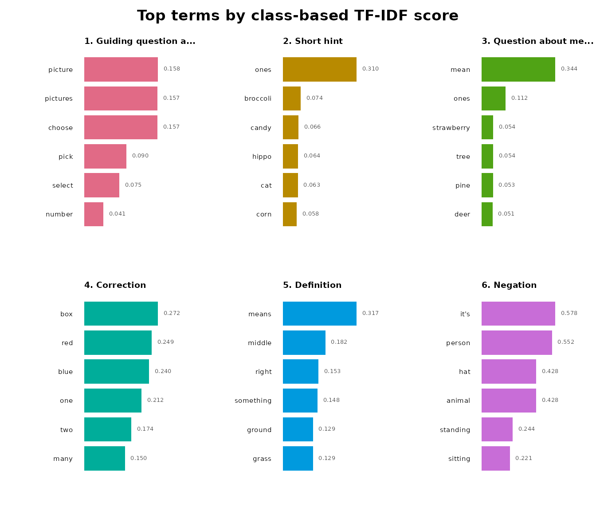
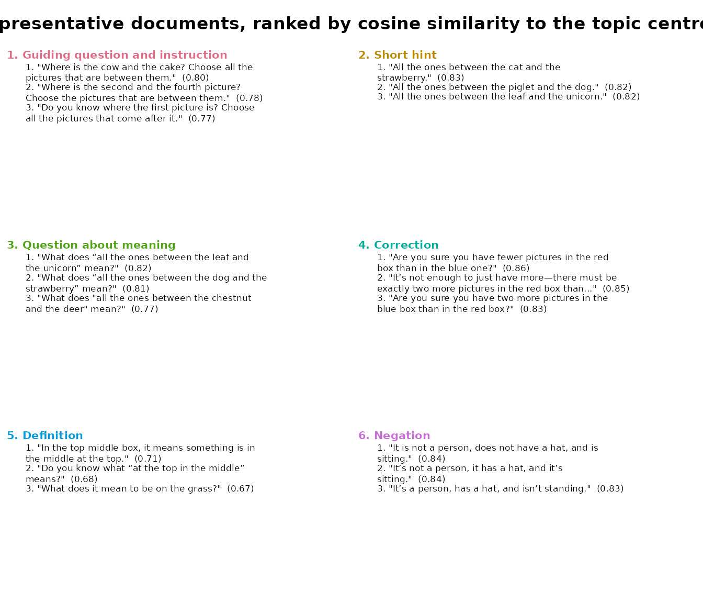
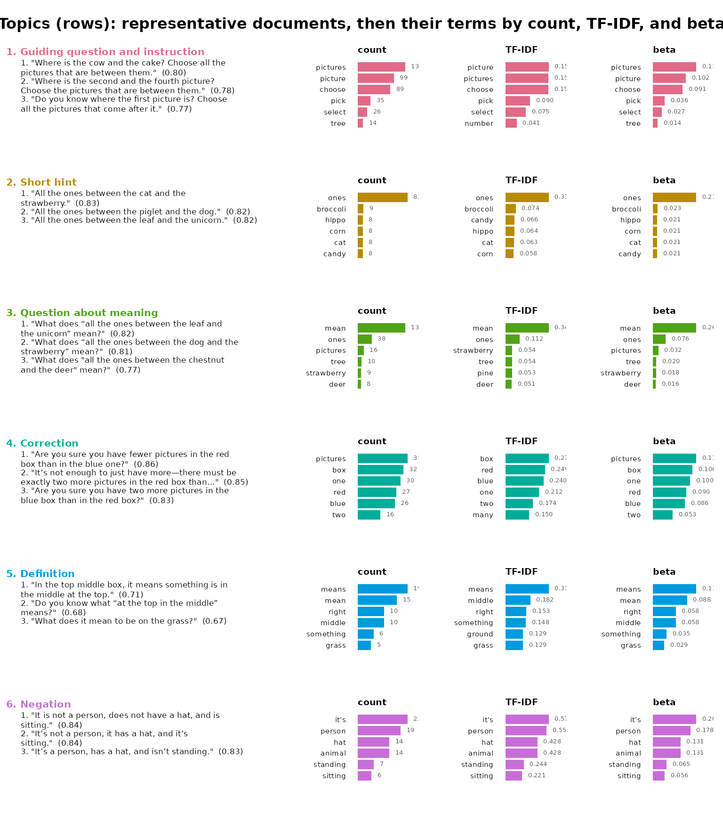

# Describing and naming topics

A semantic topic is a region of an embedding space: a set of texts whose
vectors lie close to a common center. The region itself has no words, so
a topic has to be described before it can be reported, and the
description is an interpretation that should be traceable to evidence.
Two kinds of evidence are available. The texts nearest the center show
what the members of a topic say. The words that are frequent in a topic
and rare in the others show how it is phrased. The first defines the
topic; the second helps to search and summarize it, and can mislead when
it is taken for the definition.

This guide describes the six topics of the feedback model from both
kinds of evidence, shows which settings change the words and that none
of them changes the topics, and names the topics once they have been
read.

``` r

library(sbert)
#> sbert 0.6.0: Sentence-BERT embeddings and topic models in R.
#>   14 pinned models (see models()); default: all-MiniLM-L6-v2.
#>   A model is downloaded only on request, once, and verified by SHA-256.
```

## Data

The model is fitted on the first 600 distinct feedback messages of
`feedback_translations`, with their bundled embeddings, so nothing is
downloaded.

- **`translation`:** the English text of each message; the modeled text.
- **`n`:** the number of times the message occurs in the full corpus.
- **`feedback_embeddings`:** one 384-dimensional `all-MiniLM-L6-v2`
  embedding per message, in the order of `corpus`.

``` r

corpus <- head(dedupe(feedback_translations, column = "translation"), 600)
topic_model <- topics(corpus, n_topics = 6, column = "translation",
                      embeddings = feedback_embeddings)
topic_model
#> <sbert_topic_model>
#>   documents: 600 
#>   topics: 6
#>   model: precomputed embeddings
#>   algorithm: deterministic k-means (Lloyd)
#>   topic sizes: 223, 133, 131, 49, 37, 27
#>   between/total SS: 22.6%
```

The six topics hold 223, 133, 131, 49, 37 and 27 messages. Why six is
discussed in [Choosing the number of topics and the
granularity](https://sonsoles.me/sbert/articles/choosing-topics.md).

## Which texts show what a topic is?

[`representatives()`](https://sonsoles.me/sbert/reference/representatives.md)
returns, for every topic, the messages that best evidence it, ranked in
one of two ways.

- `distance` is the cosine distance from a message to the center of its
  own topic: 0 for a message at the center, larger for one at the edge.
  Ranking by distance (`rank = "distance"`) returns the most typical
  messages.
- `margin` is the distance to the nearest other topic minus the distance
  to the message’s own topic. A large margin means that the message is
  much closer to its own topic than to any other. Ranking by margin
  (`rank = "margin"`, the default) returns the messages that could
  belong to no other topic.

The text column is long, so the tables are printed with
[`knitr::kable()`](https://rdrr.io/pkg/knitr/man/kable.html). The most
typical messages first:

``` r

knitr::kable(representatives(topic_model, n = 3, rank = "distance"),
             digits = 2)
```

| topic | rank | document_id | text | distance | margin |
|---:|---:|---:|:---|---:|---:|
| 1 | 1 | 118 | Where is the cow and the cake? Choose all the pictures that are between them. | 0.20 | 0.28 |
| 1 | 2 | 474 | Where is the second and the fourth picture? Choose the pictures that are between them. | 0.22 | 0.19 |
| 1 | 3 | 368 | Do you know where the first picture is? Choose all the pictures that come after it. | 0.23 | 0.21 |
| 2 | 1 | 277 | All the ones between the cat and the strawberry. | 0.17 | 0.28 |
| 2 | 2 | 237 | All the ones between the piglet and the dog. | 0.18 | 0.30 |
| 2 | 3 | 226 | All the ones between the leaf and the unicorn. | 0.18 | 0.23 |
| 3 | 1 | 227 | What does “all the ones between the leaf and the unicorn” mean? | 0.18 | 0.29 |
| 3 | 2 | 87 | What does “all the ones between the dog and the strawberry” mean? | 0.19 | 0.29 |
| 3 | 3 | 479 | What does “all the ones between the chestnut and the deer” mean? | 0.23 | 0.29 |
| 4 | 1 | 218 | Are you sure you have fewer pictures in the red box than in the blue one? | 0.14 | 0.46 |
| 4 | 2 | 62 | It’s not enough to just have more—there must be exactly two more pictures in the red box than in the blue box. | 0.15 | 0.48 |
| 4 | 3 | 68 | Are you sure you have two more pictures in the blue box than in the red box? | 0.17 | 0.40 |
| 5 | 1 | 364 | In the top middle box, it means something is in the middle at the top. | 0.29 | 0.16 |
| 5 | 2 | 28 | Do you know what “at the top in the middle” means? | 0.32 | 0.15 |
| 5 | 3 | 74 | What does it mean to be on the grass? | 0.33 | 0.23 |
| 6 | 1 | 366 | It is not a person, does not have a hat, and is sitting. | 0.16 | 0.50 |
| 6 | 2 | 31 | It’s not a person, it has a hat, and it’s sitting. | 0.16 | 0.47 |
| 6 | 3 | 18 | It’s a person, has a hat, and isn’t standing. | 0.17 | 0.42 |

The most typical messages lie between 0.14 and 0.33 from their centers,
and they make each topic readable: guiding questions followed by an
instruction (topic 1), short hints (topic 2), questions about the
meaning of a phrase (topic 3), corrections (topic 4), explanations of a
phrase mixed with questions about one (topic 5), and descriptions built
from negations (topic 6).

The same topics ranked by margin:

``` r

knitr::kable(representatives(topic_model, n = 3), digits = 2)
```

| topic | rank | document_id | text | distance | margin |
|---:|---:|---:|:---|---:|---:|
| 1 | 1 | 169 | Where is the cat and the princess? Choose all the pictures that are between them. | 0.23 | 0.30 |
| 1 | 2 | 559 | Where is the cup and the balloon? Select all the pictures that are between them. | 0.29 | 0.29 |
| 1 | 3 | 294 | Where is the leafy tree and the flower? Choose all the pictures that are between them. | 0.26 | 0.29 |
| 2 | 1 | 246 | All the ones between the grape and the tram. | 0.26 | 0.31 |
| 2 | 2 | 202 | All the ones between the fly and the cat. | 0.21 | 0.31 |
| 2 | 3 | 356 | All the ones between the cat and the lettuce. | 0.21 | 0.31 |
| 3 | 1 | 482 | What does “all between the plant and the princess” mean? | 0.25 | 0.32 |
| 3 | 2 | 227 | What does “all the ones between the leaf and the unicorn” mean? | 0.18 | 0.29 |
| 3 | 3 | 358 | What does “everything between the deer and the candy” mean? | 0.24 | 0.29 |
| 4 | 1 | 10 | There should be two fewer in the red one than in the blue one. | 0.18 | 0.55 |
| 4 | 2 | 475 | There should be two fewer in the blue one than in the red one. | 0.18 | 0.55 |
| 4 | 3 | 384 | If there should be fewer in the blue box, then how many should be in the red one? | 0.20 | 0.53 |
| 5 | 1 | 72 | “Sitting” means your bottom is on the ground or on a chair. | 0.44 | 0.29 |
| 5 | 2 | 325 | To be on the grass means to stand or lie down on the soft green ground where grass grows. | 0.50 | 0.28 |
| 5 | 3 | 75 | Being on the grass means something is lying or growing on the soft, green ground. | 0.45 | 0.26 |
| 6 | 1 | 380 | This is not a person, it doesn’t have a hat, and it is standing. | 0.17 | 0.53 |
| 6 | 2 | 166 | If it’s an animal, then it’s not a person. | 0.22 | 0.51 |
| 6 | 3 | 464 | This is not a person, it doesn’t have a hat, and it’s sitting. | 0.17 | 0.51 |

The two rankings agree where a topic is compact and well separated. For
corrections and negations the margins are 0.40 or more in both tables,
the largest of any topic. They disagree where a topic is diffuse. The
most typical explanations of a phrase (topic 5) have margins of 0.15 to
0.23, because they also resemble the questions about meaning of topic 3.
Ranked by margin, topic 5 is represented by definitions such as
*“Sitting” means your bottom is on the ground or on a chair*, which lie
0.44 to 0.50 from the center but cannot be mistaken for a question.
Distance shows the center of a topic; margin shows what separates it
from its neighbors. Reading both is the safer description of a diffuse
topic.

## Which words phrase each topic?

[`terms()`](https://rdrr.io/r/stats/terms.html) lists the words that
distinguish each topic. By default the score is class-based TF-IDF
(c-TF-IDF; Grootendorst, 2022): the messages of a topic are treated as
one document, and a word scores high when it is frequent in that
document and rare across the others. Each row also gives the word’s
`frequency` in the topic and `beta`, its share of the topic’s words.

``` r

terms(topic_model, n = 5)
#>    topic                                                       label       term rank
#> 1      1   Where is the cow and the cake? Choose all the pictures...    picture    1
#> 2      1   Where is the cow and the cake? Choose all the pictures...   pictures    2
#> 3      1   Where is the cow and the cake? Choose all the pictures...     choose    3
#> 4      1   Where is the cow and the cake? Choose all the pictures...       pick    4
#> 5      1   Where is the cow and the cake? Choose all the pictures...     select    5
#> 6      2            All the ones between the cat and the strawberry.       ones    1
#> 7      2            All the ones between the cat and the strawberry.   broccoli    2
#> 8      2            All the ones between the cat and the strawberry.      candy    3
#> 9      2            All the ones between the cat and the strawberry.      hippo    4
#> 10     2            All the ones between the cat and the strawberry.        cat    5
#> 11     3         What does “all the ones between the leaf and the...       mean    1
#> 12     3         What does “all the ones between the leaf and the...       ones    2
#> 13     3         What does “all the ones between the leaf and the... strawberry    3
#> 14     3         What does “all the ones between the leaf and the...       tree    4
#> 15     3         What does “all the ones between the leaf and the...       pine    5
#> 16     4 Are you sure you have fewer pictures in the red box than...        box    1
#> 17     4 Are you sure you have fewer pictures in the red box than...        red    2
#> 18     4 Are you sure you have fewer pictures in the red box than...       blue    3
#> 19     4 Are you sure you have fewer pictures in the red box than...        one    4
#> 20     4 Are you sure you have fewer pictures in the red box than...        two    5
#> 21     5      In the top middle box, it means something is in the...      means    1
#> 22     5      In the top middle box, it means something is in the...     middle    2
#> 23     5      In the top middle box, it means something is in the...      right    3
#> 24     5      In the top middle box, it means something is in the...  something    4
#> 25     5      In the top middle box, it means something is in the...      grass    5
#> 26     6    It is not a person, does not have a hat, and is sitting.       it's    1
#> 27     6    It is not a person, does not have a hat, and is sitting.     person    2
#> 28     6    It is not a person, does not have a hat, and is sitting.     animal    3
#> 29     6    It is not a person, does not have a hat, and is sitting.        hat    4
#> 30     6    It is not a person, does not have a hat, and is sitting.   standing    5
#>     score frequency   beta
#> 1  0.1581        99 0.1017
#> 2  0.1573       130 0.1336
#> 3  0.1571        89 0.0915
#> 4  0.0903        35 0.0360
#> 5  0.0751        26 0.0267
#> 6  0.3096        82 0.2103
#> 7  0.0742         9 0.0231
#> 8  0.0660         8 0.0205
#> 9  0.0638         8 0.0205
#> 10 0.0628         8 0.0205
#> 11 0.3436       130 0.2610
#> 12 0.1124        38 0.0763
#> 13 0.0545         9 0.0181
#> 14 0.0538        10 0.0201
#> 15 0.0526         8 0.0161
#> 16 0.2724        32 0.1063
#> 17 0.2490        27 0.0897
#> 18 0.2398        26 0.0864
#> 19 0.2120        30 0.0997
#> 20 0.1740        16 0.0532
#> 21 0.3165        19 0.1111
#> 22 0.1818        10 0.0585
#> 23 0.1531        10 0.0585
#> 24 0.1485         6 0.0351
#> 25 0.1290         5 0.0292
#> 26 0.5781        22 0.2056
#> 27 0.5521        19 0.1776
#> 28 0.4284        14 0.1308
#> 29 0.4284        14 0.1308
#> 30 0.2440         7 0.0654
```

The words describe what the messages are about, not what they do. The
short hints of topic 2 are described, after *ones*, by names of pictures
(*broccoli*, *candy*, *hippo*) that change from message to message. The
negations of topic 6 are described by *person*, *animal* and *hat*, the
objects being ruled out, not by the negation itself. Topics 2 and 3
share *ones*, although one hints and the other asks.

[`terms()`](https://rdrr.io/r/stats/terms.html) recomputes the words
under other settings without refitting anything. `weighting = "bm25"`
replaces the inverse-frequency part of the score with the BM25 form,
which penalizes words shared by many topics more strongly (Mendonca &
Figueira, 2025):

``` r

terms(topic_model, n = 5, weighting = "bm25")
#>    topic                                                       label       term rank
#> 1      1   Where is the cow and the cake? Choose all the pictures...     choose    1
#> 2      1   Where is the cow and the cake? Choose all the pictures...    picture    2
#> 3      1   Where is the cow and the cake? Choose all the pictures...   pictures    3
#> 4      1   Where is the cow and the cake? Choose all the pictures...       pick    4
#> 5      1   Where is the cow and the cake? Choose all the pictures...     select    5
#> 6      2            All the ones between the cat and the strawberry.       ones    1
#> 7      2            All the ones between the cat and the strawberry.   broccoli    2
#> 8      2            All the ones between the cat and the strawberry.      candy    3
#> 9      2            All the ones between the cat and the strawberry.      hippo    4
#> 10     2            All the ones between the cat and the strawberry.        cat    5
#> 11     3         What does “all the ones between the leaf and the...       mean    1
#> 12     3         What does “all the ones between the leaf and the...       ones    2
#> 13     3         What does “all the ones between the leaf and the... strawberry    3
#> 14     3         What does “all the ones between the leaf and the...       tree    4
#> 15     3         What does “all the ones between the leaf and the...       pine    5
#> 16     4 Are you sure you have fewer pictures in the red box than...        box    1
#> 17     4 Are you sure you have fewer pictures in the red box than...        red    2
#> 18     4 Are you sure you have fewer pictures in the red box than...       blue    3
#> 19     4 Are you sure you have fewer pictures in the red box than...        one    4
#> 20     4 Are you sure you have fewer pictures in the red box than...        two    5
#> 21     5      In the top middle box, it means something is in the...      means    1
#> 22     5      In the top middle box, it means something is in the...     middle    2
#> 23     5      In the top middle box, it means something is in the...      right    3
#> 24     5      In the top middle box, it means something is in the...  something    4
#> 25     5      In the top middle box, it means something is in the...      grass    5
#> 26     6    It is not a person, does not have a hat, and is sitting.       it's    1
#> 27     6    It is not a person, does not have a hat, and is sitting.     person    2
#> 28     6    It is not a person, does not have a hat, and is sitting.     animal    3
#> 29     6    It is not a person, does not have a hat, and is sitting.        hat    4
#> 30     6    It is not a person, does not have a hat, and is sitting.   standing    5
#>     score frequency   beta
#> 1  0.1387        89 0.0915
#> 2  0.1337        99 0.1017
#> 3  0.1081       130 0.1336
#> 4  0.0868        35 0.0360
#> 5  0.0730        26 0.0267
#> 6  0.2545        82 0.2103
#> 7  0.0727         9 0.0231
#> 8  0.0646         8 0.0205
#> 9  0.0624         8 0.0205
#> 10 0.0613         8 0.0205
#> 11 0.2619       130 0.2610
#> 12 0.0924        38 0.0763
#> 13 0.0532         9 0.0181
#> 14 0.0521        10 0.0201
#> 15 0.0515         8 0.0161
#> 16 0.2625        32 0.1063
#> 17 0.2419        27 0.0897
#> 18 0.2329        26 0.0864
#> 19 0.1987        30 0.0997
#> 20 0.1705        16 0.0532
#> 21 0.3080        19 0.1111
#> 22 0.1778        10 0.0585
#> 23 0.1479        10 0.0585
#> 24 0.1452         6 0.0351
#> 25 0.1259         5 0.0292
#> 26 0.5620        22 0.2056
#> 27 0.5398        19 0.1776
#> 28 0.4196        14 0.1308
#> 29 0.4196        14 0.1308
#> 30 0.2394         7 0.0654
```

`reduce_frequent_words = TRUE` takes the square root of the within-topic
frequencies before weighting, which keeps a word that a topic repeats
many times from dominating its list:

``` r

terms(topic_model, n = 3, reduce_frequent_words = TRUE)
#>    topic                                                       label      term rank score
#> 1      1   Where is the cow and the cake? Choose all the pictures...    choose    1 0.519
#> 2      1   Where is the cow and the cake? Choose all the pictures...   picture    2 0.496
#> 3      1   Where is the cow and the cake? Choose all the pictures...      pick    3 0.476
#> 4      2            All the ones between the cat and the strawberry.      ones    1 0.675
#> 5      2            All the ones between the cat and the strawberry.  broccoli    2 0.489
#> 6      2            All the ones between the cat and the strawberry.     candy    3 0.461
#> 7      3         What does “all the ones between the leaf and the...      mean    1 0.672
#> 8      3         What does “all the ones between the leaf and the...      pine    2 0.415
#> 9      3         What does “all the ones between the leaf and the...      ones    3 0.407
#> 10     4 Are you sure you have fewer pictures in the red box than...       box    1 0.835
#> 11     4 Are you sure you have fewer pictures in the red box than...       red    2 0.832
#> 12     4 Are you sure you have fewer pictures in the red box than...      blue    3 0.816
#> 13     5      In the top middle box, it means something is in the...     means    1 0.950
#> 14     5      In the top middle box, it means something is in the... something    2 0.793
#> 15     5      In the top middle box, it means something is in the...     grass    3 0.754
#> 16     6    It is not a person, does not have a hat, and is sitting.    person    1 1.310
#> 17     6    It is not a person, does not have a hat, and is sitting.      it's    2 1.275
#> 18     6    It is not a person, does not have a hat, and is sitting.    animal    3 1.184
#>    frequency   beta
#> 1         89 0.0915
#> 2         99 0.1017
#> 3         35 0.0360
#> 4         82 0.2103
#> 5          9 0.0231
#> 6          8 0.0205
#> 7        130 0.2610
#> 8          8 0.0161
#> 9         38 0.0763
#> 10        32 0.1063
#> 11        27 0.0897
#> 12        26 0.0864
#> 13        19 0.1111
#> 14         6 0.0351
#> 15         5 0.0292
#> 16        19 0.1776
#> 17        22 0.2056
#> 18        14 0.1308
```

With either setting the near-ties at the top of topic 1 (*picture*,
*pictures*, *choose*) are reordered, and *choose* now leads topic 1.
`sort_by = "beta"` ranks by the share of the topic instead of by
distinctiveness, which lists the words a topic uses most even when other
topics use them too:

``` r

terms(topic_model, n = 3, sort_by = "beta")
#>    topic                                                       label     term rank  score
#> 1      1   Where is the cow and the cake? Choose all the pictures... pictures    1 0.1573
#> 2      1   Where is the cow and the cake? Choose all the pictures...  picture    2 0.1581
#> 3      1   Where is the cow and the cake? Choose all the pictures...   choose    3 0.1571
#> 4      2            All the ones between the cat and the strawberry.     ones    1 0.3096
#> 5      2            All the ones between the cat and the strawberry. broccoli    2 0.0742
#> 6      2            All the ones between the cat and the strawberry.    candy    3 0.0660
#> 7      3         What does “all the ones between the leaf and the...     mean    1 0.3436
#> 8      3         What does “all the ones between the leaf and the...     ones    2 0.1124
#> 9      3         What does “all the ones between the leaf and the... pictures    3 0.0378
#> 10     4 Are you sure you have fewer pictures in the red box than... pictures    1 0.1369
#> 11     4 Are you sure you have fewer pictures in the red box than...      box    2 0.2724
#> 12     4 Are you sure you have fewer pictures in the red box than...      one    3 0.2120
#> 13     5      In the top middle box, it means something is in the...    means    1 0.3165
#> 14     5      In the top middle box, it means something is in the...     mean    2 0.1155
#> 15     5      In the top middle box, it means something is in the...   middle    3 0.1818
#> 16     6    It is not a person, does not have a hat, and is sitting.     it's    1 0.5781
#> 17     6    It is not a person, does not have a hat, and is sitting.   person    2 0.5521
#> 18     6    It is not a person, does not have a hat, and is sitting.   animal    3 0.4284
#>    frequency   beta
#> 1        130 0.1336
#> 2         99 0.1017
#> 3         89 0.0915
#> 4         82 0.2103
#> 5          9 0.0231
#> 6          8 0.0205
#> 7        130 0.2610
#> 8         38 0.0763
#> 9         16 0.0321
#> 10        35 0.1163
#> 11        32 0.1063
#> 12        30 0.0997
#> 13        19 0.1111
#> 14        15 0.0877
#> 15        10 0.0585
#> 16        22 0.2056
#> 17        19 0.1776
#> 18        14 0.1308
```

## Which words should be left out?

Function words are removed with a stop-word list.
[`stop_words()`](https://sonsoles.me/sbert/reference/stop_words.md)
returns the default English list, and `add` extends it with words that
carry no meaning in a particular corpus. In these messages *ones*,
*picture* and *pictures* occur across the exercises and tell little
about a topic:

``` r

length(stop_words())
#> [1] 125
feedback_stop_words <- stop_words(add = c("ones", "picture", "pictures"))
terms(topic_model, n = 3, stop_words = feedback_stop_words)
#>    topic                                                       label       term rank
#> 1      1   Where is the cow and the cake? Choose all the pictures...     choose    1
#> 2      1   Where is the cow and the cake? Choose all the pictures...       pick    2
#> 3      1   Where is the cow and the cake? Choose all the pictures...     select    3
#> 4      2            All the ones between the cat and the strawberry.   broccoli    1
#> 5      2            All the ones between the cat and the strawberry.      candy    2
#> 6      2            All the ones between the cat and the strawberry.      hippo    3
#> 7      3         What does “all the ones between the leaf and the...       mean    1
#> 8      3         What does “all the ones between the leaf and the... strawberry    2
#> 9      3         What does “all the ones between the leaf and the...       tree    3
#> 10     4 Are you sure you have fewer pictures in the red box than...        box    1
#> 11     4 Are you sure you have fewer pictures in the red box than...        red    2
#> 12     4 Are you sure you have fewer pictures in the red box than...       blue    3
#> 13     5      In the top middle box, it means something is in the...      means    1
#> 14     5      In the top middle box, it means something is in the...     middle    2
#> 15     5      In the top middle box, it means something is in the...      right    3
#> 16     6    It is not a person, does not have a hat, and is sitting.       it's    1
#> 17     6    It is not a person, does not have a hat, and is sitting.     person    2
#> 18     6    It is not a person, does not have a hat, and is sitting.     animal    3
#>     score frequency   beta
#> 1  0.1876        89 0.1196
#> 2  0.1101        35 0.0470
#> 3  0.0922        26 0.0349
#> 4  0.0888         9 0.0292
#> 5  0.0789         8 0.0260
#> 6  0.0762         8 0.0260
#> 7  0.3500       130 0.2955
#> 8  0.0581         9 0.0205
#> 9  0.0570        10 0.0227
#> 10 0.2945        32 0.1231
#> 11 0.2705        27 0.1038
#> 12 0.2605        26 0.1000
#> 13 0.2991        19 0.1118
#> 14 0.1726        10 0.0588
#> 15 0.1440        10 0.0588
#> 16 0.5427        22 0.2056
#> 17 0.5209        19 0.1776
#> 18 0.4052        14 0.1308
```

Without them, topic 1 is described by the verbs of its instructions
(*choose*, *pick*, *select*) and topic 2 by its picture names alone.

`stem = TRUE` merges inflected forms under one Porter stem, so *picture*
and *pictures* count as one word. It needs the SnowballC package:

``` r

terms(topic_model, n = 3, stem = TRUE)
#>    topic                                                       label       term rank
#> 1      1   Where is the cow and the cake? Choose all the pictures...   pictures    1
#> 2      1   Where is the cow and the cake? Choose all the pictures...     choose    2
#> 3      1   Where is the cow and the cake? Choose all the pictures...       pick    3
#> 4      2            All the ones between the cat and the strawberry.       ones    1
#> 5      2            All the ones between the cat and the strawberry.   broccoli    2
#> 6      2            All the ones between the cat and the strawberry.      candy    3
#> 7      3         What does “all the ones between the leaf and the...       mean    1
#> 8      3         What does “all the ones between the leaf and the...       ones    2
#> 9      3         What does “all the ones between the leaf and the... strawberry    3
#> 10     4 Are you sure you have fewer pictures in the red box than...        box    1
#> 11     4 Are you sure you have fewer pictures in the red box than...        red    2
#> 12     4 Are you sure you have fewer pictures in the red box than...       blue    3
#> 13     5      In the top middle box, it means something is in the...       mean    1
#> 14     5      In the top middle box, it means something is in the...     middle    2
#> 15     5      In the top middle box, it means something is in the...      right    3
#> 16     6    It is not a person, does not have a hat, and is sitting.       it's    1
#> 17     6    It is not a person, does not have a hat, and is sitting.     person    2
#> 18     6    It is not a person, does not have a hat, and is sitting.        hat    3
#>     score frequency   beta
#> 1  0.2063       229 0.2354
#> 2  0.1571        89 0.0915
#> 3  0.0903        35 0.0360
#> 4  0.2732        89 0.2282
#> 5  0.0742         9 0.0231
#> 6  0.0660         8 0.0205
#> 7  0.3170       131 0.2631
#> 8  0.1034        43 0.0863
#> 9  0.0545         9 0.0181
#> 10 0.2834        34 0.1130
#> 11 0.2490        27 0.0897
#> 12 0.2398        26 0.0864
#> 13 0.2396        34 0.1988
#> 14 0.1818        10 0.0585
#> 15 0.1531        10 0.0585
#> 16 0.5781        22 0.2056
#> 17 0.5521        19 0.1776
#> 18 0.4284        14 0.1308
```

Numbers and Roman numerals are filtered with `numbers = "remove"` and
`roman_numerals = "remove"`, and section numbering with
`section_numbers = "remove"`. The feedback messages contain no digits:

``` r

with(corpus, sum(grepl("[0-9]", translation)))
#> [1] 0
```

A small example with four invented reports shows the effect. The
embeddings are two-dimensional and made up, and serve only to put the
first two and the last two reports in different topics:

``` r

reports <- c("Enrolment fell in 2020 and 2021.",
             "Enrolment fell again in 2021, phase II.",
             "Schools reopened in 2022 after closures.",
             "Schools reopened and enrolment rose in 2022, phase III.")
toy_embeddings <- rbind(c(1, 0), c(0.9, 0.1), c(0, 1), c(0.1, 0.9))
toy_model <- topics(reports, n_topics = 2, embeddings = toy_embeddings)
terms(toy_model, n = 4)
#>   topic                                    label      term rank score frequency   beta
#> 1     1         Enrolment fell in 2020 and 2021.      2021    1 0.398         2 0.2222
#> 2     1         Enrolment fell in 2020 and 2021.      fell    2 0.398         2 0.2222
#> 3     1         Enrolment fell in 2020 and 2021. enrolment    3 0.326         2 0.2222
#> 4     1         Enrolment fell in 2020 and 2021.      2020    4 0.266         1 0.1111
#> 5     2 Schools reopened in 2022 after closures.      2022    1 0.326         2 0.1818
#> 6     2 Schools reopened in 2022 after closures.  reopened    2 0.326         2 0.1818
#> 7     2 Schools reopened in 2022 after closures.   schools    3 0.326         2 0.1818
#> 8     2 Schools reopened in 2022 after closures.  closures    4 0.218         1 0.0909
terms(toy_model, n = 4, numbers = "remove", roman_numerals = "remove")
#>   topic                                    label      term rank score frequency  beta
#> 1     1         Enrolment fell in 2020 and 2021.      fell    1 0.579         2 0.400
#> 2     1         Enrolment fell in 2020 and 2021. enrolment    2 0.461         2 0.400
#> 3     1         Enrolment fell in 2020 and 2021.     phase    3 0.289         1 0.200
#> 4     2 Schools reopened in 2022 after closures.  reopened    1 0.362         2 0.250
#> 5     2 Schools reopened in 2022 after closures.   schools    2 0.362         2 0.250
#> 6     2 Schools reopened in 2022 after closures.  closures    3 0.252         1 0.125
#> 7     2 Schools reopened in 2022 after closures.      rose    4 0.252         1 0.125
```

With the default settings the years lead both topics’ lists; removed,
the words that describe the events (*reopened*, *fell*) move up. These
filters apply to the terms only. The text and the embeddings are
untouched; to clean the text itself before encoding, see [Preparing and
cleaning a
corpus](https://sonsoles.me/sbert/articles/preparing-corpus.md).

## Do the term settings change the topics?

They do not. The topics are formed from the embeddings, and the terms
are computed afterwards from the topic assignments and the text. Fitting
the model again with BM25 weighting and the extended stop words, and
cross-tabulating the topic of every message under the two fits, shows
the same partition:

``` r

retuned <- topics(corpus, n_topics = 6, column = "translation",
                  embeddings = feedback_embeddings, weighting = "bm25",
                  stop_words = feedback_stop_words)
assignments <- merge(as.data.frame(topic_model), as.data.frame(retuned),
                     by = "document_id", suffixes = c("_default", "_retuned"))
with(assignments, table(topic_default, topic_retuned))
#>              topic_retuned
#> topic_default   1   2   3   4   5   6
#>             1 223   0   0   0   0   0
#>             2   0 133   0   0   0   0
#>             3   0   0 131   0   0   0
#>             4   0   0   0  49   0   0
#>             5   0   0   0   0  37   0
#>             6   0   0   0   0   0  27
```

Every message keeps its topic: the table is diagonal, with 223, 133,
131, 49, 37 and 27 messages. The term settings change how a topic is
worded, never which messages it holds, so they can be tuned for
readability without reopening the analysis. Fitting with them, rather
than calling [`terms()`](https://rdrr.io/r/stats/terms.html), also
changes the terms stored in the model, which the plots and
`label = "terms"` use.

## How should the topics be labeled?

By default [`topics()`](https://sonsoles.me/sbert/reference/topics.md)
labels each topic with its most central message, cut at 60 characters.
`label = "terms"` labels each topic by its three top terms instead:

``` r

term_labeled <- topics(corpus, n_topics = 6, column = "translation",
                       embeddings = feedback_embeddings, label = "terms")
topic_sizes(term_labeled)
#>   topic                       label n_documents proportion
#> 1     1 picture / pictures / choose         223     0.3717
#> 2     2     ones / broccoli / candy         133     0.2217
#> 3     3    mean / ones / strawberry         131     0.2183
#> 4     4            box / red / blue          49     0.0817
#> 5     5      means / middle / right          37     0.0617
#> 6     6      it's / person / animal          27     0.0450
```

Term labels are compact but repeat the weakness of the terms: the labels
of topics 2 and 3 both contain *ones*, and topic 6 is labeled by the
objects it mentions. A message label shows a real member of the topic.

[`keywords()`](https://sonsoles.me/sbert/reference/keywords.md) extracts
keywords from single documents (the KeyBERT design: candidate words and
phrases are ranked by the cosine similarity of their embeddings to the
document’s embedding, then selected by maximal marginal relevance;
Carbonell & Goldstein, 1998). It encodes every candidate, so it needs a
downloaded model and is not run here:

``` r

model_download()
keywords("Where is the cow and the cake? Choose all the pictures that are between them.",
         n = 5, ngrams = 2)
```

Once the representatives have been read,
[`name_topics()`](https://sonsoles.me/sbert/reference/name_topics.md)
gives the topics names that state what they are, one per topic in topic
order. The names replace the labels in every table and plot; nothing is
refitted.

``` r

topic_model <- name_topics(topic_model, c(
  "Guiding question and instruction", "Short hint",
  "Question about meaning", "Correction", "Definition", "Negation"
))
topic_sizes(topic_model)
#>   topic                            label n_documents proportion
#> 1     1 Guiding question and instruction         223     0.3717
#> 2     2                       Short hint         133     0.2217
#> 3     3           Question about meaning         131     0.2183
#> 4     4                       Correction          49     0.0817
#> 5     5                       Definition          37     0.0617
#> 6     6                         Negation          27     0.0450
```

## How coherent are the descriptions?

[`summary()`](https://rdrr.io/r/base/summary.html) reports the size of
every topic and the coherence of its top ten terms, measured as
normalized pointwise mutual information (NPMI; Bouma, 2009): whether the
words that describe a topic occur together in its messages, from -1 to
1.

``` r

summary(topic_model)
#> Semantic topic model summary
#>   documents:            600
#>   topics:               6
#>   model:                precomputed embeddings
#>   between/total SS:     22.6%
#>   mean npmi  coherence:  -0.1044
#>   topic diversity:      0.917 (top 10 terms)
#> 
#>  topic                            label n_documents proportion coherence
#>      1 Guiding question and instruction         223    0.37167   -0.2368
#>      2                       Short hint         133    0.22167   -0.4150
#>      3           Question about meaning         131    0.21833   -0.2564
#>      4                       Correction          49    0.08167    0.3011
#>      5                       Definition          37    0.06167   -0.2043
#>      6                         Negation          27    0.04500    0.1849
```

Coherence is highest for the corrections (0.301), whose messages repeat
*box*, *red* and *blue*, and lowest for the short hints (-0.415), whose
picture names rarely occur together. Low coherence here does not mean a
poor topic: the hints are a clear kind of feedback whose words vary by
design. Coherence evaluates the description, not the topic.
[`coherence()`](https://sonsoles.me/sbert/reference/coherence.md)
returns the scores as a table. `measure = "umass"` gives UMass coherence
instead (Mimno et al., 2011), a log ratio of co-occurrence counts that
is usually negative and is read the same way, higher being more
coherent:

``` r

coherence(topic_model, measure = "umass")
#>   topic                            label measure n_terms coherence
#> 1     1 Guiding question and instruction   umass      10     -2.75
#> 2     2                       Short hint   umass      10     -2.66
#> 3     3           Question about meaning   umass      10     -2.67
#> 4     4                       Correction   umass      10     -1.45
#> 5     5                       Definition   umass      10     -1.90
#> 6     6                         Negation   umass      10     -1.48
```

## How are topics shown in figures?

`type = "terms"` draws the top terms of every topic as bars:

``` r

plot(topic_model, type = "terms", n_terms = 6)
```



`type = "representatives"` draws the representative messages, with their
similarity to the center in parentheses:

``` r

plot(topic_model, type = "representatives", n_representatives = 3)
```



`type = "fit"` combines both, one row per topic, and is the figure to
report:

``` r

plot(topic_model, type = "fit", n_terms = 6, n_representatives = 3)
```



## When to use which

| Question | Verb |
|----|----|
| What does a topic say? | `representatives(rank = "distance")` |
| What separates it from its neighbors? | `representatives(rank = "margin")` |
| How is it worded? | [`terms()`](https://rdrr.io/r/stats/terms.html), `terms(weighting = "bm25")`, `terms(sort_by = "beta")` |
| Which words to drop? | `stop_words(add = )`, `numbers = "remove"`, `stem = TRUE` |
| Keywords of one document | [`keywords()`](https://sonsoles.me/sbert/reference/keywords.md) (needs a model) |
| Give the topics names | [`name_topics()`](https://sonsoles.me/sbert/reference/name_topics.md), or `topics(label = "terms")` |
| How coherent are the words? | [`summary()`](https://rdrr.io/r/base/summary.html), [`coherence()`](https://sonsoles.me/sbert/reference/coherence.md) |
| Figures | `plot(type = "terms" / "representatives" / "fit")` |
| Every table | `as.data.frame(topic_model, what = "terms" / "representatives")` |

New messages are assigned to the named topics in [Assigning new
documents and topic
mixtures](https://sonsoles.me/sbert/articles/assigning-topics.md), and
the complete analysis of the feedback corpus is in [Semantic topic
modeling with
Sentence-BERT](https://sonsoles.me/sbert/articles/sbert.md).

## References

Bouma, G. (2009). Normalized (pointwise) mutual information in
collocation extraction. *Proceedings of GSCL*, 31–40.

Carbonell, J., & Goldstein, J. (1998). The use of MMR, diversity-based
reranking for reordering documents and producing summaries. *Proceedings
of SIGIR 1998*, 335–336. <https://doi.org/10.1145/290941.291025>

Grootendorst, M. (2022). BERTopic: Neural topic modeling with a
class-based TF-IDF procedure. arXiv:2203.05794.

Mendonca, M., & Figueira, A. (2025). Modeling political discourse with
Sentence-BERT and BERTopic. arXiv:2510.22904.

Mimno, D., Wallach, H. M., Talley, E., Leenders, M., & McCallum, A.
(2011). Optimizing semantic coherence in topic models. *Proceedings of
EMNLP 2011*, 262–272.
