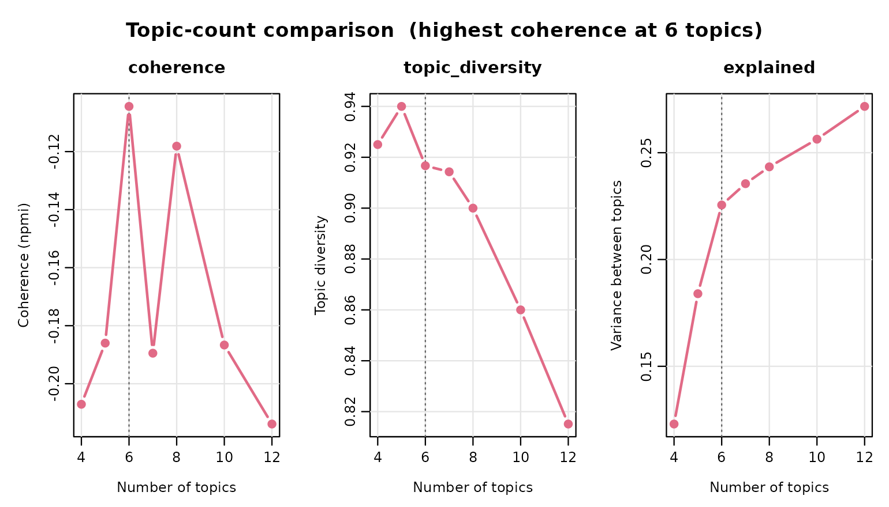
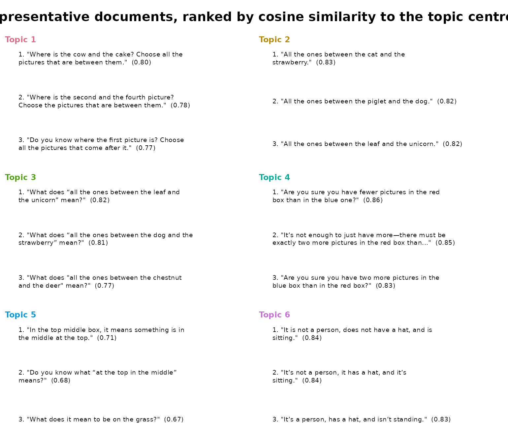
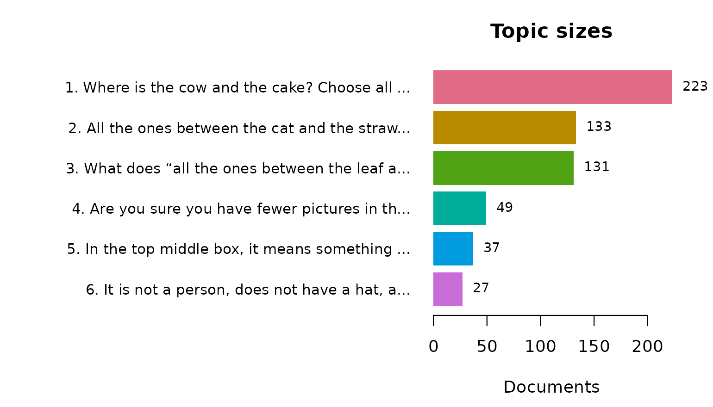
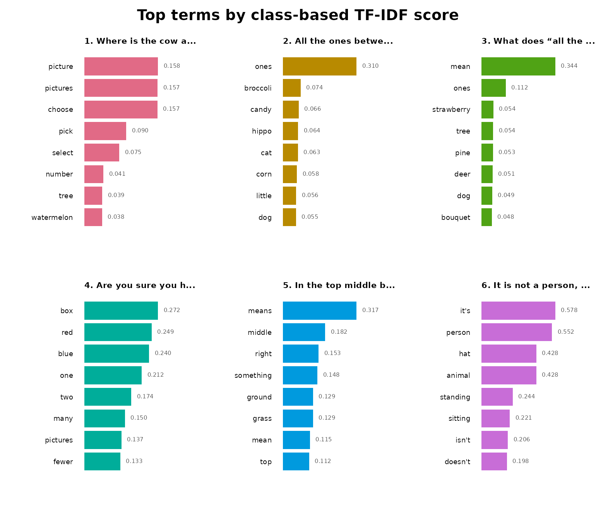
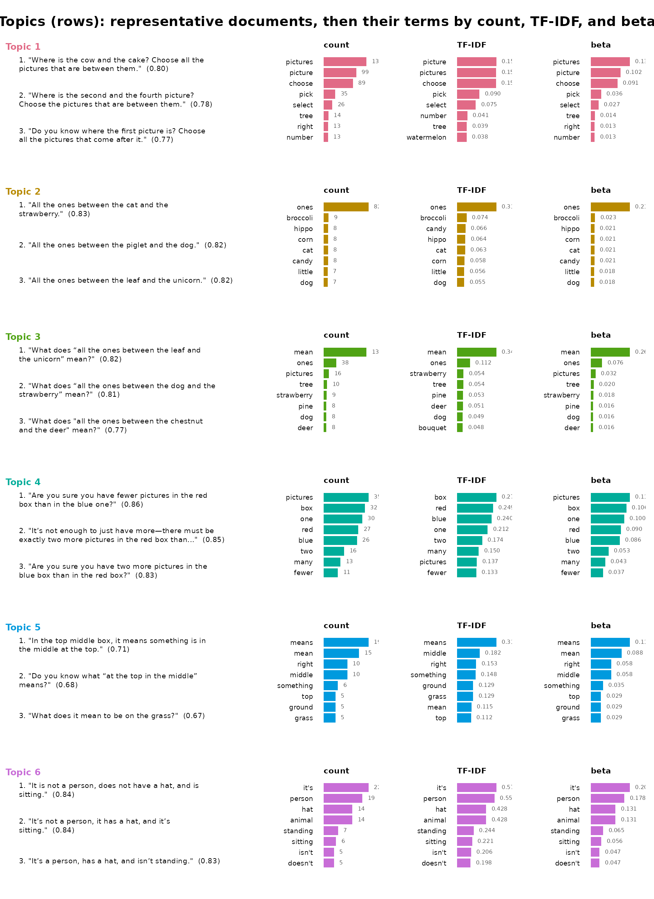

# Topic Modeling Short Feedback Messages

**sbert** computes Sentence-BERT embeddings in R, without Python.
Sentence-BERT (Reimers and Gurevych, 2019) is a family of neural models
that turn a whole sentence or short text into an embedding: a vector of
numbers in which texts with similar meaning lie close together, even
when they share few words. **sbert** downloads a pinned, hash-verified
model, tokenizes text with the model’s own Hugging Face tokenizer, runs
the model through ONNX Runtime, and pools and normalizes the result in
base R. On top of the embeddings it fits topic models: texts whose
embeddings are close are grouped into a topic, so a topic is defined by
what its texts mean rather than by the words they share.

The `feedback_translations` dataset included in the `sbert` package
comprises 8,757 AI-generated feedback messages originating from a
mathematics learning application and translated into English from ten
source languages. Given the size of the corpus and the substantial
repetition among messages, manual inspection is impractical. Moreover,
conventional frequency-based analyses provide limited insight into the
underlying content, as they primarily capture recurring linguistic
templates rather than the semantic structure of the feedback. For
example, the most frequent message, “Try again.”, occurs 11 times. Topic
modeling offers a systematic approach to identifying the principal types
of feedback generated by the application and quantifying their relative
prevalence.

To ensure methodological transparency and reproducibility, all
analytical procedures are designed to be deterministic, such that
repeated execution of the document yields identical numerical results,
visualizations, and textual outputs under the specified computational
environment.

The analysis proceeds in three stages, beginning with data-driven
topic-number selection, followed by the construction of a six-topic
model and a systematic evaluation of its results from three
complementary perspectives:

1.  **Model quality assessment.** Topic coherence and topic diversity
    are evaluated to assess the semantic interpretability and
    distinctiveness of the identified topics prior to substantive
    interpretation.
2.  **Comparative keyword analysis.** Two complementary keyword
    representations are examined for each topic: raw within-topic term
    frequencies, which identify the most prevalent vocabulary, and
    class-based term frequency–inverse class frequency (c-TF-IDF), which
    identifies terms that are particularly distinctive of a given topic
    relative to the remaining corpus. Comparing these representations
    makes it possible to distinguish generally frequent expressions from
    vocabulary that is specifically characteristic of individual topics.
    Differences between the two rankings are also considered
    analytically informative.
3.  **Representative message analysis.** For each topic, representative
    messages are selected according to their proximity to the
    corresponding topic centroid in the embedding space. These examples
    provide interpretable, document-level evidence for the semantic
    characterization of each topic and enable the proposed topic labels
    to be evaluated against the original feedback content.

Together, these procedures provide a reproducible and interpretable
characterization of the feedback generated by the application, combining
quantitative measures of model quality with lexical evidence and
representative textual examples.

The vignette builds offline. The embeddings of the 600 messages used
here are stored in the package, so no model is downloaded while it is
built. When you run the code yourself, the model is downloaded once
(about 90 MB) and you get the same results.

## The data

Many messages repeat word for word. “Try again.” alone occurs 11 times.
[`dedupe()`](https://sonsoles.me/sbert/reference/dedupe.md) keeps one
copy of each distinct message and records in `n` how often it occurred.
To keep the vignette fast we use the first 600 distinct messages; remove
[`head()`](https://rdrr.io/r/utils/head.html) to model all of them.

``` r

corpus <- head(dedupe(feedback_translations$translation), 600)
head(corpus)
#>                                                                        text n
#> 1                                        Do you know what “one more” means? 2
#> 2                     There should be two more in the red than in the blue. 3
#> 3                                   If it’s not a person, what could it be? 2
#> 4                            What does “everyone after the first one” mean? 1
#> 5 There are five pictures in the gray box. Where is there one picture less? 2
#> 6                                            How do the pictures alternate? 1
```

## The sentence model

[`models()`](https://sonsoles.me/sbert/reference/models.md) lists the 14
models that **sbert** can download. Each is pinned to one fixed version
and checked against a SHA-256 hash when it is downloaded.

``` r

models()
#>                                    model dimensions max_tokens      languages
#> 1                       all-MiniLM-L6-v2        384        256        English
#> 2                      all-MiniLM-L12-v2        384        128        English
#> 3                paraphrase-MiniLM-L3-v2        384        128        English
#> 4              multi-qa-MiniLM-L6-cos-v1        384        512        English
#> 5  paraphrase-multilingual-MiniLM-L12-v2        384        128  50+ languages
#> 6                      all-mpnet-base-v2        768        384        English
#> 7  paraphrase-multilingual-mpnet-base-v2        768        128  50+ languages
#> 8                      bge-small-en-v1.5        384        512        English
#> 9                       bge-base-en-v1.5        768        512        English
#> 10                 multilingual-e5-small        384        512 100+ languages
#> 11                 nomic-embed-text-v1.5        768       8192        English
#> 12           jina-embeddings-v2-small-en        512       8192        English
#> 13                  mxbai-embed-large-v1       1024        512        English
#> 14                        potion-base-8M        256    1000000        English
#>    size_mb
#> 1     90.9
#> 2    133.6
#> 3     69.5
#> 4     90.9
#> 5    479.4
#> 6    436.3
#> 7   1119.2
#> 8    133.8
#> 9    436.5
#> 10   487.4
#> 11   548.0
#> 12   130.5
#> 13  1337.6
#> 14    30.9
```

The default, `all-MiniLM-L6-v2`, is a small English sentence model that
turns a text of up to 256 tokens into 384 numbers. Download it once:

``` r

model_download()
```

[`topics()`](https://sonsoles.me/sbert/reference/topics.md) and
[`compare_topics()`](https://sonsoles.me/sbert/reference/compare_topics.md)
call [`encode()`](https://sonsoles.me/sbert/reference/encode.md) for
you, so the embeddings never have to be handled by hand.

## Choosing the number of topics

There is no correct number of topics.
[`compare_topics()`](https://sonsoles.me/sbert/reference/compare_topics.md)
fits one model for each candidate count and reports three measures for
each:

- `explained`: the share of the variation in the embeddings that the
  topics capture. It grows with every added topic, so it cannot choose
  the count on its own.
- `coherence`: whether each topic’s top words appear together in the
  same messages (NPMI, from −1 to 1; higher is better).
- `topic_diversity`: the number of distinct words in the topics’ top-10
  lists, divided by the length of all the lists together. It is 1 when
  no two topics share a top word.

Only `explained` is computed from the embeddings. Coherence and
diversity are computed from words, so they are a rough guide. The real
test of a count is whether each topic’s messages say the same thing,
which the next sections check.

``` r

sweep <- compare_topics(
  corpus,
  column = "text",
  n_topics = c(4, 5, 6, 7, 8, 10, 12)
)
sweep
```

    #> <sbert_topic_sweep> 7 candidates, coherence measure: npmi
    #>  n_topics  coherence topic_diversity explained
    #>         4 -0.2070855       0.9250000 0.1229819
    #>         5 -0.1860037       0.9400000 0.1839887
    #>         6 -0.1044246       0.9166667 0.2255144
    #>         7 -0.1894843       0.9142857 0.2355033
    #>         8 -0.1181287       0.9000000 0.2433832
    #>        10 -0.1866628       0.8600000 0.2563262
    #>        12 -0.2138928       0.8151261 0.2716759
    #> 
    #> Fitted models retained: fitted(x, n_topics = 6)

``` r

plot(sweep)
```



Coherence is negative at every count, because the messages are short and
two words rarely occur in the same message. It is highest at six topics
(−0.10), with eight close behind (−0.12). We use six.
[`fitted()`](https://rdrr.io/r/stats/fitted.values.html) returns the
six-topic model that
[`compare_topics()`](https://sonsoles.me/sbert/reference/compare_topics.md)
already fitted, so nothing is refitted:

``` r

topic_model <- fitted(sweep, n_topics = 6)
topic_model
#> <sbert_topic_model>
#>   documents: 600 
#>   topics: 6
#>   model: precomputed embeddings
#>   algorithm: deterministic k-means (Lloyd)
#>   topic sizes: 223, 133, 131, 49, 37, 27
#>   between/total SS: 22.6%
```

## The topics

[`topic_sizes()`](https://sonsoles.me/sbert/reference/topic_sizes.md)
lists the topics. The `label` of each topic is the message closest to
the topic’s center, cut at 60 characters, and `n_documents` counts its
messages:

``` r

topic_sizes(topic_model)
#>   topic                                                       label n_documents
#> 1     1   Where is the cow and the cake? Choose all the pictures...         223
#> 2     2            All the ones between the cat and the strawberry.         133
#> 3     3         What does “all the ones between the leaf and the...         131
#> 4     4 Are you sure you have fewer pictures in the red box than...          49
#> 5     5      In the top middle box, it means something is in the...          37
#> 6     6    It is not a person, does not have a hat, and is sitting.          27
#>   proportion
#> 1 0.37166667
#> 2 0.22166667
#> 3 0.21833333
#> 4 0.08166667
#> 5 0.06166667
#> 6 0.04500000
```

Reading the label and the messages of each topic shows that the topics
are not subjects but kinds of feedback: what the message does for the
learner.

1.  **Guiding question and instruction.** A question that makes the
    learner find something, followed by an order to act on it: *Where is
    the cow and the cake? Choose all the pictures that are between
    them.*
2.  **Short hint.** A fragment with no verb that restates the target:
    *All the ones between the cat and the strawberry.*
3.  **Question about meaning.** A question that asks the learner what a
    phrase means: *What does “all the ones between the leaf and the
    unicorn” mean?*
4.  **Correction.** A statement of what should be true, or a question
    that makes the learner check their answer: *There should be two
    fewer in the red one than in the blue one.* *Are you sure you have
    fewer pictures in the red box than in the blue one?*
5.  **Definition.** An explanation of what a word or phrase means:
    *“Sitting” means your bottom is on the ground or on a chair.*
6.  **Negation.** A description built from what something is not, used
    to rule out answers: *It is not a person, does not have a hat, and
    is sitting.* *If it’s an animal, then it’s not a person.*

Topics 1, 2, and 3 are about the same exercise, finding the pictures
between two others, and use the same words. The model still separates
them, because an instruction, a hint, and a question do different
things. Topics 3 and 5 both deal with meaning, but one asks the learner
and the other tells them.

## Example messages

One sentence names a topic; a few more show its range.
[`representatives()`](https://sonsoles.me/sbert/reference/representatives.md)
returns the messages closest to each topic’s center, so the first
message of each topic is the one that names it:

``` r

knitr::kable(
  representatives(topic_model, n = 3, rank = "distance"),
  digits = 2
)
```

| topic | rank | document_id | text | distance | margin |
|---:|---:|---:|:---|---:|---:|
| 1 | 1 | 118 | Where is the cow and the cake? Choose all the pictures that are between them. | 0.20 | 0.28 |
| 1 | 2 | 474 | Where is the second and the fourth picture? Choose the pictures that are between them. | 0.22 | 0.19 |
| 1 | 3 | 368 | Do you know where the first picture is? Choose all the pictures that come after it. | 0.23 | 0.21 |
| 2 | 1 | 277 | All the ones between the cat and the strawberry. | 0.17 | 0.28 |
| 2 | 2 | 237 | All the ones between the piglet and the dog. | 0.18 | 0.30 |
| 2 | 3 | 226 | All the ones between the leaf and the unicorn. | 0.18 | 0.23 |
| 3 | 1 | 227 | What does “all the ones between the leaf and the unicorn” mean? | 0.18 | 0.29 |
| 3 | 2 | 87 | What does “all the ones between the dog and the strawberry” mean? | 0.19 | 0.29 |
| 3 | 3 | 479 | What does “all the ones between the chestnut and the deer” mean? | 0.23 | 0.29 |
| 4 | 1 | 218 | Are you sure you have fewer pictures in the red box than in the blue one? | 0.14 | 0.46 |
| 4 | 2 | 62 | It’s not enough to just have more—there must be exactly two more pictures in the red box than in the blue box. | 0.15 | 0.48 |
| 4 | 3 | 68 | Are you sure you have two more pictures in the blue box than in the red box? | 0.17 | 0.40 |
| 5 | 1 | 364 | In the top middle box, it means something is in the middle at the top. | 0.29 | 0.16 |
| 5 | 2 | 28 | Do you know what “at the top in the middle” means? | 0.32 | 0.15 |
| 5 | 3 | 74 | What does it mean to be on the grass? | 0.33 | 0.23 |
| 6 | 1 | 366 | It is not a person, does not have a hat, and is sitting. | 0.16 | 0.50 |
| 6 | 2 | 31 | It’s not a person, it has a hat, and it’s sitting. | 0.16 | 0.47 |
| 6 | 3 | 18 | It’s a person, has a hat, and isn’t standing. | 0.17 | 0.42 |

`distance` is the cosine distance from the message to the topic’s
center: the smaller, the more typical. `margin` is how much farther the
message is from the next closest topic: the larger, the more clearly it
belongs to its own. The default, `rank = "margin"`, ranks by `margin`
instead, which favors messages that could belong to no other topic.

The plot shows the same messages, with the similarity to the center in
parentheses:

``` r

plot(topic_model, type = "representatives", n_representatives = 3)
```



## Topic sizes

`n_documents` counts distinct messages. Because we removed duplicates, a
message that was shown 11 times counts once. Passing the counts as
`weights` adds `n_weighted` and `weighted_share`, which count every time
a message was shown.

``` r

topic_sizes(topic_model, weights = corpus$n)
#>   topic                                                       label n_documents
#> 1     1   Where is the cow and the cake? Choose all the pictures...         223
#> 2     2            All the ones between the cat and the strawberry.         133
#> 3     3         What does “all the ones between the leaf and the...         131
#> 4     4 Are you sure you have fewer pictures in the red box than...          49
#> 5     5      In the top middle box, it means something is in the...          37
#> 6     6    It is not a person, does not have a hat, and is sitting.          27
#>   proportion n_weighted weighted_share
#> 1 0.37166667        267     0.36081081
#> 2 0.22166667        162     0.21891892
#> 3 0.21833333        138     0.18648649
#> 4 0.08166667         76     0.10270270
#> 5 0.06166667         57     0.07702703
#> 6 0.04500000         40     0.05405405
```

Corrections (topic 4) grow from 8.2% of the distinct messages to 10.3%
of all messages shown, so the app repeated its corrections more often
than its other kinds of feedback.

``` r

plot(topic_model, type = "sizes")
```



## The words each topic uses

Words do not define a topic here; the sentences do. Still, the words a
topic uses more than the others can be useful, for example to search the
messages or to see how a topic is phrased.
[`terms()`](https://rdrr.io/r/stats/terms.html) lists them. The `score`
is class-based TF-IDF: it is high for words that are frequent in this
topic and rare in the others.

``` r

terms(topic_model, n = 5)
#>    topic                                                       label       term
#> 1      1   Where is the cow and the cake? Choose all the pictures...    picture
#> 2      1   Where is the cow and the cake? Choose all the pictures...   pictures
#> 3      1   Where is the cow and the cake? Choose all the pictures...     choose
#> 4      1   Where is the cow and the cake? Choose all the pictures...       pick
#> 5      1   Where is the cow and the cake? Choose all the pictures...     select
#> 6      2            All the ones between the cat and the strawberry.       ones
#> 7      2            All the ones between the cat and the strawberry.   broccoli
#> 8      2            All the ones between the cat and the strawberry.      candy
#> 9      2            All the ones between the cat and the strawberry.      hippo
#> 10     2            All the ones between the cat and the strawberry.        cat
#> 11     3         What does “all the ones between the leaf and the...       mean
#> 12     3         What does “all the ones between the leaf and the...       ones
#> 13     3         What does “all the ones between the leaf and the... strawberry
#> 14     3         What does “all the ones between the leaf and the...       tree
#> 15     3         What does “all the ones between the leaf and the...       pine
#> 16     4 Are you sure you have fewer pictures in the red box than...        box
#> 17     4 Are you sure you have fewer pictures in the red box than...        red
#> 18     4 Are you sure you have fewer pictures in the red box than...       blue
#> 19     4 Are you sure you have fewer pictures in the red box than...        one
#> 20     4 Are you sure you have fewer pictures in the red box than...        two
#> 21     5      In the top middle box, it means something is in the...      means
#> 22     5      In the top middle box, it means something is in the...     middle
#> 23     5      In the top middle box, it means something is in the...      right
#> 24     5      In the top middle box, it means something is in the...  something
#> 25     5      In the top middle box, it means something is in the...      grass
#> 26     6    It is not a person, does not have a hat, and is sitting.       it's
#> 27     6    It is not a person, does not have a hat, and is sitting.     person
#> 28     6    It is not a person, does not have a hat, and is sitting.     animal
#> 29     6    It is not a person, does not have a hat, and is sitting.        hat
#> 30     6    It is not a person, does not have a hat, and is sitting.   standing
#>    rank      score frequency       beta
#> 1     1 0.15812657        99 0.10174717
#> 2     2 0.15734447       130 0.13360740
#> 3     3 0.15707789        89 0.09146968
#> 4     4 0.09026252        35 0.03597122
#> 5     5 0.07513736        26 0.02672148
#> 6     1 0.30963920        82 0.21025641
#> 7     2 0.07420924         9 0.02307692
#> 8     3 0.06596377         8 0.02051282
#> 9     4 0.06377882         8 0.02051282
#> 10    5 0.06277479         8 0.02051282
#> 11    1 0.34359216       130 0.26104418
#> 12    2 0.11237273        38 0.07630522
#> 13    3 0.05446666         9 0.01807229
#> 14    4 0.05377455        10 0.02008032
#> 15    5 0.05259430         8 0.01606426
#> 16    1 0.27236446        32 0.10631229
#> 17    2 0.24904937        27 0.08970100
#> 18    3 0.23982532        26 0.08637874
#> 19    4 0.21204418        30 0.09966777
#> 20    5 0.17403296        16 0.05315615
#> 21    1 0.31653087        19 0.11111111
#> 22    2 0.18182559        10 0.05847953
#> 23    3 0.15309964        10 0.05847953
#> 24    4 0.14845195         6 0.03508772
#> 25    5 0.12897006         5 0.02923977
#> 26    1 0.57814172        22 0.20560748
#> 27    2 0.55210406        19 0.17757009
#> 28    3 0.42837319        14 0.13084112
#> 29    4 0.42837319        14 0.13084112
#> 30    5 0.24399916         7 0.06542056
```

``` r

plot(topic_model, type = "terms")
```



The words show why they make poor names. They describe what the messages
are about, not what they do. Topic 2’s top words, after *ones*, are
names of pictures (*broccoli*, *candy*, *hippo*) that change from
message to message, and nothing in them says that the topic is made of
short hints. Topic 6’s words (*person*, *animal*, *hat*) name the
pictures, not the negation that defines the topic. And topics 2 and 3
share the word *ones*, although one gives a hint and the other asks a
question.

[`summary()`](https://rdrr.io/r/base/summary.html) adds the coherence of
each topic’s top words. It is lowest for topic 2 and highest for topic
4, whose messages repeat the same few words (*box*, *red*, *blue*):

``` r

summary(topic_model)
#> Semantic topic model summary
#>   documents:            600
#>   topics:               6
#>   model:                precomputed embeddings
#>   between/total SS:      22.6%
#>   mean npmi  coherence:  -0.1044
#>   topic topic_diversity:      0.917 (top 10 terms)
#> 
#>  topic                                                       label n_documents
#>      1   Where is the cow and the cake? Choose all the pictures...         223
#>      2            All the ones between the cat and the strawberry.         133
#>      3         What does “all the ones between the leaf and the...         131
#>      4 Are you sure you have fewer pictures in the red box than...          49
#>      5      In the top middle box, it means something is in the...          37
#>      6    It is not a person, does not have a hat, and is sitting.          27
#>  proportion coherence
#>     0.37167   -0.2368
#>     0.22167   -0.4150
#>     0.21833   -0.2564
#>     0.08167    0.3011
#>     0.06167   -0.2043
#>     0.04500    0.1849
```

To name topics by their three top words instead of a sentence, fit with
`label = "terms"`.

## Everything in one figure

`type = "fit"` shows each topic’s example messages and, beside them, its
words, one row per topic:

``` r

plot(topic_model, type = "fit", n_terms = 8, n_representatives = 3)
```



## Next steps

- `predict(topic_model, new_text)` assigns new messages to these topics
  without refitting.
- `topic_membership(topic_model)` gives each message a probability for
  every topic instead of a single topic.
- `segment = "sentence"` in
  [`topics()`](https://sonsoles.me/sbert/reference/topics.md) or
  [`compare_topics()`](https://sonsoles.me/sbert/reference/compare_topics.md)
  splits each message into sentences and models the sentences.
  [`topic_gamma()`](https://sonsoles.me/sbert/reference/topic_gamma.md)
  then gives the mix of topics in each message.
- [`topic_corpus()`](https://sonsoles.me/sbert/reference/topic_corpus.md)
  encodes the text once so that you can fit many models without encoding
  again.
- To model the original messages in their ten source languages, use
  `topics(feedback_translations$feedback, n_topics = 6, model = "paraphrase-multilingual-MiniLM-L12-v2")`.

The article *Topic Modeling COVID-19 Research Abstracts* on the package
website works through a larger corpus of long research abstracts.
