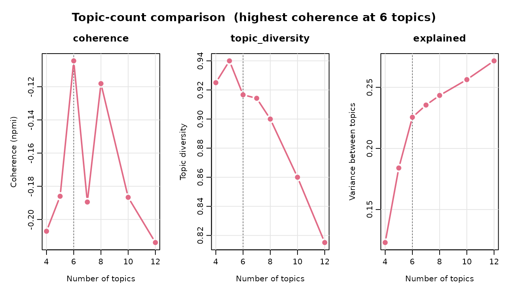
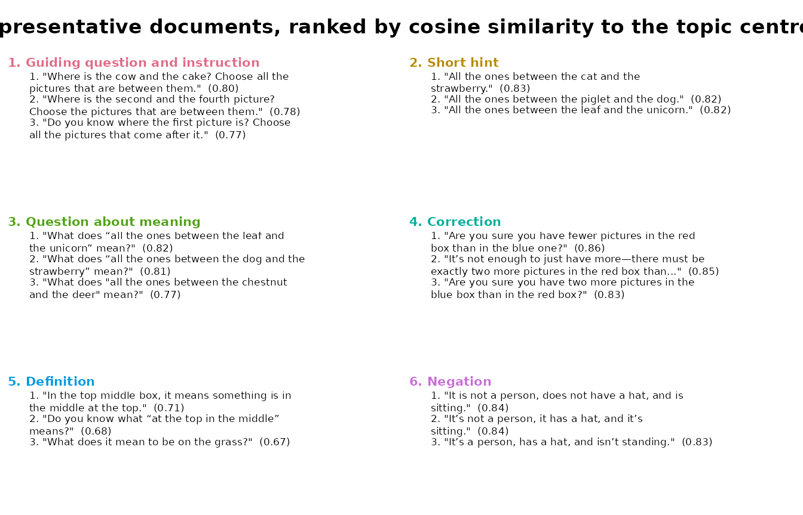
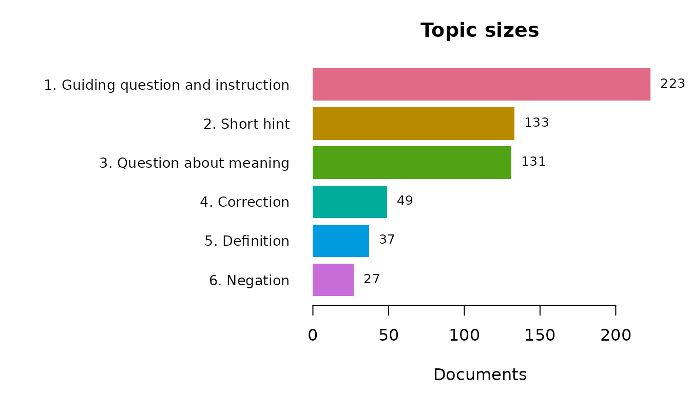
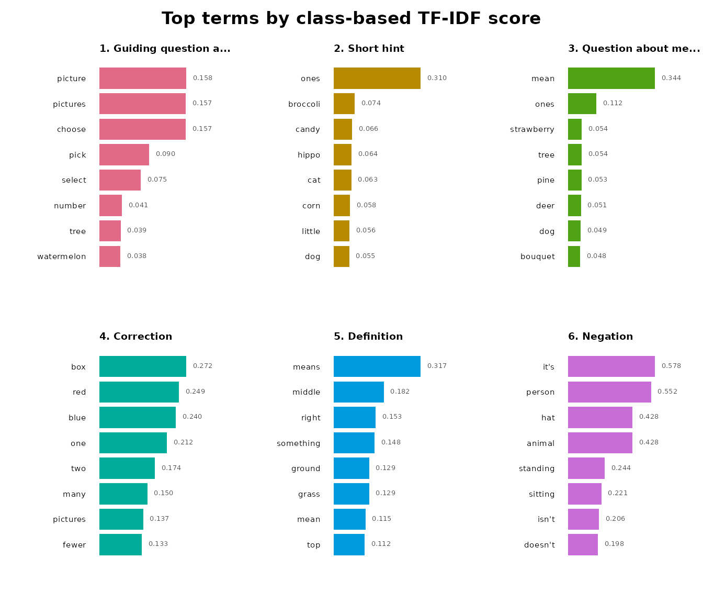
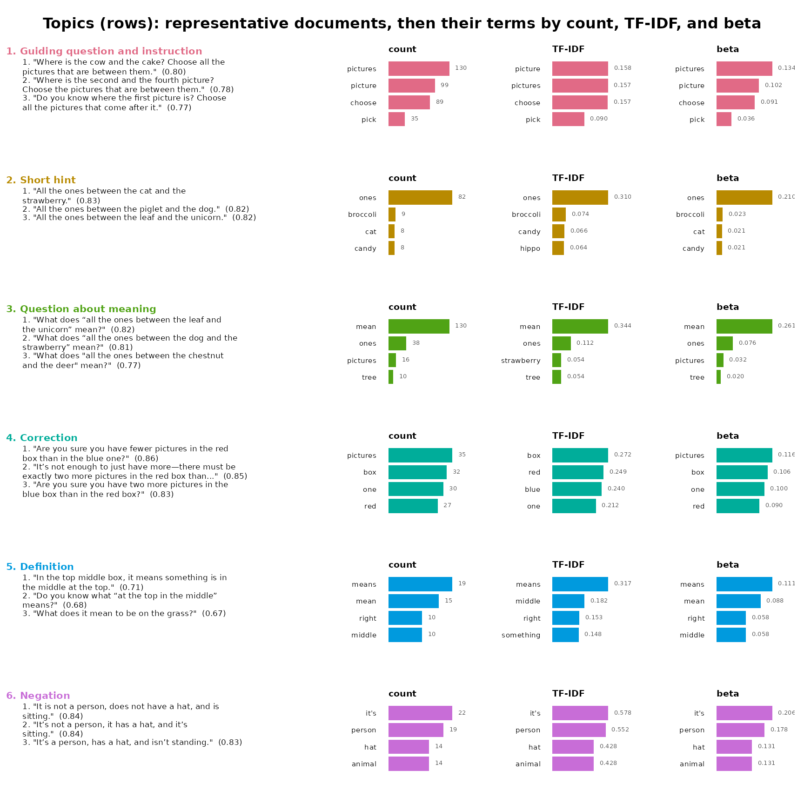

# Semantic topic modeling with Sentence-BERT

Educational software now writes much of the feedback that learners read.
An application that generates its hints, corrections and explanations
with a language model produces thousands of messages, many of them near
copies of one another, and the question an evaluator asks of such a
corpus is what kinds of feedback it contains and how often each kind is
given. Counting words does not answer that question. Frequent words and
phrases recover the templates the generator reuses (“choose all the
pictures”, “in the red box”), not what a message does for the learner:
whether it hints, asks, corrects or explains.

Semantic topic modeling groups texts by meaning instead of by shared
words. Each text is encoded as a sentence embedding, a vector in which
texts with similar meaning lie close together even when they share few
words (Reimers & Gurevych, 2019). The embeddings are normalized to unit
length and partitioned by k-means (Lloyd, 1982), so that a topic is a
region of the embedding space. A topic is then described in two ways: by
the texts nearest its center, which show what its members say, and by
the words that are frequent in it and rare elsewhere, scored with
class-based TF-IDF (Grootendorst, 2022). The `sbert` package computes
the embeddings in R, without Python, and fits the topics
deterministically, so the same input always gives the same topics,
tables and figures.

Encoding needs a model that is downloaded once on request. This article
does not download one: the embeddings of the messages it models are
bundled with the package, and every analysis below runs on them. The
step that would compute them is shown, not run.

``` r

library(sbert)
#> sbert 0.6.0: Sentence-BERT embeddings and topic models in R.
#>   14 pinned models (see models()); default: all-MiniLM-L6-v2.
#>   A model is downloaded only on request, once, and verified by SHA-256.
```

## Data

`feedback_translations` holds 8,757 AI-generated feedback messages from
a mathematics learning application, written in ten source languages and
translated into English.

- **`feedback`:** the message in its source language. Carried along with
  each modeled message, not modeled.
- **`translation`:** the English translation. The text that is modeled.
- **`n`:** added by
  [`dedupe()`](https://sonsoles.me/sbert/reference/dedupe.md), the
  number of times the message occurs in the full corpus. Used to weight
  topic sizes.

Many messages repeat word for word.
[`dedupe()`](https://sonsoles.me/sbert/reference/dedupe.md) keeps the
first occurrence of each distinct translation, with all its columns, and
counts its occurrences in `n`:

``` r

messages <- dedupe(feedback_translations, column = "translation")
nrow(messages)
#> [1] 8005
subset(messages, n >= 7, select = c(translation, n))
#>                                                                translation  n
#> 127                                                             Try again. 11
#> 305 How many pictures were there? Now you see three. How many are missing?  7
#> 712                                                     The first picture.  7
#> 790                                             There must be another way.  7
#> 874   How many pictures were there? Now you see one. How many are missing?  7
```

The corpus has 8,005 distinct translations. The most repeated message,
“Try again.”, occurs 11 times, and four more messages occur 7 times
each. Repetition is therefore moderate, but it is uneven, which matters
when topic sizes are reported.

The analysis uses the first 600 distinct messages, whose embeddings ship
with the package as `feedback_embeddings`: row *i* of that matrix is the
embedding of row *i* of `corpus`.

``` r

corpus <- head(messages, 600)
dim(feedback_embeddings)
#> [1] 600 384
with(corpus, sum(n))
#> [1] 740
```

Each of the 600 messages is a vector of 384 numbers from the
`all-MiniLM-L6-v2` model, and together they were shown 740 times. With a
downloaded model, the same analysis starts from the text alone, and
[`topics()`](https://sonsoles.me/sbert/reference/topics.md) encodes it;
this chunk is not run here:

``` r

model_download()
topic_model <- topics(corpus, n_topics = 6, column = "translation")
```

## How many kinds of feedback are there?

There is no correct number of topics.
[`compare_topics()`](https://sonsoles.me/sbert/reference/compare_topics.md)
fits one model for each candidate count and reports, for each:

- `coherence`: whether each topic’s top words occur together in the same
  messages, as normalized pointwise mutual information (NPMI; Bouma,
  2009), from -1 to 1, averaged over topics.
- `topic_diversity`: the share of distinct words among all topics’
  top-10 word lists; 1 when no two topics share a top word.
- `explained`: the share of the variation in the embeddings that the
  topics capture. It grows with every added topic, so it cannot choose
  the count on its own.
- `converged`: whether k-means reached a stable partition.

Coherence and diversity are computed from words, so they are a guide;
the test of a count is whether the messages of each topic do the same
thing, which the following sections check.

``` r

sweep <- compare_topics(corpus, column = "translation",
                        n_topics = c(4, 5, 6, 7, 8, 10, 12),
                        embeddings = feedback_embeddings)
sweep
#> <sbert_topic_sweep> 7 candidates, coherence measure: npmi
#>  n_topics coherence topic_diversity explained converged
#>         4    -0.207           0.925     0.123      TRUE
#>         5    -0.186           0.940     0.184      TRUE
#>         6    -0.104           0.917     0.226      TRUE
#>         7    -0.189           0.914     0.236      TRUE
#>         8    -0.118           0.900     0.243      TRUE
#>        10    -0.187           0.860     0.256      TRUE
#>        12    -0.214           0.815     0.272      TRUE
#> 
#> Fitted models retained: fitted(x, n_topics = 6)
```

``` r

plot(sweep)
```



Every candidate converged. Coherence is negative at every count, because
the messages are short and two content words rarely occur in the same
message, and it is highest at six topics (-0.104), with eight close
behind (-0.118). Six topics explain 22.6% of the variation in the
embeddings and keep a topic diversity of 0.917.
[`summary()`](https://rdrr.io/r/base/summary.html) states the same
choice in one row:

``` r

summary(sweep)
#> Topic-count comparison: highest mean npmi coherence per level
#> 
#>   segment n_candidates min_topics max_topics best_n_topics coherence topic_diversity
#>  document            7          4         12             6    -0.104           0.917
#>  explained all_converged
#>      0.226          TRUE
```

The analysis proceeds with six topics.
[`fitted()`](https://rdrr.io/r/stats/fitted.values.html) returns the
six-topic model that
[`compare_topics()`](https://sonsoles.me/sbert/reference/compare_topics.md)
already fitted, so nothing is refitted:

``` r

topic_model <- fitted(sweep, n_topics = 6)
topic_model
#> <sbert_topic_model>
#>   documents: 600 
#>   topics: 6
#>   model: precomputed embeddings
#>   algorithm: deterministic k-means (Lloyd)
#>   topic sizes: 223, 133, 131, 49, 37, 27
#>   between/total SS: 22.6%
```

## What are the topics?

[`topic_sizes()`](https://sonsoles.me/sbert/reference/topic_sizes.md)
lists the topics. The `label` of each topic is the message closest to
its center, cut at 60 characters, and `n_documents` counts its messages:

``` r

topic_sizes(topic_model)
#>   topic                                                       label n_documents
#> 1     1   Where is the cow and the cake? Choose all the pictures...         223
#> 2     2            All the ones between the cat and the strawberry.         133
#> 3     3         What does “all the ones between the leaf and the...         131
#> 4     4 Are you sure you have fewer pictures in the red box than...          49
#> 5     5      In the top middle box, it means something is in the...          37
#> 6     6    It is not a person, does not have a hat, and is sitting.          27
#>   proportion
#> 1     0.3717
#> 2     0.2217
#> 3     0.2183
#> 4     0.0817
#> 5     0.0617
#> 6     0.0450
```

Reading the labels and the messages of each topic (shown in the next
section) shows that the topics are not subjects but kinds of feedback,
defined by what a message does for the learner:

1.  **Guiding question and instruction.** A question that makes the
    learner find something, followed by an order to act on it: *Where is
    the cow and the cake? Choose all the pictures that are between
    them.*
2.  **Short hint.** A fragment with no verb that restates the target:
    *All the ones between the cat and the strawberry.*
3.  **Question about meaning.** A question that asks the learner what a
    phrase means: *What does “all the ones between the leaf and the
    unicorn” mean?*
4.  **Correction.** A statement of what should be true, or a question
    that makes the learner check an answer: *Are you sure you have fewer
    pictures in the red box than in the blue one?*
5.  **Definition.** An explanation of what a word or phrase means: *In
    the top middle box, it means something is in the middle at the top.*
6.  **Negation.** A description built from what something is not, used
    to rule out answers: *It is not a person, does not have a hat, and
    is sitting.*

Topics 1, 2 and 3 concern the same exercise, finding the pictures
between two others, and use the same words. The embeddings still
separate them, because an instruction, a hint and a question do
different things. Topics 3 and 5 both deal with meaning, but one asks
the learner and the other tells them.

[`name_topics()`](https://sonsoles.me/sbert/reference/name_topics.md)
gives the topics these names, one per topic in topic order. The names
replace the labels in every table and plot that follows; nothing is
refitted.

``` r

topic_model <- name_topics(topic_model, c(
  "Guiding question and instruction", "Short hint",
  "Question about meaning", "Correction", "Definition", "Negation"
))
topic_sizes(topic_model)
#>   topic                            label n_documents proportion
#> 1     1 Guiding question and instruction         223     0.3717
#> 2     2                       Short hint         133     0.2217
#> 3     3           Question about meaning         131     0.2183
#> 4     4                       Correction          49     0.0817
#> 5     5                       Definition          37     0.0617
#> 6     6                         Negation          27     0.0450
```

Instructions are the largest kind of feedback, with 223 of the 600
distinct messages (37.2%), and negations the smallest, with 27 (4.5%).

## How typical are the example messages?

[`representatives()`](https://sonsoles.me/sbert/reference/representatives.md)
returns the messages of each topic ranked by how typical they are. With
`rank = "distance"` the ranking is by the cosine distance from the
message to its topic’s center; `margin` is how much farther the message
is from the next closest topic. The text column is long, so the table is
printed with
[`knitr::kable()`](https://rdrr.io/pkg/knitr/man/kable.html):

``` r

knitr::kable(representatives(topic_model, n = 3, rank = "distance"),
             digits = 2)
```

| topic | rank | document_id | text | distance | margin |
|---:|---:|---:|:---|---:|---:|
| 1 | 1 | 118 | Where is the cow and the cake? Choose all the pictures that are between them. | 0.20 | 0.28 |
| 1 | 2 | 474 | Where is the second and the fourth picture? Choose the pictures that are between them. | 0.22 | 0.19 |
| 1 | 3 | 368 | Do you know where the first picture is? Choose all the pictures that come after it. | 0.23 | 0.21 |
| 2 | 1 | 277 | All the ones between the cat and the strawberry. | 0.17 | 0.28 |
| 2 | 2 | 237 | All the ones between the piglet and the dog. | 0.18 | 0.30 |
| 2 | 3 | 226 | All the ones between the leaf and the unicorn. | 0.18 | 0.23 |
| 3 | 1 | 227 | What does “all the ones between the leaf and the unicorn” mean? | 0.18 | 0.29 |
| 3 | 2 | 87 | What does “all the ones between the dog and the strawberry” mean? | 0.19 | 0.29 |
| 3 | 3 | 479 | What does “all the ones between the chestnut and the deer” mean? | 0.23 | 0.29 |
| 4 | 1 | 218 | Are you sure you have fewer pictures in the red box than in the blue one? | 0.14 | 0.46 |
| 4 | 2 | 62 | It’s not enough to just have more—there must be exactly two more pictures in the red box than in the blue box. | 0.15 | 0.48 |
| 4 | 3 | 68 | Are you sure you have two more pictures in the blue box than in the red box? | 0.17 | 0.40 |
| 5 | 1 | 364 | In the top middle box, it means something is in the middle at the top. | 0.29 | 0.16 |
| 5 | 2 | 28 | Do you know what “at the top in the middle” means? | 0.32 | 0.15 |
| 5 | 3 | 74 | What does it mean to be on the grass? | 0.33 | 0.23 |
| 6 | 1 | 366 | It is not a person, does not have a hat, and is sitting. | 0.16 | 0.50 |
| 6 | 2 | 31 | It’s not a person, it has a hat, and it’s sitting. | 0.16 | 0.47 |
| 6 | 3 | 18 | It’s a person, has a hat, and isn’t standing. | 0.17 | 0.42 |

The most typical messages lie between 0.14 and 0.33 from their centers.
Corrections and negations are the tightest topics: their nearest
messages are within 0.17 of the center, and their margins (0.40 to 0.50)
are the largest in the table, so these messages could belong to no other
kind of feedback. Definitions are the loosest: their closest message is
0.29 from the center, and the topic mixes explanations of a phrase with
questions about it, the boundary it shares with topic 3. The default,
`rank = "margin"`, ranks by `margin` instead and favors messages that
are unambiguous members of their topic.

The plot shows the same messages, with the similarity to the center in
parentheses:

``` r

plot(topic_model, type = "representatives", n_representatives = 3)
```



## How large are the topics once repetition is counted?

`n_documents` counts distinct messages, so a message shown four times
counts once. Passing the name of the count column as `weights` adds
`n_weighted` and `weighted_share`, which count every time a message was
shown:

``` r

topic_sizes(topic_model, weights = "n")
#>   topic                            label n_documents proportion n_weighted weighted_share
#> 1     1 Guiding question and instruction         223     0.3717        267         0.3608
#> 2     2                       Short hint         133     0.2217        162         0.2189
#> 3     3           Question about meaning         131     0.2183        138         0.1865
#> 4     4                       Correction          49     0.0817         76         0.1027
#> 5     5                       Definition          37     0.0617         57         0.0770
#> 6     6                         Negation          27     0.0450         40         0.0541
```

Corrections grow from 8.2% of the distinct messages to 10.3% of all
messages shown, and questions about meaning shrink from 21.8% to 18.6%.
The application repeated its corrections more often than its other kinds
of feedback, so a count of distinct messages understates how much
correcting it did.

``` r

plot(topic_model, type = "sizes")
```



## What words does each topic use?

Words do not define these topics; the sentences do. The words a topic
uses more than the others still help to search the messages or to see
how a topic is phrased. [`terms()`](https://rdrr.io/r/stats/terms.html)
lists them; the `score` is class-based TF-IDF, high for words frequent
in this topic and rare in the others:

``` r

terms(topic_model, n = 5)
#>    topic                            label       term rank  score frequency   beta
#> 1      1 Guiding question and instruction    picture    1 0.1581        99 0.1017
#> 2      1 Guiding question and instruction   pictures    2 0.1573       130 0.1336
#> 3      1 Guiding question and instruction     choose    3 0.1571        89 0.0915
#> 4      1 Guiding question and instruction       pick    4 0.0903        35 0.0360
#> 5      1 Guiding question and instruction     select    5 0.0751        26 0.0267
#> 6      2                       Short hint       ones    1 0.3096        82 0.2103
#> 7      2                       Short hint   broccoli    2 0.0742         9 0.0231
#> 8      2                       Short hint      candy    3 0.0660         8 0.0205
#> 9      2                       Short hint      hippo    4 0.0638         8 0.0205
#> 10     2                       Short hint        cat    5 0.0628         8 0.0205
#> 11     3           Question about meaning       mean    1 0.3436       130 0.2610
#> 12     3           Question about meaning       ones    2 0.1124        38 0.0763
#> 13     3           Question about meaning strawberry    3 0.0545         9 0.0181
#> 14     3           Question about meaning       tree    4 0.0538        10 0.0201
#> 15     3           Question about meaning       pine    5 0.0526         8 0.0161
#> 16     4                       Correction        box    1 0.2724        32 0.1063
#> 17     4                       Correction        red    2 0.2490        27 0.0897
#> 18     4                       Correction       blue    3 0.2398        26 0.0864
#> 19     4                       Correction        one    4 0.2120        30 0.0997
#> 20     4                       Correction        two    5 0.1740        16 0.0532
#> 21     5                       Definition      means    1 0.3165        19 0.1111
#> 22     5                       Definition     middle    2 0.1818        10 0.0585
#> 23     5                       Definition      right    3 0.1531        10 0.0585
#> 24     5                       Definition  something    4 0.1485         6 0.0351
#> 25     5                       Definition      grass    5 0.1290         5 0.0292
#> 26     6                         Negation       it's    1 0.5781        22 0.2056
#> 27     6                         Negation     person    2 0.5521        19 0.1776
#> 28     6                         Negation     animal    3 0.4284        14 0.1308
#> 29     6                         Negation        hat    4 0.4284        14 0.1308
#> 30     6                         Negation   standing    5 0.2440         7 0.0654
```

``` r

plot(topic_model, type = "terms")
```



The words show why they make poor names. They describe what the messages
are about, not what they do. The top words of the short hints, after
*ones*, are names of pictures (*broccoli*, *candy*, *hippo*) that change
from message to message, and nothing in them says that the topic is made
of hints. The words of the negations (*person*, *animal*, *hat*) name
the pictures, not the negation that defines the topic. Short hints and
questions about meaning share the word *ones*, although one gives a hint
and the other asks a question.

[`summary()`](https://rdrr.io/r/base/summary.html) adds the coherence of
each topic’s top words:

``` r

summary(topic_model)
#> Semantic topic model summary
#>   documents:            600
#>   topics:               6
#>   model:                precomputed embeddings
#>   between/total SS:     22.6%
#>   mean npmi  coherence:  -0.1044
#>   topic diversity:      0.917 (top 10 terms)
#> 
#>  topic                            label n_documents proportion coherence
#>      1 Guiding question and instruction         223    0.37167   -0.2368
#>      2                       Short hint         133    0.22167   -0.4150
#>      3           Question about meaning         131    0.21833   -0.2564
#>      4                       Correction          49    0.08167    0.3011
#>      5                       Definition          37    0.06167   -0.2043
#>      6                         Negation          27    0.04500    0.1849
```

Coherence is lowest for the short hints (-0.415), whose picture names
rarely recur together, and highest for the corrections (0.301), whose
messages repeat the same few words (*box*, *red*, *blue*). To name
topics by their three top words instead of a message, fit with
`label = "terms"`.

## The whole model in one figure

`type = "fit"` shows each topic’s example messages and, beside them, its
words, one row per topic:

``` r

plot(topic_model, type = "fit", n_terms = 4, n_representatives = 3)
```



The figure is the report of the analysis: six kinds of feedback, each
with the messages that define it and the vocabulary that phrases it.

## When to use which

| Question | Verb |
|----|----|
| How many topics, at which granularity? | [`compare_topics()`](https://sonsoles.me/sbert/reference/compare_topics.md), [`summary()`](https://rdrr.io/r/base/summary.html), [`fitted()`](https://rdrr.io/r/stats/fitted.values.html) |
| What are the topics and how large are they? | [`topic_sizes()`](https://sonsoles.me/sbert/reference/topic_sizes.md), `topic_sizes(weights = )` |
| What do the topics say? | [`representatives()`](https://sonsoles.me/sbert/reference/representatives.md), [`name_topics()`](https://sonsoles.me/sbert/reference/name_topics.md) |
| Which words phrase them? | [`terms()`](https://rdrr.io/r/stats/terms.html), [`coherence()`](https://sonsoles.me/sbert/reference/coherence.md), [`topic_diversity()`](https://sonsoles.me/sbert/reference/topic_diversity.md) |
| Which topic does a new message belong to? | [`predict()`](https://rdrr.io/r/stats/predict.html), [`topic_membership()`](https://sonsoles.me/sbert/reference/topic_membership.md) |
| What mix of topics is in a long document? | `topics(segment = "sentence")`, [`topic_gamma()`](https://sonsoles.me/sbert/reference/topic_gamma.md) |
| Every table at once | `as.data.frame(topic_model, what = )` |

## Further reading

**Vignettes**

- [Sentence embeddings without
  Python](https://sonsoles.me/sbert/articles/embeddings.html)

**Guides**

- [Choosing the number of topics and the
  granularity](https://sonsoles.me/sbert/articles/choosing-topics.html)
- [Segmenting long
  documents](https://sonsoles.me/sbert/articles/segmenting.html)
- [Preparing and cleaning a
  corpus](https://sonsoles.me/sbert/articles/preparing-corpus.html)
- [Describing and naming
  topics](https://sonsoles.me/sbert/articles/describing-topics.html)
- [Assigning new documents and topic
  mixtures](https://sonsoles.me/sbert/articles/assigning-topics.html)
- [Models, the cache, and custom
  models](https://sonsoles.me/sbert/articles/models-and-cache.html)
- [Parallel and high-throughput topic
  modeling](https://sonsoles.me/sbert/articles/parallel.html)
- [Verification: Python parity and
  determinism](https://sonsoles.me/sbert/articles/verification.html)

**Case studies**

- [COVID-19 research
  abstracts](https://sonsoles.me/sbert/articles/case-covid.html)
- [Multilingual feedback
  messages](https://sonsoles.me/sbert/articles/case-multilingual-feedback.html)

## References

Bouma, G. (2009). Normalized (pointwise) mutual information in
collocation extraction. *Proceedings of GSCL*, 31–40.

Grootendorst, M. (2022). BERTopic: Neural topic modeling with a
class-based TF-IDF procedure. arXiv:2203.05794.

Lloyd, S. P. (1982). Least squares quantization in PCM. *IEEE
Transactions on Information Theory*, *28*(2), 129–137.
<https://doi.org/10.1109/TIT.1982.1056489>

Reimers, N., & Gurevych, I. (2019). Sentence-BERT: Sentence embeddings
using Siamese BERT-networks. *Proceedings of EMNLP-IJCNLP 2019*,
3982–3992. <https://doi.org/10.18653/v1/D19-1410>
